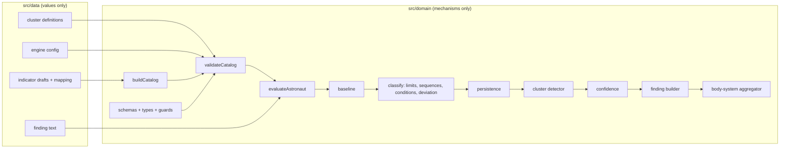
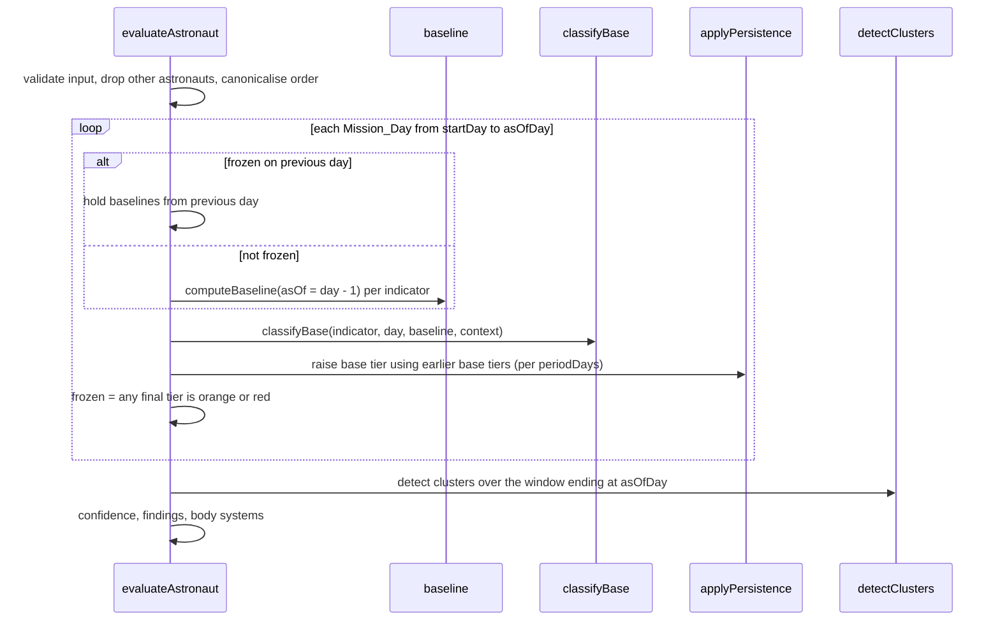

# Design Document: Domain Engine

## Overview

The domain engine is the framework-free health-logic core of the Astronaut Health Companion. For one astronaut at a time it turns readings, symptom reports and context into explained results. The loop is **measure, compare to personal baseline, classify, explain**. The engine is rule-based (decision D7), pure TypeScript (decision D4) and takes time as an input, so it can run without any contact with Earth.

The design has five rules:

1. **Rules are data.** Every threshold, floor, window, step, template and mapping lives in `src/data/` and is validated by Zod at the boundary. The functions in `src/domain/` contain mechanisms only. Changing a number never means editing a function.
2. **Nothing is invented.** Values come from `docs/PROJECT.md` sections 6 to 9 as written, with their A/B/C flags. Every `sources` array is empty. Where PROJECT.md or the requirements are silent, the design records a proposal under "Assumptions and decisions to review" and stores it as data that carries a visible `proposed-default` marker.
3. **Pure and deterministic.** Functions take explicit inputs, return new values and never read a clock. Input order never changes a result.
4. **Failures are values.** Bad data returns a `Result` error or a `Catalog_Problem` that names the field, indicator or astronaut. The engine never throws on user data.
5. **The compiler and the schemas do the checking.** The project has no test runner (`.kiro/steering/tech.md`). Correctness is supported by strict TypeScript, compile-time guards, Zod validation at boundaries, the `validateCatalog` function, and `npm run check`. The "Verification Strategy" section states exactly what each mechanism covers and what it does not.

### Scope

In scope: `src/domain/` (types, schemas, baseline, rules, environment type, evaluation, catalog validation, compile-time guards) and `src/data/` (indicator catalog, cluster definitions, engine config, finding text). Out of scope: UI, simulation, scenario and environment values, the ground link, countermeasure content, any I/O, and any test runner, test script, test package or test file. Foundation already provides the `Tier` type (`src/domain/types.ts`), `TierSchema` (`src/domain/tier-schema.ts`), Zod 4.6.7, and ESLint rules that keep `src/domain` free of React and Next and ban `Math.random` and `Date.now`.

### Research summary

- **Zod 4 and non-finite numbers.** In Zod 4, `z.number()` rejects `NaN` and `±Infinity` by design ([Zod issue 4721](https://github.com/colinhacks/zod/issues/4721), [Zod 4 changelog](https://zod.dev/v4/changelog)). Requirement 10.2 comes for free, and the issue path names the field. Zod 4 reports an unknown enum value with the issue code `invalid_value` and a too-short array with `too_small`. `validateCatalog` uses these codes to map schema issues to specific `Catalog_Problem` codes.
- **`satisfies`.** The TypeScript `satisfies` operator checks that a value matches a type without widening the value's own type ([TypeScript 4.9 release notes](https://www.typescriptlang.org/docs/handbook/release-notes/typescript-4-9.html)). Data files use it so a wrong field name or a missing key fails `npm run typecheck`.
- **Exhaustiveness checking.** Assigning the remaining value in a `switch` default branch to a variable of type `never` makes the compiler report any union member that is not handled ([TypeScript narrowing handbook](https://www.typescriptlang.org/docs/handbook/2/narrowing.html#exhaustiveness-checking)).
- **Type equality assertions.** The `Equal<A, B>` pattern compares two types for identity and is used widely in the [type-challenges](https://github.com/type-challenges/type-challenges) project. It is written once in `src/domain/type-guards.ts` and used with a type-level `Expect`.
- **JSON round trip caveat.** `JSON.stringify(-0)` yields `0`. The round-trip guarantee (Requirement 10.5) therefore holds up to the sign of zero. The schemas contain no transforms, so a value that parses once parses to an equal value again.
- Content was rephrased for compliance with licensing restrictions.

## Assumptions and decisions to review

### Assumptions accepted by the user (carried from the requirements phase)

| ID    | Assumption                                                                                                                                  | Where it lives (data, not logic)                                                             |
| ----- | ------------------------------------------------------------------------------------------------------------------------------------------- | -------------------------------------------------------------------------------------------- |
| TD-1  | Blood pressure "≥140/90" means systolic ≥140 **or** diastolic ≥90. Each component is its own indicator with its own limits.                | `bp-systolic` and `bp-diastolic` entries in the catalog                                      |
| TD-2  | The minimum absolute change floor gates **both** the yellow and the orange deviation tiers.                                                 | `deviation.minAbsoluteChange` per indicator; the gate is one code path in `deviation.ts`     |
| TD-3  | Deviation is two-sided unless an indicator says otherwise.                                                                                  | `deviation.direction` (`both` default, `high`, `low`) per indicator                          |
| TD-4  | "Elevated" in cluster rules means yellow or worse **and** the reading is above the baseline mean.                                           | Cluster member `{ kind: 'indicator', minTier: 'yellow', direction: 'above-baseline' }`       |
| TD-5  | A cluster can only raise a body system's tier, never lower it.                                                                              | `aggregateBodySystems` takes the maximum                                                     |
| TD-6  | `Finding.sourceIds` is the union of the contributing indicators' source ids.                                                                | `buildFindings`                                                                              |
| TD-7  | Projected mission dose and 30-day body mass change are **inputs**. The engine does not compute them.                                        | `career-effective-dose` reading value is the projected dose; `body-mass-change-30d` is a %   |
| TD-8  | The CO₂ cluster's "cognitive dip" comes from reaction-time readings only (Requirement 22.4). Its exact definition is decision TD-27.        | Cluster member in `src/data/clusters.ts`                                                     |
| TD-9  | `Environment_Profile` has a minimal shape: `id`, `label`, `backgroundDoseRateMsvPerDay`, and `hazardWeights` for all five hazards.          | `EnvironmentProfileSchema`                                                                   |
| TD-10 | CI must not fail because `sources` arrays are empty. The unverified check reports and never gates.                                          | `findUnverifiedIndicators` returns data; `validateCatalog` raises no problem for empty `sources` |

### Decisions added by the design (to review)

PROJECT.md and the requirements leave these open. Each is configurable data. Values that are not in PROJECT.md carry `source: 'proposed-default'` in the data file.

| ID    | Decision                                                                                                                                                                                                                                                                                                      | Configurable at                                      |
| ----- | ------------------------------------------------------------------------------------------------------------------------------------------------------------------------------------------------------------------------------------------------------------------------------------------------------------- | ---------------------------------------------------- |
| TD-11 | **Floors not in PROJECT.md.** Only resting heart rate has a floor (5 bpm, section 6.8). Every other deviation-enabled indicator has `minAbsoluteChange: null`, which means "no floor yet". The engine applies no floor, sets `floorPending: true` on the evidence, and `findPendingFloors` lists them. A tiny SD with no floor can produce noisy yellows until the team supplies floors. | `src/data/indicators/*.ts`                           |
| TD-12 | **Which indicators have deviation rules.** Resting HR, systolic BP, diastolic BP, temperature, sleep, mood, reaction time (`high` only), cabin CO₂, 30-day body mass change and energy intake use the engine-wide 2 SD and 3 SD (section 6.2, flag B). The cluster rules need yellow signals from these indicators. SpO₂, glucose, WHO-5, exercise adherence and radiation indicators have none. | `deviation` field per indicator                      |
| TD-13 | **Cluster windows.** Fatigue and stress uses 5 days (PROJECT.md section 7). Infection, under-fuelling, CO₂ exposure and vision change are not stated, so they reuse 5 days as `proposed-default`.                                                                                                              | `windowDays` and `windowSource` per cluster          |
| TD-14 | **Dose-rate "sustained".** PROJECT.md gives no duration. The orange rule uses 2 consecutive daily readings above 5× background, `proposed-default`. The red rule (above 20×) and the solar particle event rule are not sustained.                                                                              | `periods` in the dose-rate sequence rule             |
| TD-15 | **Indicator-to-system and hazard mapping.** Section 9 maps hazards to indicators loosely and never maps indicators to body systems. The design proposes one table (flag C). The weakest assignments are glucose, energy intake and the two radiation indicators.                                                | `src/data/indicators/mapping.ts`                     |
| TD-16 | **Cabin CO₂ operators.** PROJECT.md says "about 5" and "about 10" without an operator. The design uses at or above (`gte`).                                                                                                                                                                                    | Hard limits of `cabin-co2`                           |
| TD-17 | **Sampling cadence.** `periodDays` is 1 for daily indicators and 7 for WHO-5 and exercise adherence. Reaction time is treated as daily (`proposed-default`) because PROJECT.md does not say how often PVT-B runs. Glucose is on-demand and shows as no data on days without a reading.                            | `periodDays` per indicator                           |
| TD-18 | **Baseline method.** Sample SD (n−1). Pre-flight values form the baseline until the 14-day window holds at least 2 accepted readings, then the window alone defines it. "Accepted" means quality `good` on a day when no indicator was orange or red. A 2-reading window gives a very small SD, so TD-11 matters. | `baseline` block in `engine-config.ts`               |
| TD-19 | **Window edges.** The window is the 14 days ending on the as-of day (days `asOf−13` to `asOf`). A reading exactly 14 days earlier is excluded. A reading is classified against the baseline as of the previous day.                                                                                            | `baseline.windowDays`                                |
| TD-20 | **Persistence counts periods, not calendar days.** "2 consecutive Mission_Days" is applied per `periodDays`, which is identical for daily indicators and prevents one weekly reading from counting twice.                                                                                                       | `persistence` block                                  |
| TD-21 | **Confidence steps.** Start at high. Missing data, a poor-quality reading and a single supporting signal each lower confidence by 1 step, once each. A supporting signal (reaction time in the fatigue cluster) adds 1 step back. Floor is low, ceiling is high. A finding on one indicator therefore reaches at most medium. A configured step of 0 is allowed, which is why Requirements 25.3 to 25.5 say "no higher than". | `confidence` block                                   |
| TD-22 | **Cluster member direction for mass and intake.** Under-fuelling uses "mass loss above baseline" and "intake below baseline" so that weight gain or high intake is not flagged. Requirement 21.2 only says yellow or worse.                                                                                      | Cluster members in `src/data/clusters.ts`            |
| TD-23 | **Cluster flags.** PROJECT.md section 7 gives a flag only for vision change (C). The other four clusters are flagged B (team heuristic).                                                                                                                                                                       | `verification` per cluster                           |
| TD-24 | **Duplicate readings.** Two readings for the same astronaut, indicator and day are reported as a `duplicate-reading` error. The engine keeps one, chosen by a fixed order (good quality first, then lower value), so the result does not depend on input order.                                                | `evaluate.ts` canonicalisation                       |
| TD-25 | **Source allow-list guard.** `validateCatalog` reports an `unapproved-source` problem for any source id that is not in `approvedSourceIds` (empty today). Adding a citation means adding its id to the list in the same change, so a source cannot appear by accident. The guard reports a problem only for a listed-but-unapproved id. It never reports an empty `sources` array (TD-10, Requirement 29.13). | `src/data/indicators/approved-sources.ts`            |
| TD-26 | **Findings and clusters.** Each yellow-or-worse indicator gets its own finding, and a cluster adds one more. The engine does not suppress indicator findings covered by a cluster. The UI may group them by `clusterId`.                                                                                     | `buildFindings`                                      |
| TD-27 | **Cognitive_Dip and CO₂ cluster members (team decision to review).** The Cognitive_Dip is a **single** reaction-time reading at least 25% above the baseline mean on one day of the window. This reuses the 25% figure of the reaction-time sequence rule in PROJECT.md section 6.4, but not its "2 consecutive tests" condition and not the yellow-tier gate, because reaction time has no floor yet (TD-11). The cabin CO₂ member follows Requirement 22.1 literally: a reading above the habitat baseline mean, with no tier gate. This can fire on any above-mean CO₂ reading, so the team may prefer to require yellow or worse. | `baseline-relative` members in `src/data/clusters.ts` |

## Architecture

### Layers and dependency direction

`src/domain/` never imports from `src/data/`. Data files import types and schemas from the domain and are checked by them at compile time (`satisfies`) and at load time (`validateCatalog`). Every engine function receives its catalog, config, cluster definitions and text as parameters. This keeps requirement 2.1 true without relying on the permission to import data modules.



### Evaluation pipeline

`evaluateAstronaut` is a day-by-day replay. It must replay because the baseline freeze (Requirement 12) depends on the tiers of earlier days, and the persistence rule (Requirement 15) depends on earlier base tiers.



### Per-day algorithm

For day `d`, with `frozen(d−1)` the freeze flag of the previous day:

1. `baselines(d)` is `baselines(d−1)` if `frozen(d−1)`. Otherwise it is `computeBaseline` for each indicator as of day `d−1`, using accepted readings. On the first day it is the pre-flight seed.
2. For each indicator, `classifyBase` evaluates, in this order: hard limits, sequence rules, conditional (symptom) rules, context rules (radiation), and only if none was satisfied, the deviation rule. The base tier is the worst satisfied tier.
3. `applyPersistence` raises a base tier of yellow or worse to orange when the previous `consecutivePeriods − 1` periods (spaced by `periodDays`) were also yellow or worse at the base level. It reads base tiers only, so it cannot cascade.
4. `frozen(d)` is true when any final tier of that day is orange or red.
5. A reading is **accepted** for baseline adaptation when its quality is `good` and `frozen(day of reading)` is false.

An indicator with no reading in its current period `[d − periodDays + 1, d]` is `no-data`. This is a separate status, not green.

### Determinism by construction

`evaluateAstronaut` copies and sorts every input list by a total order before any other step: readings by (day, indicator id, quality, value), symptoms by (day, kind), safety flags by day, alerts by (start day, end day). All later steps read only the sorted copies. Outputs have a fixed order: classifications by indicator id, findings by id, body systems in `BODY_SYSTEM_ORDER`. `meanOf` and `sampleSd` sum over a copy sorted ascending, so their result does not depend on input order even at the floating-point level. No function sorts in place, so no argument is modified.

### Folder layout

```
src/domain/
├── types.ts                  # Tier (existing) + re-exports of inferred types
├── tier-schema.ts            # existing
├── type-guards.ts            # Equal<>, Expect<>, compile-time assertions (types only, no runtime code)
├── tiers.ts                  # tier and confidence order, worstTier
├── result.ts                 # Result, DomainError
├── schemas/                  # vocabulary, source, reading, finding, cluster, config, catalog-problem
├── indicators/               # definition schema, buildCatalog, validateCatalog, lookup, verification
├── baseline/                 # stats, computeBaseline
├── rules/                    # compare, classify-base, deviation, persistence, clusters,
│                             # confidence, findings, body-systems, text
├── environments/             # environment-profile.ts (schema and type only)
└── evaluate.ts               # evaluateAstronaut (the replay)
src/data/
├── indicators/               # vitals, sleep-behaviour, nutrition-msk, radiation, habitat,
│                             # mapping, approved-sources, index (defaultCatalog)
├── clusters.ts
├── engine-config.ts
└── finding-text.ts
```

The `.gitkeep` files in `domain/indicators`, `domain/baseline`, `domain/rules` and `domain/environments` are deleted when real files are added. No file under `src/` is a test file and `package.json` gains no dependency or script.

## Components and Interfaces

All functions are pure and have no module-level mutable state (Requirement 29.5). Types come from the schemas in "Data Models".

### Shared vocabulary (`tiers.ts`, `result.ts`)

```ts
export const TIER_ORDER = ['green', 'yellow', 'orange', 'red'] as const satisfies readonly Tier[];
export const CONFIDENCE_ORDER = ['low', 'medium', 'high'] as const satisfies readonly Confidence[];
export function compareTiers(a: Tier, b: Tier): number;
export function worstTier(tiers: readonly [Tier, ...Tier[]]): Tier;
export function maxTier(a: Tier, b: Tier): Tier;

export type Result<T, E> = { ok: true; value: T } | { ok: false; error: E };
export type DomainError =
  | { code: 'unknown-indicator'; indicatorId: string; message: string }
  | { code: 'baseline-unavailable'; astronautId: string; indicatorId: string; message: string }
  | { code: 'duplicate-reading'; astronautId: string; indicatorId: string; day: number; message: string }
  | { code: 'value-out-of-range'; indicatorId: string; day: number; message: string }
  | { code: 'invalid-input'; field: string; message: string };
```

The non-empty tuple type of `worstTier` makes an empty call a compile error.

### Catalog validation (`indicators/validate-catalog.ts`)

```ts
/** Raw, not yet trusted catalog data. Unknown on purpose, so out-of-union values can be reported. */
export interface CatalogInput {
  readonly indicators: readonly unknown[];   // merged definitions (draft + mapping)
  readonly clusters: readonly unknown[];
  readonly config: unknown;
  readonly approvedSourceIds: readonly string[];
}

/** Plain serialisable data (Requirement 29.14). Never throws. */
export function validateCatalog(input: CatalogInput): readonly CatalogProblem[];
```

`validateCatalog` is the single place that checks catalog consistency (Requirement 29.6). It returns **all** problems in one list (29.11) and an empty list when there are none (29.12). It runs these steps and never stops at the first failure:

1. **Schema pass (29.4).** Each indicator is parsed with `IndicatorDefinitionSchema`, each cluster with `ClusterDefinitionSchema`, and the config with `EngineConfigSchema`, all with `safeParse`. Every Zod issue becomes one `Catalog_Problem` whose `entryId` is the entry's `id` (or `indicators[3]` when the id is missing or not a string, or `engine-config` for the config) and whose `field` is the dotted Zod issue path. Two issue kinds get specific codes: an `invalid_value` issue on a `system` or `hazards[i]` path becomes `unknown-body-system` or `unknown-hazard` and quotes the offending value (29.10), and a `too_small` issue on `verification.thresholds` or `verification.mapping` becomes `missing-verification-flags` (29.8).
2. **Duplicate ids (29.7).** One `duplicate-indicator-id` or `duplicate-cluster-id` problem per id that occurs more than once, however many times it occurs.
3. **Consistency of entries that parsed.**
   - `limit-order` (29.9): on each side (high and low), a red limit less severe than an orange limit, with the field set to `hardLimits.red`.
   - `sd-order` (29.9): `orangeSd` below `yellowSd`, using the indicator's own values and falling back to `config.deviationDefaults` for a missing one. The field is `deviation.orangeSd`.
   - `unknown-indicator-ref` (29.10): a cluster member or supporting member whose `indicatorId` is not an indicator id in the input, and a `tierRaises.memberId` that names no member of the cluster. The message quotes the unknown value.
   - `unapproved-source` (TD-25): a source id that is not in `approvedSourceIds`, on an indicator or a cluster.
4. **Empty `sources` is valid (29.13).** No step reports an empty `sources` array.

```ts
export interface Catalog {
  readonly indicators: readonly IndicatorDefinition[];
  readonly byId: ReadonlyMap<string, IndicatorDefinition>;
}

export function buildCatalog(
  drafts: readonly IndicatorDraft[],
  mapping: IndicatorMapping,
  clusters: readonly ClusterDefinition[],
  config: EngineConfig,
  approvedSourceIds: readonly string[],
): Result<{ catalog: Catalog; clusters: readonly ClusterDefinition[]; config: EngineConfig }, readonly CatalogProblem[]>;

export function indicatorsForHazard(catalog: Catalog, hazard: Hazard): readonly IndicatorDefinition[];
export function indicatorsForSystem(catalog: Catalog, system: BodySystem): readonly IndicatorDefinition[];
```

`buildCatalog` merges each draft with its mapping entry (hazards, system, `verification.mapping`). A draft with no mapping entry yields a `missing-mapping` problem. It then calls `validateCatalog` and returns `ok: false` with every problem, or the parsed values. It is the only way to obtain a `Catalog`, so `evaluateAstronaut` only ever receives validated data. `defaultCatalog` in `src/data/indicators/index.ts` calls `buildCatalog` once at module load. Shipped data is code, not user data, so invalid shipped data makes that module throw with the formatted problem list. This fails the dev server and the build step that imports it, and the message names the entry id and field path.

A red limit is at least as severe as an orange limit when every value that satisfies red also satisfies orange. For the high side that means `red.value > orange.value`, or equal values unless orange is `gt` and red is `gte`. The low side mirrors this.

### Verification checker (`indicators/verification.ts`)

```ts
export function findUnverifiedIndicators(catalog: Catalog): readonly string[];            // sources.length === 0
export function unverifiedForFinding(catalog: Catalog, finding: Finding): readonly string[]; // finding.indicators that are unverified
export function findPendingFloors(catalog: Catalog): readonly string[];                    // deviation.minAbsoluteChange === null
```

None of these throws or signals failure (TD-10).

### Baseline (`baseline/`)

```ts
export interface Baseline { readonly mean: number; readonly sd: number; readonly source: 'seed' | 'window'; readonly sampleSize: number }
export function meanOf(values: readonly number[]): number;
export function sampleSd(values: readonly number[]): number;   // n−1; 0 for a single value

export interface BaselineInput {
  readonly astronautId: string;
  readonly indicatorId: string;
  readonly seed: readonly number[];
  readonly accepted: readonly Reading[];      // already filtered: quality good, not on a frozen day
  readonly asOfDay: number;
  readonly config: BaselineConfig;
}
export function computeBaseline(input: BaselineInput): Result<Baseline, DomainError>;
```

`computeBaseline` takes the accepted readings with `asOfDay − windowDays < day ≤ asOfDay`. If at least `minWindowReadings` remain, it returns their statistics. Otherwise it returns the seed statistics, or a `baseline-unavailable` error that names the astronaut and indicator when the seed has fewer than `minSeedReadings`. The caller decides which readings are accepted; the freeze logic lives in `evaluate.ts`, so `computeBaseline` stays a pure statistics function. `sampleSd` computes the variance as the sum of squared deviations from the mean divided by n−1, and clamps the result at zero before the square root, so the SD is never negative or `NaN`.

### Classification (`rules/`)

```ts
export interface ClassificationContext {
  readonly definition: IndicatorDefinition;
  readonly day: number;
  readonly history: ReadonlyMap<number, Reading>;     // this indicator, by day
  readonly baseline: Baseline | undefined;
  readonly symptomsToday: readonly SymptomReport[];
  readonly safetyFlagToday: boolean;
  readonly environment: EnvironmentProfile;
  readonly careerDoseBeforeMissionMsv: number;
  readonly alertsActive: readonly AlertKind[];
  readonly config: EngineConfig;
}

export interface RuleHit { readonly ruleId: string; readonly kind: 'hard-limit' | 'sequence' | 'conditional' | 'context' | 'deviation'; readonly tier: Tier }
export interface DeviationEvidence {
  readonly mean: number; readonly sd: number; readonly difference: number;     // signed: value − mean
  readonly floor: number | null; readonly floorPending: boolean;
  readonly yellowSd: number; readonly orangeSd: number; readonly direction: 'above' | 'below';
}

export type BaseClassification =
  | { status: 'classified'; baseTier: Tier; hits: readonly RuleHit[]; reading: Reading;
      baseline: Baseline | undefined;               // the baseline in force that day, used by cluster members
      deviation?: DeviationEvidence; missingPeriods: readonly number[]; evidenceReadings: readonly Reading[] }
  | { status: 'no-data'; missingPeriods: readonly number[] };

export function classifyBase(ctx: ClassificationContext): Result<BaseClassification, DomainError>;
export function classifyDeviation(value: number, baseline: Baseline, settings: ResolvedDeviation): { tier: Tier; evidence: DeviationEvidence };
export function applyPersistence(tier: Tier, earlierBaseTiers: readonly (Tier | 'no-data')[], cfg: PersistenceConfig): Tier;
export function compare(value: number, c: Comparison): boolean;       // gt, gte, lt, lte exactly
```

`earlierBaseTiers[0]` is the base tier one period back. `applyPersistence` returns `max(tier, cfg.raisesTo)` when `tier ≥ cfg.minTier` and the first `consecutivePeriods − 1` entries are all `≥ cfg.minTier`. Otherwise it returns `tier`. A `no-data` entry breaks the chain.

`Classification` (the final per-day result) is `BaseClassification` plus `tier: Tier` (after persistence) and `persistenceApplied: boolean`, or the `no-data` variant, which has no `tier` field.

#### Rule semantics

| Rule kind          | Evaluation                                                                                                                                                                                                                                                                                                 |
| ------------------ | ---------------------------------------------------------------------------------------------------------------------------------------------------------------------------------------------------------------------------------------------------------------------------------------------------------- |
| Hard limit         | `compare(value, limit)` for each limit in `hardLimits.red`, then `hardLimits.orange`. Operators are used exactly as stored.                                                                                                                                                                                |
| Sequence rule      | Periods `k = 0..N−1` cover `(day − (k+1)·periodDays, day − k·periodDays]`. The period's reading is the latest in that range. All N must exist and satisfy the condition. If any is missing, the rule is not satisfied and the missing period end days are returned in `missingPeriods`.                      |
| Sequence condition | `absolute`: `compare(value, {op, value})`. `baseline-relative`: `compare(value, {op, mean·(1+fraction)})`, needs a baseline. `background-multiple`: `compare(value, {op, background·multiple})` using the environment profile.                                                                              |
| Conditional rule   | The current reading satisfies the optional comparison, and the required report exists **on the same Mission_Day**: a symptom of a listed kind (or any symptom), or a safety flag. No report means not satisfied.                                                                                          |
| Context rule       | `allowance-fraction`: with `remaining = careerLimitMsv − careerDoseBeforeMissionMsv`, satisfied when `projected ≥ fraction·remaining` (orange) or `projected > remaining` (red), written without division. `external-alert`: satisfied when a solar particle event alert covers the day.                  |
| Deviation rule     | Runs only if no other rule was satisfied and the indicator has `deviation`. With `diff = value − mean` and `|diff|` filtered by `direction`: yellow when `|diff| > 0`, `|diff| ≥ yellowSd·sd` and `|diff| ≥ floor`; orange when `|diff| ≥ orangeSd·sd` and `|diff| ≥ floor`. A `null` floor counts as 0. |

Every `switch` over a rule kind, condition kind, comparison operator, tier, confidence, hazard, body system, symptom kind or cluster member kind ends with a `never` check (see "Compile-time guard patterns").

### Clusters (`rules/clusters.ts`)

```ts
export interface DayClassifications { readonly day: number; readonly byIndicator: ReadonlyMap<string, Classification> }
export interface ClusterDetection {
  readonly cluster: ClusterDefinition;
  readonly tier: Tier;
  readonly satisfiedMembers: readonly { memberId: string; day: number; indicatorId?: string; reading?: Reading }[];
  readonly supportingMembers: readonly { memberId: string; day: number }[];
}
export function detectClusters(
  clusters: readonly ClusterDefinition[],
  days: readonly DayClassifications[],          // history up to the as-of day
  symptoms: readonly SymptomReport[],
  asOfDay: number,
): readonly ClusterDetection[];
```

A member is satisfied on a day by its kind:

- `indicator`: the classification of its indicator is at least `minTier` and the direction filter holds (`above-baseline` means `reading.value > baseline.mean`).
- `baseline-relative`: the indicator has a reading that day, the classification carries a baseline, and `compare(value, {op, baseline.mean·(1+fraction)})` holds. The tier is not consulted. A day without a baseline does not satisfy it. This kind expresses the Cognitive_Dip (TD-27) and the CO₂ member.
- `symptom`: a symptom of a listed kind exists on that day.

A cluster is detected when every required member is satisfied on at least one day in `[asOfDay − windowDays + 1, asOfDay]`. At most one detection per cluster id is returned. Its tier is the definition's tier, raised by any matching `tierRaises` entry (vision change: sudden vision loss raises it to red). A detection never lowers a tier (TD-5).

### Confidence (`rules/confidence.ts`)

```ts
export interface ConfidenceFactors { readonly missingData: boolean; readonly poorQuality: boolean; readonly singleSignal: boolean; readonly supportingSignal: boolean }
export function evaluateConfidence(f: ConfidenceFactors, cfg: ConfidenceConfig): Confidence;
```

`score = start − Σ(step of each true reduction factor) + (supportingSignal ? supportBonusSteps : 0)`, clamped to the range low to high. Each factor counts once, however many readings trigger it. Evidence is derived by the evaluator: `missingData` is true when a classification on the finding has `missingPeriods` or a cluster member indicator has no data on the as-of day; `poorQuality` is true when any evidence reading is `poor`; `singleSignal` is true when fewer than two distinct signals (indicators plus symptom reports) support the finding.

### Findings (`rules/findings.ts`, `rules/text.ts`)

```ts
export function buildFindings(input: {
  catalog: Catalog; text: FindingText; config: EngineConfig;
  classifications: readonly Classification[];      // as of asOfDay
  detections: readonly ClusterDetection[];
  asOfDay: number;
}): readonly Finding[];
export function renderTemplate(template: string, values: Readonly<Record<string, string | number>>): Result<string, DomainError>;
```

- One indicator finding per classification at yellow, orange or red. One cluster finding per detection.
- `id` is deterministic: `indicator:<indicatorId>:<day>` or `cluster:<clusterId>:<day>`.
- `reason` is rendered from templates in `FindingText`. It names every contributing indicator label, its value with unit, and a sentence for each rule hit. Placeholders are `{name}`. `renderTemplate` fails on an unknown placeholder, so a template typo is an error and not silent text.
- `action` is numbered steps joined by newlines: cluster-specific steps first (for CO₂ exposure, the first step is to check the environment), then the tier steps from PROJECT.md section 8. Yellow gives self-management and a watch on the trend, orange gives a guided assessment and preparing a message to ground, red gives immediate steps and urgent escalation.
- `sourceIds` is the sorted, de-duplicated union of `sources[].id` over the contributing indicator definitions. It is empty when all are empty (TD-6).
- `indicators` is the sorted list of contributing indicator ids.
- `system` is the indicator's system, or the cluster's system.

### Body systems (`rules/body-systems.ts`)

```ts
export type SystemStatus =
  | { system: BodySystem; status: 'no-data'; indicatorIds: readonly []; findingIds: readonly [] }
  | { system: BodySystem; status: 'classified'; tier: Tier; indicatorIds: readonly string[]; findingIds: readonly string[] };
export function aggregateBodySystems(catalog: Catalog, classifications: readonly Classification[], findings: readonly Finding[]): readonly SystemStatus[];
```

For each of the six systems the indicator tier is the worst tier among its indicators that have data. A cluster finding that names the system gives the final tier `max(indicator tier, cluster tier)` (TD-5). A system with no indicator data and no cluster finding is `no-data`. `findingIds` lists every finding whose `system` matches and whose tier is above green.

### Orchestrator (`evaluate.ts`)

```ts
export interface EvaluationInput {
  readonly astronautId: string;
  readonly asOfDay: number;
  readonly startDay?: number;                       // default: earliest reading day, else asOfDay
  readonly seeds: Readonly<Record<string, readonly number[]>>;   // pre-flight values by indicator id
  readonly readings: readonly Reading[];
  readonly symptoms: readonly SymptomReport[];
  readonly safetyFlags: readonly SafetyFlag[];
  readonly alerts: readonly AlertReport[];
  readonly careerDoseBeforeMissionMsv: number;
  readonly environment: EnvironmentProfile;
  readonly catalog: Catalog;
  readonly clusters: readonly ClusterDefinition[];
  readonly config: EngineConfig;
  readonly text: FindingText;
}
export interface DayState { readonly day: number; readonly baselines: Readonly<Record<string, Baseline>>; readonly frozen: boolean; readonly classifications: readonly Classification[] }
export interface EvaluationResult {
  readonly asOfDay: number;
  readonly classifications: readonly Classification[];     // as of asOfDay
  readonly findings: readonly Finding[];
  readonly bodySystems: readonly SystemStatus[];
  readonly history: readonly DayState[];                    // explains every baseline and tier
  readonly errors: readonly DomainError[];
}
export function evaluateAstronaut(input: EvaluationInput): EvaluationResult;
```

Behaviour:

- Records for other astronauts are ignored. Records dated after `asOfDay` are ignored.
- Inputs are sorted into a canonical order before use (see "Determinism by construction"), so permuting `readings`, `symptoms`, `safetyFlags` or `alerts` cannot change the result.
- Unknown indicator ids and duplicate readings become `errors` and do not abort the evaluation.
- An indicator that needs a baseline but has no usable seed produces a `baseline-unavailable` error. Its hard limits and sequence rules still run.
- Inputs are never mutated. All outputs are new objects, and all input and output interfaces use `readonly` fields and `readonly` arrays.
- UI code calls `indicatorsForHazard` and `indicatorsForSystem` directly for hazard and system links.

### Compile-time guard patterns

These patterns are what Requirements 29.1 to 29.3 ask for. They are checked by `npm run typecheck`, so they need no runtime code and no test.

**1. Exhaustive `switch` with a `never` check.** Used for every branch over a union. The default branch has no `throw`, because the engine never throws. The `never` assignment is the compile-time check.

```ts
export function opWord(op: Comparison['op'], words: FindingText['opWords']): string {
  switch (op) {
    case 'gt': return words.gt;
    case 'gte': return words.gte;
    case 'lt': return words.lt;
    case 'lte': return words.lte;
    default: {
      const unhandled: never = op; // adding a new operator makes this line a type error
      return unhandled;
    }
  }
}
```

**2. `Record` keyed by the full union, with `satisfies`.** A lookup table with a missing key, an extra key or a wrong value type fails to compile.

```ts
export const BODY_SYSTEM_ORDER = [
  'cardiovascular', 'musculoskeletal', 'vision', 'immune', 'mental', 'sleep',
] as const satisfies readonly BodySystem[];

export const BODY_SYSTEM_LABELS = {
  cardiovascular: 'Cardiovascular',
  musculoskeletal: 'Bones and muscles',
  vision: 'Vision',
  immune: 'Immune',
  mental: 'Mental',
  sleep: 'Sleep',
} satisfies Record<BodySystem, string>;
```

**3. `satisfies` on catalog data.** Data files are typed against the draft type, so a misspelt field or a wrong operator fails `typecheck`. The literal types are kept for the rest of the file.

```ts
// src/data/indicators/vitals.ts
export const restingHr = {
  id: 'resting-hr',
  label: 'Resting heart rate',
  unit: 'bpm',
  periodDays: 1,
  hardLimits: {
    orange: [{ op: 'gt', value: 110 }, { op: 'lt', value: 45 }],
    red: [{ op: 'gt', value: 130 }, { op: 'lt', value: 40 }],
  },
  // ...remaining fields as in the catalog table
} satisfies IndicatorDraft;
```

**4. `Equal<>` assertions in `src/domain/type-guards.ts`.** The file holds types only. Its exported assertion aliases are never used at runtime, and exporting them keeps ESLint from reporting unused names.

```ts
export type Equal<A, B> =
  (<T>() => T extends A ? 1 : 2) extends (<T>() => T extends B ? 1 : 2) ? true : false;
export type Expect<T extends true> = T;

// An exported type stays identical to its schema output.
export type ReadingMatchesSchema = Expect<Equal<z.infer<typeof ReadingSchema>, Reading>>;
export type FindingMatchesSchema = Expect<Equal<z.infer<typeof FindingSchema>, Finding>>;
// ...one line per exported type (Requirement 29.3)

// The existing hand-written Tier union stays identical to the Zod schema.
export type TierMatchesSchema = Expect<Equal<z.infer<typeof TierSchema>, Tier>>;

// Order arrays cover exactly the union, no more and no less.
export type TierOrderIsComplete = Expect<Equal<(typeof TIER_ORDER)[number], Tier>>;
export type ConfidenceOrderIsComplete = Expect<Equal<(typeof CONFIDENCE_ORDER)[number], Confidence>>;
export type BodySystemOrderIsComplete = Expect<Equal<(typeof BODY_SYSTEM_ORDER)[number], BodySystem>>;
```

Because `types.ts` defines most types as `z.infer` aliases, the schema-to-type assertions are mainly a guard against someone replacing an alias with a hand-written interface that drifts. The assertions that carry real information are the `Tier` check and the order-array completeness checks.

## Data Models

The schemas are the single source of each type: `type X = z.infer<typeof XSchema>` (Requirement 10.4). `src/domain/types.ts` keeps the existing `Tier` declaration (and the guard in `tier-schema.ts`) and re-exports every other type with `export type { ... } from './schemas/...'`. The cycle between `types.ts` and the schema modules is type-only and is erased at compile time. Objects use `z.strictObject` so unknown fields are rejected. Schemas use no `.transform` and no `.catch`, so parsing never silently changes a value.

### Vocabulary and inputs

```ts
export const VerificationFlagSchema = z.enum(['A', 'B', 'C']);
export const ConfidenceSchema = z.enum(['low', 'medium', 'high']);
export const HazardSchema = z.enum(['radiation', 'isolation-confinement', 'distance-from-earth', 'gravity-fields', 'hostile-closed-environment']);
export const BodySystemSchema = z.enum(['cardiovascular', 'musculoskeletal', 'vision', 'immune', 'mental', 'sleep']);
export const QualityFlagSchema = z.enum(['good', 'poor']);
export const SymptomKindSchema = z.enum(['chest-pain', 'fainting', 'headache', 'cough', 'sore-throat', 'vision-blurring', 'acuity-change', 'sudden-vision-loss', 'other']);
export const MissionDaySchema = z.int().nonnegative();

export const SourceReferenceSchema = z.strictObject({ id: z.string().min(1), citation: z.string().min(1), url: z.url().optional() });

export const ReadingSchema = z.strictObject({
  astronautId: z.string().min(1), indicatorId: z.string().min(1),
  day: MissionDaySchema, value: z.number(), quality: QualityFlagSchema,
});
export const SymptomReportSchema = z.strictObject({ astronautId: z.string().min(1), day: MissionDaySchema, kind: SymptomKindSchema });
export const SafetyFlagSchema = z.strictObject({ astronautId: z.string().min(1), day: MissionDaySchema });
export const AlertReportSchema = z.strictObject({ kind: z.literal('solar-particle-event'), startDay: MissionDaySchema, endDay: MissionDaySchema })
  .refine((a) => a.endDay >= a.startDay, { path: ['endDay'], message: 'endDay must be on or after startDay' });
```

`z.number()` rejects `NaN` and infinities, so every numeric field is finite.

### Catalog problem (`schemas/catalog-problem.ts`)

```ts
export const CatalogProblemCodeSchema = z.enum([
  'schema',                    // any Zod issue without a more specific code
  'duplicate-indicator-id',
  'duplicate-cluster-id',
  'missing-verification-flags',
  'missing-mapping',
  'limit-order',
  'sd-order',
  'unknown-body-system',
  'unknown-hazard',
  'unknown-indicator-ref',
  'unapproved-source',
]);

export const CatalogProblemSchema = z.strictObject({
  code: CatalogProblemCodeSchema,
  entryKind: z.enum(['indicator', 'cluster', 'config']),
  entryId: z.string().min(1),    // the entry id, `indicators[3]` when no id exists, or `engine-config`
  field: z.string(),             // dotted path, for example `hardLimits.red` or `members.2.indicatorId`
  message: z.string().min(1),    // plain language; quotes the offending value where one exists
});
export type CatalogProblem = z.infer<typeof CatalogProblemSchema>;
```

Every field is a string, so a `CatalogProblem` serialises to JSON and back unchanged and a UI or dev page can render the list directly (Requirement 29.14). The glossary's "code, id, field, message" maps to `code`, `entryId`, `field` and `message`. `entryKind` is an addition that helps display. Exhaustive handling of `CatalogProblemCode` (for example in a display function) uses the `never` pattern, so adding a code forces every consumer to handle it.

### Environment profile (`domain/environments/environment-profile.ts`)

```ts
export const EnvironmentProfileSchema = z.strictObject({
  id: z.string().min(1),
  label: z.string().min(1),
  backgroundDoseRateMsvPerDay: z.number().min(0),
  hazardWeights: z.record(HazardSchema, z.number().min(0)),   // Zod 4: all five keys required
});
```

The domain holds no ISS, lunar or Mars values. The engine uses only the dose rate. Hazard weights pass through for the body-map spec.

### Indicator definition

```ts
const ComparisonSchema = z.strictObject({ op: z.enum(['gt', 'gte', 'lt', 'lte']), value: z.number() });
const FindingTierSchema = TierSchema.exclude(['green']);

const SequenceConditionSchema = z.discriminatedUnion('kind', [
  z.strictObject({ kind: z.literal('absolute'), op: ComparisonSchema.shape.op, value: z.number() }),
  z.strictObject({ kind: z.literal('baseline-relative'), op: ComparisonSchema.shape.op, fraction: z.number() }),
  z.strictObject({ kind: z.literal('background-multiple'), op: ComparisonSchema.shape.op, multiple: z.number().positive() }),
]);
const SequenceRuleSchema = z.strictObject({ tier: FindingTierSchema, periods: z.int().min(1), condition: SequenceConditionSchema, source: RuleSourceSchema });

const ConditionalRuleSchema = z.strictObject({
  tier: FindingTierSchema,
  comparison: ComparisonSchema.optional(),                       // absent means "any value"
  requires: z.discriminatedUnion('kind', [
    z.strictObject({ kind: z.literal('symptom'), symptoms: z.array(SymptomKindSchema).min(1).or(z.literal('any')) }),
    z.strictObject({ kind: z.literal('safety-flag') }),
  ]),
});

const ContextRuleSchema = z.discriminatedUnion('kind', [
  z.strictObject({ kind: z.literal('allowance-fraction'), tier: FindingTierSchema, fraction: z.number().positive(), op: z.enum(['gt', 'gte']) }),
  z.strictObject({ kind: z.literal('external-alert'), tier: FindingTierSchema, alert: z.literal('solar-particle-event') }),
]);

const DeviationSettingsSchema = z.strictObject({
  yellowSd: z.number().positive().optional(),                    // falls back to config.deviationDefaults
  orangeSd: z.number().positive().optional(),
  minAbsoluteChange: z.number().min(0).nullable(),               // null = floor not yet supplied (TD-11)
  direction: z.enum(['both', 'high', 'low']).default('both'),
});

export const IndicatorDefinitionSchema = z.strictObject({
  id: z.string().min(1), label: z.string().min(1), unit: z.string().min(1),
  periodDays: z.int().min(1),
  earthReference: z.strictObject({ low: z.number().optional(), high: z.number().optional(), note: z.string().optional() }).optional(),  // informational, never used by the classifier
  validRange: z.strictObject({ min: z.number(), max: z.number() }).optional(),                                       // only for stated scales
  careerLimitMsv: z.number().positive().optional(),
  hardLimits: z.strictObject({ orange: z.array(ComparisonSchema), red: z.array(ComparisonSchema) }),
  sequenceRules: z.array(SequenceRuleSchema),
  conditionalRules: z.array(ConditionalRuleSchema),
  contextRules: z.array(ContextRuleSchema),
  deviation: DeviationSettingsSchema.optional(),
  verification: z.strictObject({
    thresholds: z.array(VerificationFlagSchema).min(1),          // every listed flag is kept
    deviation: z.array(VerificationFlagSchema).optional(),
    mapping: z.array(VerificationFlagSchema).min(1),             // C for hazard and system assignments
  }),
  sources: z.array(SourceReferenceSchema),                       // empty = unverified, and valid (Requirement 29.13)
  hazards: z.array(HazardSchema).min(1),
  system: BodySystemSchema,
});
```

`RuleSourceSchema` is `z.enum(['project-doc', 'proposed-default'])`. It marks rule values that are not in PROJECT.md (TD-14). `IndicatorDraft` is the definition without `hazards`, `system` and `verification.mapping`. They are merged from `mapping.ts` by `buildCatalog`. The `orangeSd ≥ yellowSd` and red-versus-orange limit ordering rules cannot be expressed per field in the schema, so `validateCatalog` checks them (Requirement 29.9).

### Cluster definition

```ts
const ClusterMemberSchema = z.discriminatedUnion('kind', [
  z.strictObject({ kind: z.literal('indicator'), id: z.string().min(1), indicatorId: z.string().min(1),
    minTier: z.enum(['yellow', 'orange', 'red']), direction: z.enum(['any', 'above-baseline', 'below-baseline']) }),
  z.strictObject({ kind: z.literal('baseline-relative'), id: z.string().min(1), indicatorId: z.string().min(1),
    op: z.enum(['gt', 'gte']), fraction: z.number().min(0) }),       // value op mean·(1+fraction); no tier gate (TD-27)
  z.strictObject({ kind: z.literal('symptom'), id: z.string().min(1), symptoms: z.array(SymptomKindSchema).min(1) }),
]);

export const ClusterDefinitionSchema = z.strictObject({
  id: z.string().min(1), label: z.string().min(1),
  windowDays: z.int().min(1), windowSource: z.enum(['project-doc', 'proposed-default']),
  tier: FindingTierSchema, system: BodySystemSchema,
  members: z.array(ClusterMemberSchema).min(1),                  // all required
  supporting: z.array(ClusterMemberSchema),                      // optional, raise confidence only
  tierRaises: z.array(z.strictObject({ memberId: z.string(), whenSymptomIn: z.array(SymptomKindSchema).min(1), tier: FindingTierSchema })),
  verification: z.array(VerificationFlagSchema).min(1),
  sources: z.array(SourceReferenceSchema),
});
```

### Engine config (`src/data/engine-config.ts`)

```ts
export const EngineConfigSchema = z.strictObject({
  deviationDefaults: z.strictObject({ yellowSd: z.number().positive(), orangeSd: z.number().positive() }),
  baseline: z.strictObject({ windowDays: z.int().min(1), minSeedReadings: z.int().min(2), minWindowReadings: z.int().min(2) }),
  freeze: z.strictObject({ atOrAbove: FindingTierSchema }),
  persistence: z.strictObject({ minTier: FindingTierSchema, consecutivePeriods: z.int().min(2), raisesTo: FindingTierSchema }),
  confidence: z.strictObject({
    start: ConfidenceSchema,
    steps: z.strictObject({ missingData: z.int().min(0), poorQuality: z.int().min(0), singleSignal: z.int().min(0) }),
    supportBonusSteps: z.int().min(0),
  }),
});
```

Shipped values: `deviationDefaults { yellowSd: 2, orangeSd: 3 }` (section 6.2, flag B); `baseline { windowDays: 14, minSeedReadings: 2, minWindowReadings: 2 }`; `freeze.atOrAbove: 'orange'`; `persistence { minTier: 'yellow', consecutivePeriods: 2, raisesTo: 'orange' }`; `confidence { start: 'high', steps { 1, 1, 1 }, supportBonusSteps: 1 }`. The `minSeedReadings: 2` and `minWindowReadings: 2` values follow Requirement 11 (a sample SD needs two values). The file is typed `satisfies z.input<typeof EngineConfigSchema>` and also passed through `validateCatalog`.

### Finding

```ts
export const FindingSchema = z.strictObject({
  id: z.string().min(1),
  kind: z.enum(['indicator', 'cluster']),
  clusterId: z.string().min(1).optional(),
  day: MissionDaySchema,
  tier: TierSchema,
  reason: z.string().min(1),
  confidence: ConfidenceSchema,
  action: z.string().min(1),
  sourceIds: z.array(z.string().min(1)),                         // may be empty
  indicators: z.array(z.string().min(1)),
  system: BodySystemSchema,
});
```

`kind`, `clusterId` and `day` are additions to the fields required by Requirement 24.1. They let the UI group and date findings.

### Finding text (`src/data/finding-text.ts`)

```ts
interface FindingText {
  indicatorReason: string;                                       // "{label} was {value} {unit} on day {day}. {ruleSentences}"
  clusterReason: string;
  opWords: Record<'gt' | 'gte' | 'lt' | 'lte', string>;          // "above", "at or above", "below", "at or below"
  ruleSentences: { hardLimit: string; sequence: string; conditional: string; context: string; deviation: string };
  tierSteps: Record<'yellow' | 'orange' | 'red', readonly string[]>;     // section 8 behaviours only
  clusterSteps: Record<string, readonly string[]>;               // by cluster id; CO₂ starts with "check the environment"
}
```

The copy contains no medication, dosing or treatment advice. Countermeasure content belongs to a later spec. The file is typed `satisfies FindingText`, so a missing tier or rule key fails `typecheck`. A template placeholder typo is not visible to the compiler, so `renderTemplate` reports it as an error at run time (see "Error Handling").

### Catalog values (from PROJECT.md section 6)

`P` is `periodDays`. "Seq" lists sequence rules. Every `sources` array is empty. Flags are the `verification.thresholds` list. Operators are as written in PROJECT.md. Rows marked † are TD-14, TD-16 or TD-17 proposals.

| id                      | unit    | P   | Hard limits (orange / red)                                                              | Seq or conditional                                                                                                          | Flags | Deviation                                    |
| ----------------------- | ------- | --- | --------------------------------------------------------------------------------------- | --------------------------------------------------------------------------------------------------------------------------- | ----- | -------------------------------------------- |
| `resting-hr`            | bpm     | 1   | `>110`, `<45` / `>130`, `<40`                                                           | Conditional red: chest pain or fainting, any value                                                                          | A, B  | floor 5, flag B                              |
| `bp-systolic`           | mmHg    | 1   | `≥140`, `<90` / `≥180`                                                                  | Conditional red: `<80` with any symptom                                                                                     | A, C  | floor pending                                |
| `bp-diastolic`          | mmHg    | 1   | `≥90` / `≥120`                                                                          |                                                                                                                             | A, C  | floor pending                                |
| `body-temperature`      | °C      | 1   | `≥38.0`, `<35.5` / `≥39.0`, `<35.0`                                                     |                                                                                                                             | A, B  | floor pending                                |
| `spo2`                  | %       | 1   | `<92` / `<90`                                                                           |                                                                                                                             | A, C  |                                              |
| `fasting-glucose`       | mg/dL   | 1†  | `≥126`, `<70` / `<54`, `>300`                                                           |                                                                                                                             | A, B  |                                              |
| `sleep-hours`           | h       | 1   |                                                                                         | Orange: `<6` for 3 periods. Red: `<4` for 1 period; `<5` for 5 periods                                                      | B, C  | floor pending                                |
| `mood`                  | 1 to 5  | 1   |                                                                                         | Orange: `≤2` for 3 periods. Conditional red: `≤1` with safety flag                                                          | B     | floor pending                                |
| `who5`                  | 0 to 100| 7   | `<50` / `≤28`                                                                           |                                                                                                                             | A     |                                              |
| `reaction-time`         | ms      | 1†  |                                                                                         | Orange: baseline-relative `≥ +25%` for 2 periods                                                                            | B, C  | direction `high`, floor pending              |
| `body-mass-change-30d`  | % loss  | 1   | `≥5` / `≥10`                                                                            |                                                                                                                             | A     | floor pending                                |
| `energy-intake`         | % plan  | 1   |                                                                                         | Orange: `<70` for 3 periods                                                                                                 | B, C  | floor pending                                |
| `exercise-adherence`    | % plan  | 7   |                                                                                         | Orange: `<50` for 2 periods                                                                                                 | B, C  |                                              |
| `career-effective-dose` | mSv     | 1   |                                                                                         | Context: orange `projected ≥ 0.8 × remaining`; red `projected > remaining`; `careerLimitMsv: 600`                            | C     |                                              |
| `dose-rate`             | mSv/day | 1   |                                                                                         | Orange: `> 5×` background for 2 periods†. Red: `> 20×` background for 1 period. Context red: solar particle event            | B, C  |                                              |
| `cabin-co2`             | mmHg    | 1   | `≥5`† / `≥10`†                                                                          |                                                                                                                             | C     | floor pending                                |

Earth-reference ranges from section 6 (heart rate 60 to 100, temperature 36.1 to 37.2, and so on) are stored in `earthReference` as information only. The classifier never reads them (Requirement 3.9). Because `earthReference` is only read by display code, no classification function takes it as an input, so a classifier cannot depend on it by accident.

### Proposed indicator mapping (flag C, TD-15)

| Indicator                              | Hazards                             | Body system       |
| -------------------------------------- | ----------------------------------- | ----------------- |
| `resting-hr`, `bp-systolic`, `bp-diastolic` | gravity-fields                 | cardiovascular    |
| `spo2`                                 | hostile-closed-environment          | cardiovascular    |
| `fasting-glucose`                      | hostile-closed-environment          | cardiovascular    |
| `body-temperature`                     | hostile-closed-environment          | immune            |
| `sleep-hours`                          | isolation-confinement               | sleep             |
| `mood`, `who5`, `reaction-time`        | isolation-confinement               | mental            |
| `cabin-co2`                            | hostile-closed-environment          | mental            |
| `body-mass-change-30d`, `exercise-adherence` | gravity-fields                | musculoskeletal   |
| `energy-intake`                        | hostile-closed-environment          | musculoskeletal   |
| `career-effective-dose`, `dose-rate`   | radiation                           | immune            |

The `vision` system has no indicator. It reports `no-data` until the vision-change cluster fires. A `distance-from-earth` hazard has no indicator in this spec; the simulation and escalation specs own it. The mapping file is typed `satisfies Record<string, { hazards: readonly Hazard[]; system: BodySystem }>`, and `buildCatalog` reports a `missing-mapping` problem for any draft without an entry.

### Cluster values (`src/data/clusters.ts`)

| Cluster id             | Required members (all within the window)                                                                                         | Supporting          | Tier   | System     | Window            | Flag |
| ---------------------- | -------------------------------------------------------------------------------------------------------------------------------- | ------------------- | ------ | ---------- | ----------------- | ---- |
| `fatigue-stress`       | `sleep-hours`, `mood`, `resting-hr`, each yellow or worse, `any` direction                                                       | `reaction-time` yellow or worse, above baseline | orange | mental     | 5, project-doc    | B    |
| `possible-infection`   | `body-temperature` and `resting-hr` yellow or worse and above baseline; symptom `cough` or `sore-throat`                         |                     | orange | immune     | 5, proposed       | B    |
| `under-fuelling`       | `body-mass-change-30d` yellow or worse and above baseline; `energy-intake` yellow or worse and below baseline; `resting-hr` yellow or worse and above baseline | | orange | musculoskeletal | 5, proposed | B    |
| `possible-co2-exposure`| symptom `headache`; `cabin-co2` `baseline-relative` `gt` fraction 0 (reading above the habitat baseline mean); `reaction-time` `baseline-relative` `gte` fraction 0.25 (Cognitive_Dip, TD-27) |                     | orange | mental     | 5, proposed       | B    |
| `vision-change`        | symptom `vision-blurring`, `acuity-change` or `sudden-vision-loss`; `tierRaises`: `sudden-vision-loss` raises to red             |                     | orange | vision     | 5, proposed       | C    |

## Correctness Properties

*A property is a characteristic or behavior that should hold true across all valid executions of a system-essentially, a formal statement about what the system should do. Properties serve as the bridge between human-readable specifications and machine-verifiable correctness guarantees.*

The project has no test runner, so none of the statements below is checked by an automated test. They are **documented invariants**: behaviour the implementation must preserve and that a reviewer can check against the code. Each one names the requirements it comes from and the mechanism that supports it:

- **Type** (T): the compiler enforces it through strict types, `readonly`, exhaustive `switch`, `Record` keyed by a full union, `satisfies` or `Equal<>`. `npm run typecheck` fails when it drifts.
- **Validation** (V): Zod schemas or `validateCatalog` enforce it at run time on data crossing a boundary. It is caught when data is loaded or parsed, not by `npm run check`.
- **Construction** (C): it holds because of how the code is structured (one code path, a canonical sort, a pure function with no shared state). Only code review can confirm it. Where a guarantee rests on construction alone, that is stated.

The invariants are written as universally quantified statements because that is the most precise way to state them. "For any" means every input the type admits.

### Property 1: Worst tier

*For any* non-empty list of tiers, `worstTier` returns a member of the list that is greater than or equal to every member, and returns the same tier for any permutation of the list.

**Validates: Requirements 1.4, 1.5, 1.6**

**Supported by:** T (the non-empty tuple parameter; `TIER_ORDER` is `satisfies readonly Tier[]` and `TierOrderIsComplete` asserts it lists every tier once) and C (the function folds with `maxTier`, which compares positions in `TIER_ORDER`).

### Property 2: Evaluation is deterministic and does not mutate its input

*For any* valid evaluation input, calling `evaluateAstronaut` twice returns deeply equal results, and the input is unchanged by the call.

**Validates: Requirements 2.3, 2.4, 2.5**

**Supported by:** T (every parameter and result type is `readonly`, so a write is a compile error) and C (no function sorts in place; no module-level mutable state; the lint rules ban `Math.random` and `Date.now` in `src/domain`).

### Property 3: Catalog validity

*For any* list of indicator definitions, cluster definitions and engine config, `validateCatalog` returns no problem if and only if all indicator ids are unique, all cluster ids are unique, every definition parses with its schema and has a mapping with at least one hazard and exactly one body system, on each side (high and low) every red limit is at least as severe as every orange limit, `orangeSd` is not below `yellowSd`, and every cluster member names an indicator in the catalog. Every problem it returns names the entry id and the field.

**Validates: Requirements 3.1, 3.2, 3.6, 3.7, 3.8, 27.1, 29.4, 29.7, 29.8, 29.9, 29.10**

**Supported by:** V (`validateCatalog` and the schemas) and T (`satisfies IndicatorDraft` stops most shape errors earlier, at typecheck).

### Property 4: Schema round trip

*For any* valid Reading, SymptomReport, SafetyFlag, AlertReport, SourceReference, IndicatorDefinition, ClusterDefinition, EnvironmentProfile, EngineConfig or Finding, parsing the JSON serialisation of the value with its schema produces a value equal to the original, up to the sign of zero.

**Validates: Requirements 10.1, 10.5**

**Supported by:** C (the schemas contain no `.transform`, `.catch` or `.preprocess`, and `direction` has a default that is written back into every parsed value) and T (`Equal<>` assertions tie each exported type to its schema).

### Property 5: Invalid input is rejected without throwing

*For any* input object that has a non-finite number, an unknown enum value or a missing required field, the schema returns a failure whose issue path names that field, and no call throws.

**Validates: Requirements 10.2, 10.6**

**Supported by:** V (Zod 4 rejects non-finite numbers; strict objects reject extra fields) and C (domain code calls `safeParse` only, never `parse`).

### Property 6: Unknown indicator ids return an error

*For any* Reading whose `indicatorId` is not in the catalog, `evaluateAstronaut` and `classifyBase` return an `unknown-indicator` error whose message contains that id, and the evaluation continues for the other readings.

**Validates: Requirements 10.3**

**Supported by:** C (a catalog lookup that returns `undefined` is the only path to the error branch) and T (`Result` forces callers to handle `ok: false`).

### Property 7: Baseline statistics bounds

*For any* non-empty list of finite numbers, `meanOf` lies between the minimum and maximum (up to floating-point rounding) and `sampleSd` is greater than or equal to zero.

**Validates: Requirements 11.1, 11.5, 11.6**

**Supported by:** C (`sampleSd` sums squares, divides by n−1 and clamps at zero before the square root).

### Property 8: Baseline statistics under shift and reorder

*For any* list of at least two finite numbers, adding a constant to every value shifts the mean by that constant and leaves the SD unchanged (up to floating-point rounding), and reordering the values leaves the mean and SD unchanged.

**Validates: Requirements 11.7, 11.8**

**Supported by:** C (both functions compute from deviations to the mean, and sum over a copy sorted ascending, so reordering gives the same bits).

### Property 9: Baseline follows the window, else the seed

*For any* seed, any set of accepted in-flight readings and any as-of day, `computeBaseline` equals the statistics of the accepted readings with `asOf − windowDays < day ≤ asOf` when there are at least `minWindowReadings` of them, and equals the seed statistics otherwise. A reading dated outside the window changes nothing.

**Validates: Requirements 11.2, 11.3, 11.9**

**Supported by:** C (one filter expression decides window membership, and the window length comes from `config.baseline.windowDays`).

### Property 10: Short seed returns a named error

*For any* astronaut id, indicator id and seed with fewer than `minSeedReadings` values and no usable window, `computeBaseline` returns a `baseline-unavailable` error whose message contains both ids.

**Validates: Requirements 11.4**

**Supported by:** T (the `Result` return type) and C (the error message is built from the two ids in one place).

### Property 11: A reading never shapes its own baseline

*For any* reading history and any day `d`, the baseline recorded for day `d` is unchanged when the values of the day-`d` readings change.

**Validates: Requirements 12.3**

**Supported by:** C (the replay computes `baselines(d)` with `asOf = d − 1`, before it reads any day-`d` reading).

### Property 12: Baseline freeze and resume

*For any* reading history in which some indicator is orange or red on every day from `D` to `E`, the baselines of the astronaut on every day from `D` to `E` equal the baselines on day `D`. On the first later day with no orange or red indicator, baselines are computed from accepted readings again.

**Validates: Requirements 12.1, 12.2**

**Supported by:** C (the replay copies the previous day's baselines when `frozen(d−1)` is true) and V (`config.freeze.atOrAbove` is schema-checked).

### Property 13: Astronauts are isolated

*For any* evaluation input and any set of records belonging to other astronauts, adding those records leaves the result for the evaluated astronaut unchanged.

**Validates: Requirements 12.4**

**Supported by:** C (`evaluateAstronaut` filters every record list by `astronautId` as its first step and holds no state between calls).

### Property 14: Hard limits dominate and ignore the baseline

*For any* indicator definition and reading, if the value satisfies a red hard limit the base tier is red, and if it satisfies an orange hard limit and no red limit the base tier is orange. The base tier is the same under any baseline and does not depend on `earthReference`. Each comparison operator is applied exactly as stored.

**Validates: Requirements 13.1, 13.2, 13.3, 13.4, 13.7, 3.9**

**Supported by:** T (`compare` has an exhaustive `switch` over the four operators; `ClassificationContext` has no `earthReference` field) and C (hard limits are evaluated first, before any rule that reads the baseline).

### Property 15: Sequence rules need every period

*For any* reading series and any sequence rule with `N` periods, the rule is satisfied if and only if each of the `N` most recent periods ending on the evaluation day has a reading that meets the condition. When a period has no reading, the rule is not satisfied and `missingPeriods` lists exactly the periods without readings.

**Validates: Requirements 13.5, 13.6**

**Supported by:** C (one loop over `k = 0..N−1` both tests the condition and collects missing periods).

### Property 16: Deviation tiers match the rule

*For any* value, baseline, floor (including `null`), direction and SD settings, with no hard limit satisfied, `classifyDeviation` returns yellow when `|diff| > 0`, `|diff| ≥ yellowSd·sd` and `|diff| ≥ floor` hold, orange when `|diff| ≥ orangeSd·sd` and `|diff| ≥ floor` hold, and green otherwise. A difference below the floor is green for both tiers, a difference in the excluded direction is green, and the evidence reports the baseline mean, SD, difference and floor used. An indicator without deviation settings never gets a tier from this rule. The same reading evaluated against two baselines uses the baseline passed in each call.

**Validates: Requirements 14.1, 14.2, 14.3, 14.4, 14.5, 14.6, 14.10**

**Supported by:** C (the floor gate is one expression, applied to both tiers, TD-2; the function reads only its arguments) and T (`DeviationEvidence` is a required part of the result type).

### Property 17: Deviation is monotone in the difference

*For any* baseline, settings and two values on the same side of the mean with `|diff₁| ≤ |diff₂|`, the tier for the second value is not lower than the tier for the first.

**Validates: Requirements 14.7**

**Supported by:** C (the tier is a threshold function of `|diff|` with fixed cut-offs).

### Property 18: Persistence

*For any* tier and list of earlier base tiers (each a tier or `no-data`), `applyPersistence` returns `max(tier, orange)` when the tier and the previous `consecutivePeriods − 1` base tiers are all yellow or worse, and returns the tier otherwise. The result is never lower than the input, applying it again to its own result with the same history gives the same result, and a history whose base tiers are all yellow or lower never produces a result above orange.

**Validates: Requirements 15.1, 15.2, 15.3, 15.4, 15.5**

**Supported by:** C (the function takes base tiers only, so persisted output cannot feed back into it, and it only ever applies `maxTier`) and T (the `earlierBaseTiers` type has no variant for a persisted tier).

### Property 19: Symptom-conditioned rules need a same-day report

*For any* resting heart rate reading, a chest pain or fainting report on the same day gives red. *For any* systolic reading below 80, a report of any kind on the same day gives red. *For any* mood reading of 1 or lower, a safety flag on the same day gives red. The same reports dated on a different day never satisfy the rule.

**Validates: Requirements 16.1, 16.2, 16.3, 16.4**

**Supported by:** C (the context carries only `symptomsToday` and `safetyFlagToday`, which `evaluateAstronaut` filters by day) and V (the rule shapes come from the schema).

### Property 20: No data is distinct from green

*For any* reading history, an indicator with no reading in `[day − periodDays + 1, day]` and no evaluable sequence rule is classified `no-data`, which has no tier, and an indicator with such a reading is never `no-data`.

**Validates: Requirements 17.1, 17.2**

**Supported by:** T (the `no-data` variant of `Classification` has no `tier` field, so it cannot be read as green).

### Property 21: Clusters fire exactly when every member is present in the window

*For any* cluster definition, any member satisfaction days and any evaluation day, `detectClusters` returns exactly one detection if and only if every required member is satisfied on some day in `[asOf − windowDays + 1, asOf]`, and none otherwise. A detection lists the evidence of every required member, takes its window and tier from the definition, and is reported at most once per cluster id.

**Validates: Requirements 18.1, 18.2, 18.3, 18.4, 18.5, 18.6, 19.1, 19.2, 19.4, 20.1, 20.3, 21.1, 21.3, 22.1, 22.3**

**Supported by:** C (a single `every` over the required members and a single result per cluster) and V (window length, members and tier come from `ClusterDefinitionSchema`-validated data).

### Property 22: Elevated means yellow or worse and above baseline

*For any* classification (tier, reading value, baseline mean) and `indicator` member direction, an `above-baseline` member is satisfied if and only if the tier is yellow or worse and the value exceeds the mean, a `below-baseline` member if and only if the tier is yellow or worse and the value is below the mean, and an `any` member if and only if the tier is yellow or worse.

**Validates: Requirements 20.2, 21.2**

**Supported by:** T (exhaustive `switch` over `direction`).

### Property 23: Cognitive dip and baseline-relative members

*For any* reaction-time reading and baseline mean, the Cognitive_Dip member is satisfied if and only if the value is at least `mean · 1.25`. A member of kind `baseline-relative` is never satisfied on a day with no reading or no baseline, and only reaction-time readings can satisfy the Cognitive_Dip member.

**Validates: Requirements 22.1, 22.4**

**Supported by:** C (the member names its indicator, and the detector reads only that indicator's classification), V (`fraction` and `op` come from the cluster data), and T (exhaustive `switch` over member kinds).

### Property 24: Vision symptoms set the cluster tier

*For any* set of symptom reports within the window, the vision-change detection is orange when the set contains a vision-blurring or acuity-change report and no sudden-vision-loss report, is red when it contains a sudden-vision-loss report (including when both appear on one day), and does not exist when it contains neither. At most one detection is returned.

**Validates: Requirements 23.1, 23.2, 23.3, 23.4**

**Supported by:** C (`tierRaises` takes the maximum tier over matching entries) and V (the vision cluster has verification flag C in its validated definition).

### Property 25: Input order never changes the result

*For any* evaluation input and any permutation of `readings`, `symptoms`, `safetyFlags` and `alerts`, `evaluateAstronaut` returns a deeply equal result. The cluster detector, the confidence evaluator and the body-system aggregator each return the same result for any ordering of their inputs.

**Validates: Requirements 18.7, 25.9, 26.5**

**Supported by:** C (inputs are sorted by a total order before use and outputs have a fixed order; see "Determinism by construction"). This is the weakest-supported invariant, because it rests on every step reading only the sorted copies. Reviewers should check it first when the evaluator changes.

### Property 26: Findings are complete and traceable

*For any* evaluation result, every finding parses with `FindingSchema`, has a non-empty id, reason and action (only `sourceIds` may be empty), has a valid tier and body system, lists exactly the ids of its contributing indicators, and has a reason that contains each contributing indicator's label, its value and a sentence for each rule hit. Its `sourceIds` equal the sorted union of the `sources[].id` of those indicators, and are empty when all are empty. Action and reason templates come from `src/data/finding-text.ts`. The tier-level action follows the section 8 behaviour, and the possible-CO₂-exposure action starts with the environment check.

**Validates: Requirements 22.2, 24.1, 24.2, 24.3, 24.4, 24.5, 24.6, 24.8, 24.9, 24.10**

**Supported by:** T (`FindingText` uses `Record<'yellow' | 'orange' | 'red', ...>`, and `Finding` is the schema-inferred type) and V (`renderTemplate` returns an error for an unknown placeholder; `FindingSchema.safeParse` can be applied to any finding before display).

### Property 27: Findings exist for exactly the yellow, orange and red indicators

*For any* evaluation result, each indicator classified yellow, orange or red has exactly one indicator finding with the same tier, and no indicator that is green or `no-data` has one.

**Validates: Requirements 24.7**

**Supported by:** C (`buildFindings` maps one classification to at most one finding, keyed by the deterministic id).

### Property 28: Confidence is monotone in its factors

*For any* set of confidence factors and configuration, `evaluateConfidence` returns a Confidence of high, medium or low. It returns high when the configured start is high and no reduction factor is set. Adding a reduction factor (missing data, poor quality or single signal) never raises the result, removing one never lowers it, and the result never goes below low. Adding a supporting signal never lowers it.

**Validates: Requirements 17.4, 19.3, 25.1, 25.2, 25.3, 25.5, 25.6, 25.7, 25.8**

**Supported by:** T (the return type is the `Confidence` union and `CONFIDENCE_ORDER` is checked for completeness) and C (a clamped sum of non-negative steps). The wording "no higher than" in Requirements 25.3 to 25.5 is what this construction delivers, because a configured step of 0 or a result already at low gives an equal result.

### Property 29: Poor quality never raises confidence

*For any* evaluation input and any contributing reading of a finding, marking that reading `poor` leaves the finding's confidence the same or lower.

**Validates: Requirements 25.4**

**Supported by:** C (`poorQuality` is a boolean that only subtracts) and V (`QualityFlagSchema` limits quality to `good` or `poor`).

### Property 30: Body-system aggregation

*For any* set of classifications and cluster findings, the tier of each body system equals the worst tier of its indicators that have data, raised to the cluster finding tier when a cluster finding names the system. It is never lower than any contributing indicator or cluster finding, and the system is `no-data` if and only if it has no indicator with data and no cluster finding. `no-data` indicators are ignored. The result lists the contributing indicator ids and finding ids.

**Validates: Requirements 17.3, 26.1, 26.2, 26.3, 26.4**

**Supported by:** T (`SystemStatus` is a discriminated union; `BODY_SYSTEM_ORDER` covers every system) and C (the aggregator takes the maximum and never assigns a lower tier).

### Property 31: Hazard and system lookups

*For any* catalog and any hazard or body system, the lookup returns exactly the indicators whose definition lists that hazard or has that system, no others and none missing.

**Validates: Requirements 27.3, 27.4**

**Supported by:** C (each lookup is one `filter` over the catalog) and V (`validateCatalog` guarantees every indicator has a valid system and at least one valid hazard).

### Property 32: Unverified indicators are those without sources

*For any* catalog, `findUnverifiedIndicators` returns exactly the ids whose `sources` array is empty, and `unverifiedForFinding` returns exactly the finding's indicators among them. Adding a source to one unverified definition removes that id from the result and leaves every other entry unchanged. An empty `sources` array never makes `validateCatalog` report a problem.

**Validates: Requirements 28.1, 28.2, 28.3, 28.4, 28.5, 29.13**

**Supported by:** C (a single `length === 0` filter) and V (`validateCatalog` has no code path that reports empty `sources`).

### Property 33: Career allowance tier

*For any* projected mission dose `P ≥ 0`, career dose before the mission `A ≥ 0` and limit `L`, with `R = L − A`, the career-dose classification is red when `P > R`, orange when `P ≥ 0.8·R` and `P ≤ R`, and green otherwise. The projected dose is taken from the reading and is not computed by the engine.

**Validates: Requirements 7.2, 7.3, 7.4, 7.9**

**Supported by:** C (the comparisons are written without division, and the 0.8 fraction and the 600 mSv limit come from data).

### Property 34: Dose rate tier

*For any* environment background `b ≥ 0`, dose-rate series and solar particle event window, the dose-rate classification is red when the current rate exceeds `20·b` or an alert covers the day, orange when the previous `periods` daily rates (including the current one) all exceed `5·b` and it is not red, and green otherwise.

**Validates: Requirements 7.5, 7.6, 7.7**

**Supported by:** C (the multiples and the period count are data in the dose-rate definition; the background value is a function argument) and T (the alert kind is a single-member union).

### Property 35: `validateCatalog` contract

*For any* catalog input, `validateCatalog` does not throw, returns every problem it finds and not only the first, returns an empty list when there are none, and returns only plain data that survives a JSON round trip.

**Validates: Requirements 29.4, 29.6, 29.11, 29.12, 29.14**

**Supported by:** T (return type `readonly CatalogProblem[]`; all fields are strings) and C (every step appends to one list; each step catches nothing because it only calls `safeParse`).

## Error Handling

The engine never throws on caller data. A function that can fail returns `Result`. `evaluateAstronaut` collects errors in `result.errors` and continues, so one bad record does not hide the others. Catalog data problems are returned as a list of `CatalogProblem`.

| Condition                                                    | Where detected                     | Behaviour                                                                                                         |
| ------------------------------------------------------------ | ---------------------------------- | ----------------------------------------------------------------------------------------------------------------- |
| Non-finite number, wrong enum, missing field                 | Domain schemas                     | `safeParse` failure; `invalid-input` error with the field path. Records that fail are dropped from the evaluation. |
| Unknown indicator id on a reading                            | `evaluateAstronaut`, `classifyBase`| `unknown-indicator` error naming the id; the reading is ignored.                                                  |
| Reading outside the indicator's `validRange` (mood, WHO-5)   | `evaluateAstronaut`                | `value-out-of-range` error; the reading is ignored.                                                               |
| Two readings for one astronaut, indicator and day            | `evaluateAstronaut`                | `duplicate-reading` error; one reading is kept by the fixed order in TD-24.                                       |
| Seed has fewer than 2 values and no usable window            | `computeBaseline`                  | `baseline-unavailable` error naming astronaut and indicator. Hard limits and sequence rules still run; deviation and baseline-relative rules are skipped for that indicator. |
| Deviation floor is `null`                                    | `classifyDeviation`                | No floor applied; `floorPending: true` in the evidence. Not an error.                                             |
| Sequence period has no reading                               | `classifyBase`                     | Rule not satisfied; period end days in `missingPeriods`; confidence factor `missingData`.                         |
| No reading in the current period                             | `classifyBase`                     | `no-data` status.                                                                                                 |
| Template placeholder with no value                           | `renderTemplate`                   | `invalid-input` error. The finding builder falls back to a plain reason that lists indicator, value and rule, and adds the error to `errors`. |
| Catalog, cluster or config data invalid                      | `validateCatalog`, `buildCatalog`  | A list of `CatalogProblem` with all problems at once, each with code, entry id, field path and message. `buildCatalog` returns `ok: false`. |
| Shipped catalog invalid at load                              | `defaultCatalog` module            | The module throws with the formatted problem list. Shipped data is code, so this is a programmer error that must stop the dev server or build. |
| Empty `sources` or pending floor                             | `findUnverifiedIndicators`, `findPendingFloors` | Returned as data. Never a `CatalogProblem`, never an error and never a non-zero exit (TD-10).        |

## Verification Strategy (no test runner)

The project has no Vitest, Vite, fast-check or other test runner, and this spec adds none (Requirement 29.15). It adds no test script, no test package and no test file. The only verification command is `npm run check`, which runs `lint`, `format:check` and `typecheck` in that order. The strategy is to move as much checking as possible into the type system and into boundary validation, and to say plainly which guarantees remain a matter of review.

### What each mechanism covers

| Mechanism | What it enforces | Requirements | Run by |
| --------- | ---------------- | ------------ | ------ |
| Strict TypeScript, no `any` | Typed inputs and outputs for every function; `readonly` data so arguments are not modified; non-empty tuple for `worstTier` | 2.3, 29.1, 29.5 | `typecheck`, `lint` (no explicit `any`) |
| Exhaustive `switch` with a `never` default | Every branch over tier, confidence, hazard, body system, verification flag, symptom kind, operator, rule kind, condition kind, member kind and `CatalogProblemCode` handles all members | 29.2 | `typecheck` |
| `Record` keyed by a full union, with `satisfies` | Lookup tables (`BODY_SYSTEM_LABELS`, `FindingText.tierSteps`, the mapping file) have exactly the keys of the union | 29.2 | `typecheck` |
| `satisfies` on data files | Catalog drafts, cluster definitions, the engine config and the finding text match their types, so a misspelt or missing field fails | 29.3 | `typecheck` |
| `Equal<>` assertions in `type-guards.ts` | Each exported type equals its schema's inferred type; `Tier` equals `TierSchema`'s type; each order array lists its whole union once | 29.3, 1.1, 1.2, 1.3, 9.2, 10.4 | `typecheck` |
| ESLint rules (existing) | No React or Next imports in `src/domain`; no `Math.random`; no `Date.now` | 2.1 (in part), 2.5 | `lint` |
| Zod boundary validation | Readings, symptom reports, safety flags, alerts, environment profiles, definitions, clusters, config and findings reject non-finite numbers, wrong enums, missing fields and extra fields | 10.1, 10.2, 10.6 | Run time, at the point of parsing |
| `validateCatalog` | Duplicate ids, missing verification flags, limit order, SD order, unknown body system, hazard or indicator reference, unapproved source; every schema failure with entry id and field path | 3.6, 3.7, 3.8, 27.1, 29.4 to 29.14 | Run time, when the catalog is loaded |
| Design by construction | Determinism, order independence, freeze, persistence, monotonicity (see the invariants) | 2.4, 11 to 26 | Code review |

### What `npm run check` does not cover

`npm run check` does not run any engine code. It therefore does not confirm that `validateCatalog` accepts the shipped data. That check runs when `defaultCatalog` is first loaded, for example when the dev server renders a page that imports it or when `next build` prerenders one. A catalog mistake that the compiler cannot see (a duplicate id, a red limit less severe than an orange limit, a cluster member naming a missing indicator) is therefore caught at load time with a message that names the entry and field, and not by `npm run check`.

The team can show the same problem list on a dev page, because `validateCatalog` returns plain data. Building that page is outside this spec.

The behavioural invariants in "Correctness Properties" marked Construction are not machine-checked. They are small, pure functions with one code path each, which is what makes review practical. The two that deserve the most review attention are Property 25 (input order) and Property 12 (freeze), because each depends on the structure of the whole replay in `evaluate.ts` and not on one function.

### Review checklist for implementers

1. Every new union member is handled in each `switch`; none of them has a `default` that returns a value other than the `never` variable.
2. Every new data file ends each exported value with `satisfies <Type>`; none uses `as` to silence a type error.
3. Every new exported type has an `Equal<>` line in `type-guards.ts`.
4. No function mutates an argument, sorts in place, reads a clock, or calls `Math.random`.
5. Any new threshold, window or text is data in `src/data/` with a flag. No value is added without a PROJECT.md source or a `proposed-default` marker. No `sources` entry is added without adding its id to `approvedSourceIds`.
6. `npm run check` passes.

### Worked examples for review

These hand-checkable cases document intended behaviour. They are not executable tests.

- **Personal baseline (Requirement 14.8, 14.9).** Resting HR 62 bpm against mean 72 and SD 6: `diff = 10`, `2·SD = 12`, so the deviation rule gives green. Against mean 48 and SD 2: `diff = 14`, `3·SD = 6` and the floor is 5, so `14 ≥ 6` and `14 ≥ 5` give orange, which is yellow or worse.
- **Boundary operators (Requirement 13.4).** Resting HR 110 is not orange (`gt 110`). Resting HR 110.1 is orange. Body temperature 38.0 is orange (`gte 38.0`). Systolic 140 is orange (`gte 140`), and diastolic 90 is orange on its own (TD-1).
- **Persistence (Requirement 15).** Resting HR deviates to yellow on days 10 and 11 with no hard limit. Day 10 is yellow. Day 11 is orange, because day 10's base tier was yellow, and the baseline freezes from day 11.
- **Cognitive dip (TD-27).** Reaction-time baseline mean 300 ms. A reading of 375 ms satisfies the dip (`375 ≥ 300·1.25`). A reading of 374 ms does not.
- **Vision change (Requirement 23.3).** A `vision-blurring` report and a `sudden-vision-loss` report on one day give one vision-change finding at red.
- **Career dose (Requirement 7).** Limit 600 mSv, prior dose 300 mSv, so remaining is 300. A projected dose of 240 gives orange (`240 ≥ 0.8·300`). A projected dose of 300 is orange. A projected dose of 301 is red.

### Requirements coverage

Each requirement is supported by at least one mechanism, listed by group:

- Requirements 1, 9 and 10 by the vocabulary types, the schemas and the `Equal<>` assertions.
- Requirement 2 by `readonly` types, the lint rules and the determinism construction.
- Requirements 3 to 8 by the catalog data typed with `satisfies`, the schemas and `validateCatalog`. The values are those in the "Catalog values" table, which must match PROJECT.md section 6.
- Requirements 11 to 17 by Properties 7 to 20.
- Requirements 18 to 23 by Properties 21 to 24.
- Requirements 24 and 25 by Properties 26 to 29.
- Requirement 26 by Property 30. Requirement 27 by Properties 3 and 31. Requirement 28 by Property 32.
- Requirement 29 by the compile-time guard patterns, `validateCatalog` (Properties 3 and 35) and this strategy.
