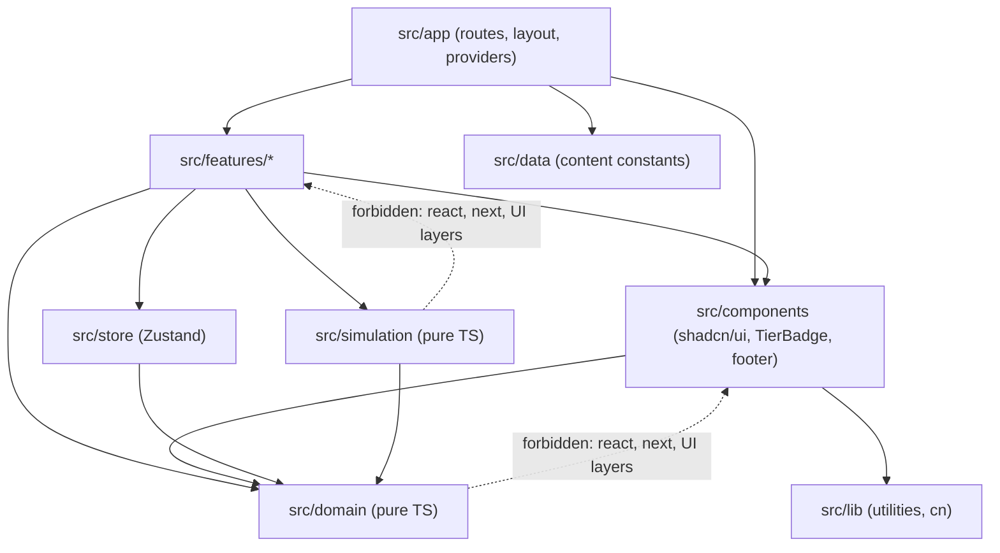
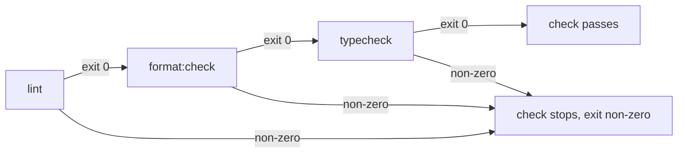

# Design Document

## Overview

The foundation spec produces the empty-but-working base of the Astronaut Health Companion (build step 1 in `docs/PROJECT.md` section 14). It delivers no health logic, no thresholds, no simulation data and no feature screens. Its value is a set of guard rails that later specs inherit automatically:

- A Next.js App Router project in strict TypeScript, with a placeholder page and a decision-support footer on every route.
- Tailwind CSS v4 and shadcn/ui, with exactly one stylesheet (`globals.css`) holding all design tokens, including the four status-tier colours.
- A `TierBadge` component that pairs every tier colour with an icon and a text label, so status never relies on colour alone.
- The agreed folder layout, with `.gitkeep` placeholders.
- ESLint rules that enforce the framework-free `domain/` and `simulation/` layers, ban `Math.random` and `Date.now` where determinism matters, ban `any`, ban literal colours, and restrict `style` attributes.
- Zod, Zustand and Recharts installed and proven by a sample schema, a sample store and a development-only chart route.
- A one-command quality gate (`check`: lint, format check and type check), a manual checklist that excluded technology is absent, and three always-on steering files.

Decisions respected: D3 (no hand-written CSS), D4 (framework-free domain and simulation), D5 (no PWA, offline or manifest), D7 (no ML). The prototype has no backend. No indicator definitions, threshold values, scenario data or source citations are created.

The project is Next.js only. By user decision it has no Vite, no Vitest and no other test runner, and the spec creates no automated tests. Correctness is verified by lint, type check, build and the manual steps in "Integration and manual verification".

### Research summary

| Finding | Effect on the design |
|---|---|
| Next.js 16 removed `next lint`, and `next build` no longer lints. Linting runs through the ESLint CLI with a flat config ([guide](https://chris.lu/web_development/tutorials/next-js-16-linting-setup-eslint-9-flat-config), [Next.js ESLint docs](https://nextjs.org/docs/pages/api-reference/config/eslint)). | `lint` is `eslint .`. The `build` script runs `lint` first, so a lint failure also fails the build (needed for Requirement 2.8). |
| `eslint-config-next` depends on plugins capped at ESLint 9, and an ESLint 10 setup needs workarounds ([guide](https://chris.lu/web_development/tutorials/next-js-16-linting-setup-eslint-10-flat-config)). | ESLint is pinned to the major that `eslint-config-next` supports at scaffold time, even if a newer major exists. Requirement 1.2 only mandates latest stable for Next.js, React and TypeScript, with one recorded exception: TypeScript is pinned at 6.0.3 (npm `latest` is 7.0.2) because `typescript-eslint@8.72.2`, used by `eslint-config-next`, declares the peer range `typescript >=4.8.4 <6.1.0`. TypeScript moves to the latest major once typescript-eslint supports it. |
| Current shadcn/ui on Tailwind v4 stores colours as CSS variables in the global stylesheet, in OKLCH, and exposes them to Tailwind through an `@theme inline` block ([shadcn theming](https://ui.shadcn.com/docs/theming), [components.json](https://ui.shadcn.com/docs/components-json)). | Status tokens use the same mechanism: `:root` and `.dark` variables plus `@theme inline` mappings. There is no `tailwind.config` file. |
| `eslint-plugin-better-tailwindcss` can validate class names against a v4 CSS entry point through its `entryPoint` setting ([plugin repo](https://github.com/schoero/eslint-plugin-better-tailwindcss)). | Its `no-unregistered-classes` rule gives the "fail on unconfigured Tailwind utility" behaviour of Requirement 2.8. Tailwind itself silently ignores unknown classes. |

Content was rephrased for compliance with licensing restrictions.

## Architecture

### Layering

Dependencies point downward only. The two bottom layers are pure TypeScript and are policed by ESLint (Requirement 5).



### Scaffold procedure

`create-next-app` refuses to write into a directory whose files it would overwrite (the repository already has `.gitignore`, `docs/` and `.kiro/`). The scaffold is therefore generated in a temporary directory and merged by hand:

1. Run `npx create-next-app@latest` in a temporary directory with TypeScript, Tailwind, ESLint, App Router, `src/` directory, import alias `@/*` and npm.
2. Copy the generated files into the repository root. Merge `.gitignore` (union of both files). Set the `package.json` name to `health-companion` (the folder name has capitals, which npm rejects).
3. Add `.npmrc` with `save-exact=true`, then rewrite every caret range in `package.json` to the exact installed version (Requirement 1.7). Commit `package-lock.json`.
4. Run `npx shadcn@latest init` with `components.json` aliases pointing at `src/`, then add `button`, `card`, `badge` and `tooltip`.
5. Remove create-next-app demo content (logos, default page text, `next/font/google` usage). The layout uses the Tailwind system font stack, so the build needs no network access to Google Fonts.

### Quality gate



`check` is `npm run lint && npm run format:check && npm run typecheck`. The `&&` operator runs the scripts one at a time, stops at the first failure and works in `cmd`, PowerShell and POSIX shells. No extra runner package is needed. `build` is a separate gate (`npm run build`) that also runs `lint` first.

## Components and Interfaces

### 1. Next.js and TypeScript scaffold (Requirement 1)

- App Router, all source under `src/`. Path alias `@/*` maps to `src/*` in `tsconfig.json`. Next.js reads the alias from `tsconfig.json`, so the build and the type check resolve it identically.
- `tsconfig.json` sets `"strict": true`. A type error makes `tsc --noEmit` exit non-zero and print `file(line,col)`, which covers Requirement 1.9.
- `src/app/layout.tsx`: root layout. Imports `./globals.css`, renders `children` inside `<main>` and renders `<DisclaimerFooter />` once.
- `src/app/page.tsx`: placeholder page. Shows the heading "Health Companion" and a row of the four `TierBadge` variants (a visual check that tokens work). It contains no notice text of its own; the notice is visible through the footer, which the layout pins to the bottom of a `min-h-svh` flex column, so both are visible at 1280×720.
- Versions: Next.js, React and TypeScript at the latest stable (no prerelease or canary) on the scaffold date. Every dependency is pinned to an exact version. A manual check compares `package.json` against `package-lock.json` (see "Integration and manual verification").

### 2. Styling and design tokens (Requirements 2 and 3)

**Tooling.** Tailwind CSS v4 through `@tailwindcss/postcss` in `postcss.config.mjs`. shadcn/ui `components.json`:

| Key | Value |
|---|---|
| `tailwind.css` | `src/app/globals.css` |
| `tailwind.config` | empty (Tailwind v4) |
| `tailwind.cssVariables` | `true` |
| `rsc` | `true` |
| `aliases.components` | `@/components` |
| `aliases.ui` | `@/components/ui` |
| `aliases.utils` | `@/lib/utils` |
| `aliases.lib` | `@/lib` |

Generated component files land in `src/components/ui/` (`button.tsx`, `card.tsx`, `badge.tsx`, `tooltip.tsx`), which is under `src/components/`. The default shadcn style is accepted as generated.

**`cn`.** `src/lib/utils.ts` exports `cn(...inputs: ClassValue[]): string` as `twMerge(clsx(inputs))`. Both `clsx` and `tailwind-merge` come from the shadcn init.

**Global_Tokens_File.** `src/app/globals.css` is the only `.css` file under `src/`. Its allowed contents:

- `@import "tailwindcss"` and `@import "tw-animate-css"` (added by shadcn).
- `@custom-variant dark (&:is(.dark *));`
- `:root { … }` and `.dark { … }` blocks containing only custom-property declarations (the light and dark value sets).
- `@theme inline { … }` mapping token variables to Tailwind colour names.
- `@layer base { … }` rules generated by shadcn.

Interpretation of Requirement 2.5: `:root` and `.dark` are the token scopes that hold the Design_Token definitions, so they are allowed outside the base layer as long as they contain only `--*` declarations. Any other class, ID or element selector must sit inside `@layer base`. This keeps the file compatible with future `shadcn add` runs.

**Status tokens.** Per tier `T` in `green | yellow | orange | red`, the file defines `--status-T` and `--status-T-foreground` in both `:root` and `.dark`, and maps them in `@theme inline`:

```css
@theme inline {
  --color-status-green: var(--status-green);
  --color-status-green-foreground: var(--status-green-foreground);
  /* repeated for yellow, orange and red */
}
```

This gives `bg-status-green`, `text-status-green` and `text-status-green-foreground`, and the same for the other three tiers.

Starting values (OKLCH, same format shadcn uses). These are candidates only; the design-time contrast check decides, and a failing pair is adjusted until it reaches 4.5:1.

| Token | Light background | Light foreground | Dark background | Dark foreground |
|---|---|---|---|---|
| green | `oklch(0.45 0.12 150)` | `oklch(0.985 0 0)` | `oklch(0.75 0.17 150)` | `oklch(0.2 0.04 150)` |
| yellow | `oklch(0.85 0.17 95)` | `oklch(0.25 0.05 95)` | `oklch(0.85 0.17 95)` | `oklch(0.2 0.04 95)` |
| orange | `oklch(0.5 0.15 50)` | `oklch(0.985 0 0)` | `oklch(0.75 0.16 55)` | `oklch(0.2 0.04 55)` |
| red | `oklch(0.5 0.2 27)` | `oklch(0.985 0 0)` | `oklch(0.7 0.19 25)` | `oklch(0.2 0.04 25)` |

**Contrast check (design time, manual).** The contrast requirement (3.3) is checked by hand while the tokens are written, not by an automated test. For each of the eight background and foreground pairs (four tiers, light and dark sets), measure the WCAG 2.1 contrast ratio with the browser developer tools contrast checker or an online WCAG contrast checker, and adjust the OKLCH value until the ratio is at least 4.5:1. Record the final ratios in the task notes or commit message.

There is no theme toggle in this spec. The dark value set exists so later specs can add one without touching the tokens.

**No inline styles and no literal colours.** Components use Tailwind utilities and token-backed classes only. ESLint enforces this (section 5).

### 3. Tier type, schema and TierBadge (Requirements 3.5 to 3.7, 3.9, 6.4)

**`src/domain/types.ts`** contains exactly one declaration:

```ts
export type Tier = 'green' | 'yellow' | 'orange' | 'red';
```

No constants, interfaces or other types, per Requirement 4.2.

**`src/domain/tier-schema.ts`** holds the Zod schema. The schema file, not `types.ts`, owns the runtime list of values:

```ts
import { z } from 'zod';
import type { Tier } from './types';

export const TierSchema = z.enum(['green', 'yellow', 'orange', 'red']);

// Compile-time guard: the schema and the Tier type must describe the same set.
type SchemaTier = z.infer<typeof TierSchema>;
type Equal<A, B> = [A] extends [B] ? ([B] extends [A] ? true : false) : false;
export const tierSchemaMatchesType: Equal<SchemaTier, Tier> = true;
```

`z.enum` is exact-match, so it rejects the empty string, wrong case, padded strings, `null`, `undefined` and numbers without extra code. The `Equal<SchemaTier, Tier>` guard is checked by `typecheck`: if the schema and the type drift apart, `tsc --noEmit` reports an error. Nothing here is a threshold; the four values come from `docs/PROJECT.md` section 8.

**`src/components/tier-badge.tsx`** is a shared component built on the shadcn `Badge`:

```ts
interface TierBadgeProps { tier: Tier }

const TIER_BADGE: Record<Tier, { label: string; Icon: LucideIcon; className: string }> = {
  green:  { label: 'Normal for you', Icon: CircleCheck,   className: 'bg-status-green text-status-green-foreground' },
  yellow: { label: 'Drifting',       Icon: Eye,           className: 'bg-status-yellow text-status-yellow-foreground' },
  orange: { label: 'Concerning',     Icon: TriangleAlert, className: 'bg-status-orange text-status-orange-foreground' },
  red:    { label: 'Act now',        Icon: OctagonAlert,  className: 'bg-status-red text-status-red-foreground' },
};
```

- Labels come from the "Meaning" column of `docs/PROJECT.md` section 8.
- `Record<Tier, …>` makes the map exhaustive. Adding a tier without a badge entry is a type error.
- The prop type is `Tier`, so passing any other value is a type error at build time (Requirement 3.9). This is confirmed by a manual negative example (see "Integration and manual verification").
- Class names appear as full literal strings so Tailwind's scanner generates them. `cn` merges them over the Badge default colours; the last conflicting class wins.
- The icon is `aria-hidden`. The label is real text inside the badge. Each badge therefore shows colour, one icon and one label.

### 4. Folder layout (Requirement 4)

```
src/
├── app/                      layout.tsx, page.tsx, globals.css, dev/chart-check/
├── domain/
│   ├── indicators/           .gitkeep
│   ├── baseline/             .gitkeep
│   ├── rules/                .gitkeep
│   ├── environments/         .gitkeep
│   ├── types.ts              (Tier only)
│   └── tier-schema.ts
├── simulation/
│   ├── engine/ crew/ environments/ events/ demo-packs/    each .gitkeep
│   └── scenarios/
│       └── iss/ lunar/ mars/                              each .gitkeep
├── features/
│   └── body-map/ check-in/ trends/ alerts/ escalation/ radiation/ countermeasures/   each .gitkeep
├── components/               ui/ (shadcn), tier-badge.tsx, disclaimer-footer.tsx
├── store/                    counter-store.ts
├── data/                     disclaimer.ts
└── lib/                      utils.ts
```

A directory with no other file or subdirectory holds exactly one `.gitkeep`. `.gitkeep` is chosen over `README.md` because it cannot carry data by accident (Requirement 4.6). `src/simulation/` and `src/features/` contain only subdirectories, so they need no placeholder. Later specs delete a `.gitkeep` when they add real files.

### 5. Lint rules enforcing the architecture (Requirements 3.8, 5, 8, 10.5)

ESLint 9 flat config in `eslint.config.mjs`. The project-specific blocks live in `eslint.rules.mjs` as an exported array `projectRules`, which `eslint.config.mjs` spreads into the config. Two local rules live in `eslint-rules/`.

Config order matters in flat config, because a later block replaces the options of an earlier block for the same rule ID on the same file. The order is:

| # | Block | Files | Rules |
|---|---|---|---|
| 1 | Ignores | `.next/**`, `node_modules/**`, `next-env.d.ts`, `coverage/**` | n/a |
| 2 | `eslint-config-next/core-web-vitals` and `eslint-config-next/typescript` | all | Next.js, React, hooks and TypeScript rule sets |
| 3 | No `any` | `src/**/*.{ts,tsx}` | `@typescript-eslint/no-explicit-any: error` (annotations, type arguments, assertions) |
| 4 | Seeded randomness outside `lib` | `src/**/*.{ts,tsx}`, ignoring `src/lib/**` | `no-restricted-properties`: `Math.random` |
| 5 | Framework-free layers | `src/domain/**`, `src/simulation/**` | `no-restricted-properties`: `Math.random` and `Date.now`. `no-restricted-imports`: patterns below. `no-restricted-syntax`: destructuring `random` from `Math` or `now` from `Date` |
| 6 | Colours and styles | `src/**/*.{ts,tsx}` | `local/no-literal-colors: error`; `local/no-unjustified-style: error` (tsx) |
| 7 | Tailwind class check | `src/**/*.tsx` | `better-tailwindcss/no-unregistered-classes: error`, `settings.better-tailwindcss.entryPoint = src/app/globals.css` |
| 8 | `eslint-config-prettier` | all | disables style rules that conflict with Prettier (Requirement 8.3) |

Block 5 comes after block 4 on purpose: domain and simulation files get the larger `no-restricted-properties` list.

**Forbidden imports in `domain/` and `simulation/`** (`no-restricted-imports`):

| Pattern | Matches |
|---|---|
| `react`, `react-dom`, `next` | the bare modules |
| `react/*`, `react-dom/*`, `next/*` | sub-paths |
| `@/components`, `@/features`, `@/app`, `@/store` (and `/**`) | UI layers by alias |
| `**/components`, `**/features`, `**/app`, `**/store` (and `/**`) | the same layers by relative path |

`react-dom` and the relative-path forms go slightly beyond the wording of Requirement 5.1. They close obvious loopholes and cannot match legitimate domain code. Each message names the rule and the reason ("domain and simulation must stay framework-free (D4)"). ESLint's default output already shows file, line and rule ID.

**`local/no-literal-colors`** reports any string literal or template element containing a hex colour (`#` followed by 3, 4, 6 or 8 hex digits at a word boundary) or a call-like `rgb(`, `rgba(`, `hsl(`, `hsla(` or `oklch(`. It matches inside longer strings so Tailwind arbitrary values such as `bg-[#fff]` are caught. A custom rule is used because `no-restricted-syntax` selectors with regex attributes are fragile for these patterns. `var(--token)` strings pass.

**`local/no-unjustified-style`** reports a JSX `style` attribute unless both hold: the value is a non-literal expression (computed at runtime), and a comment ends on the line immediately above the attribute (Requirement 10.5).

**Limit.** ESLint cannot see runtime-constructed strings such as `'#' + hex`. These rules catch what is written in source, which is what the requirements ask for.

### 6. Runtime libraries (Requirement 6)

- `zod`, `zustand` and `recharts` are in `dependencies` at the latest stable on the install date.
- **Sample store**, `src/store/counter-store.ts`:

```ts
interface CounterState { count: number; increment: () => void; reset: () => void }
export const useCounterStore = create<CounterState>()((set) => ({
  count: 0,
  increment: () => set((s) => ({ count: s.count + 1 })),
  reset: () => set({ count: 0 }),
}));
```

- **Development-only check route** at `/dev/chart-check`:
  - `src/app/dev/chart-check/page.dev.tsx` is the route file. A `pageExtensions` setting in `next.config.ts` includes the extension `dev.tsx` only when `NODE_ENV === 'development'`. In a production build the file is not a page, so it is absent from the build output and `next start` answers 404 (Requirement 6.7).
  - `src/app/dev/chart-check/chart-check.tsx` starts with `"use client"`. It renders one Recharts `LineChart` with five hard-coded points (a constant array in the file, no fetch), wrapped in a small class-based error boundary. If rendering throws, the boundary shows a visible message ("Chart failed to render") in place of the chart. The component also reads `useCounterStore`, so the store is exercised by a client component only (Requirement 6.3).
  - Risk: the `pageExtensions` approach depends on Next.js evaluating `next.config.ts` with the final `NODE_ENV`. The manual build and `next start` checks confirm it. Fallback if it fails: keep `page.tsx` and call `notFound()` when `NODE_ENV === 'production'`. The route would then be listed in the build output, so Requirement 6.7 would need a wording change. Raise this with the user if the fallback is needed.

### 7. Scripts and README (Requirements 8 and 9)

| Script | Command | Purpose |
|---|---|---|
| `dev` | `next dev` | Start the development server |
| `build` | `npm run lint && next build` | Lint, then create the production build |
| `start` | `next start` | Serve the production build |
| `lint` | `eslint .` | Run ESLint |
| `format` | `prettier --write .` | Rewrite files to Prettier formatting |
| `format:check` | `prettier --check .` | List files that differ, change nothing |
| `typecheck` | `tsc --noEmit` | Type check with strict TypeScript |
| `check` | `npm run lint && npm run format:check && npm run typecheck` | Run the three gates in order, stop on first failure |

There are no `test` or `test:watch` scripts, because the project has no test runner.

`.prettierrc.json` uses Prettier defaults plus `"singleQuote": true`; shadcn output is reformatted once by `npm run format`. `.prettierignore` lists `.next`, `node_modules`, `coverage`, `package-lock.json`, `next-env.d.ts`, `.kiro` and `docs` (the spec and master documents are not code).

`README.md` documents every script with one list entry in the form ``- `name`: description`` (description 1 to 200 characters). A manual check confirms each script in the table appears once (Requirement 9.8).

### 8. Excluded-technology review (Requirement 10)

Requirement 10 is verified by a manual review of `package.json` and the file tree, run at the final checkpoint. Any violation found is fixed before the spec is accepted. `npm run lint` already enforces criterion 5 (the `style` attribute rule) through section 5.

| Check | Rule |
|---|---|
| PWA packages | name matches `serwist`, `@serwist/*`, `next-pwa`, `@ducanh2912/next-pwa`, `workbox-*` |
| PWA files | any file named `sw.js`, `service-worker.*`, `manifest.json`, `manifest.webmanifest`, or `src/app/manifest.*`, outside `node_modules`, `.next` and `.git` |
| Database clients | `prisma`, `@prisma/client`, `drizzle-orm`, `mongoose`, `mongodb`, `pg`, `mysql2`, `better-sqlite3`, `sequelize`, `typeorm`, `knex`, `firebase`, `@supabase/*` |
| Auth libraries | `next-auth`, `@auth/*`, `better-auth`, `@clerk/*`, `passport`, `lucia` |
| API routes and server actions | any `route.ts(x)` or `route.js` under `src/app/`, or a `"use server"` directive in any file under `src/` |
| ML packages | `@tensorflow/*`, `tensorflow`, `onnxruntime-*`, `brain.js`, `ml5`, `@huggingface/*`, `@xenova/*`, `synaptic` (also checked for imports in `src/`) |
| Extra stylesheets | any `.css` under `src/` other than `src/app/globals.css` |
| CSS-in-JS | `styled-components`, `@emotion/*`, `@stitches/*`, `jss`, `@vanilla-extract/*`, `@linaria/*` |

The lists are a best-effort denylist, not a proof.

### 9. Steering files (Requirement 11)

Three files in `.kiro/steering/`, each starting with this front matter:

```markdown
---
inclusion: always
---
```

| File | Content |
|---|---|
| `product.md` | Purpose and challenge (section 1), product concept and core loop (section 2), scope (section 4), the decision-support positioning (section 2.3). A "Source of truth and honesty" block: `docs/PROJECT.md` is the source of truth. If a chat message conflicts with it, stop and ask which applies before changing anything. All thresholds are drafts with verification flags. A value flagged C must not be presented as fact in user-facing text or code comments. |
| `tech.md` | Stack (13.1), architecture rules (13.2), styling rules (13.3), code conventions (13.7), and an "Agent rules" list with one bold, individually identifiable line each: **No PWA.** **No backend.** **No ML.** **No custom CSS.** **No health logic in components.** **No invented thresholds or sources.** **No `Math.random()`.** **No test runner.** **Ask when a requirement is ambiguous.** |
| `structure.md` | The folder layout from 13.4 and the simulation groups from 11.1, listing every folder name. |

The steering text contains no threshold numbers. The front matter, headings, required phrases and folder names are checked by manual review (see "Integration and manual verification").

### 10. Disclaimer notice and footer (Requirements 1.6 and 12)

- `src/data/disclaimer.ts` exports the only copy of the text:

```ts
export const DISCLAIMER_NOTICE =
  'Decision support only, not a diagnostic device. This prototype uses synthetic data and draft thresholds.';

export function assertDisclaimerPresent(text: string): void {
  if (text.trim().length === 0) {
    throw new Error('Disclaimer_Notice is missing or empty; refusing to build without it.');
  }
}

assertDisclaimerPresent(DISCLAIMER_NOTICE);
```

  The module-level call runs when Next.js evaluates the layout during `next build`, so an empty notice fails the build with a message naming the notice (Requirement 12.5). This is confirmed by a manual negative example: empty the constant temporarily, run `npm run build`, and revert.
- `src/components/disclaimer-footer.tsx` is a server component. It renders `<footer>` with `DISCLAIMER_NOTICE`, using wrapping utilities (`text-sm`, `text-balance`, padding) and none of `truncate`, `line-clamp-*`, `overflow-hidden`, `hidden` or `sr-only`, so the full text shows from 320 px to 3840 px wide.
- `layout.tsx` renders the footer exactly once. Because it is a server component in the layout, the text is in the initial HTML for every route.
- No other file under `src/` repeats the text; a text search of `src/` confirms this (Requirement 12.4).

## Data Models

### `Tier` and its schema

| Item | Location | Definition |
|---|---|---|
| `Tier` | `src/domain/types.ts` | `'green' \| 'yellow' \| 'orange' \| 'red'`, the only declaration in the file |
| `TierSchema` | `src/domain/tier-schema.ts` | `z.enum` of the same four literals, equal to `Tier` by a compile-time check |

### `TierBadgeConfig` (internal to `tier-badge.tsx`)

| Field | Type | Rule |
|---|---|---|
| `label` | `string` | non-empty, unique across tiers |
| `Icon` | `LucideIcon` | unique across tiers |
| `className` | `string` | contains `bg-status-<tier>` and `text-status-<tier>-foreground` |

### `CounterState`

| Field | Type | Initial |
|---|---|---|
| `count` | `number` | `0` |
| `increment` | `() => void` | adds 1 |
| `reset` | `() => void` | sets `count` to 0 |

### Design token set (in `globals.css`)

| Token | Scopes | Count |
|---|---|---|
| `--status-{green,yellow,orange,red}` | `:root`, `.dark` | 4 × 2 |
| `--status-{green,yellow,orange,red}-foreground` | `:root`, `.dark` | 4 × 2 |
| `--color-status-*` and `--color-status-*-foreground` | `@theme inline` | 8 |

### Steering file front matter

```yaml
inclusion: always
```

### `package.json` constraints

- `dependencies`: `next`, `react`, `react-dom`, `zod`, `zustand`, `recharts`, plus shadcn runtime packages (`radix-ui`, `class-variance-authority`, `clsx`, `tailwind-merge`, `lucide-react`, `tw-animate-css`).
- `devDependencies`: `typescript`, `eslint`, `eslint-config-next`, `eslint-config-prettier`, `eslint-plugin-better-tailwindcss`, `prettier`, `tailwindcss`, `@tailwindcss/postcss`, `postcss`, and the `@types/*` packages that `create-next-app` generates for Next.js, React and Node.
- No `vite`, `vitest`, `@vitejs/plugin-react`, `fast-check` or `culori`, and no test runner of any kind.
- Every version is an exact version string, and the lockfile agrees.

## Error Handling

| Situation | Behaviour |
|---|---|
| Strict-mode type error | `tsc --noEmit` prints file and position and exits non-zero. `check` stops. |
| Tier schema and `Tier` type drift apart | The `Equal<SchemaTier, Tier>` guard fails `tsc --noEmit`. |
| Forbidden import, `Math.random`, `Date.now`, `any`, literal colour or unjustified `style` | ESLint prints `file:line:col`, the message and the rule ID, and exits non-zero. Custom rules name the reason and, where relevant, the decision (D3, D4). |
| Unknown Tailwind utility | `better-tailwindcss/no-unregistered-classes` fails `lint`, and `build` runs `lint` first, so the build fails. |
| Missing shadcn component | The import fails with Next.js "Module not found", naming the missing path. |
| Empty or missing disclaimer text | `assertDisclaimerPresent` throws at module load, and `next build` fails with a message naming the Disclaimer_Notice. There is no build output without the notice. |
| Prohibited package, file, directive or extra stylesheet | Found by the manual excluded-technology review, which lists each package name or file path. A `style` attribute violation is also reported by `lint`. |
| Chart render error on `/dev/chart-check` | The error boundary shows "Chart failed to render" in place of the chart. The page itself still loads. |
| Production request for `/dev/chart-check` | Not a page in the production build, so the server answers 404. |
| Formatting differences | `format:check` lists the files and exits non-zero without modifying anything. `format` rewrites them. |
| ESLint major mismatch with `eslint-config-next` at install | `npm install` reports a peer dependency conflict. The fix is to pin ESLint to the major the config supports (see Research summary). |
| Contrast below 4.5:1 for a token pair | Found by the design-time manual contrast check. Adjust that OKLCH value. |

## Testing Strategy

This spec has no automated tests and no test runner. By user decision, Vite, Vitest, `fast-check` and `culori` are not installed, and there is no replacement (no Jest, no `node:test`). Property-based testing does not apply, so the design has no Correctness Properties section.

Verification relies on four things:

- **Lint** (`npm run lint`): architecture rules, `any`, literal colours, `style` attributes, unknown Tailwind classes, framework-free layers.
- **Type check** (`npm run typecheck`): strict mode, the `@/*` alias, the `Equal<SchemaTier, Tier>` guard, the exhaustive `Record<Tier, …>` map and the `TierBadge` prop type.
- **Build** (`npm run build`): lint, compilation, CSS generation, the disclaimer assertion and the route list.
- **Manual steps**: the checklist below, for behaviour that needs a running server, a browser or a deliberate negative example, and for requirements that were previously verified only by an automated test.

### Integration and manual verification

`npm run check` and `npm run build` run at the final checkpoint. The rest is done by hand.

1. `npm run check` exits 0 on the clean scaffold (8.5, 8.6, 9.2, 9.4, 9.5, 9.6).
2. `npm run build` exits 0 (1.8, 2.1, 9.3). The route list does not include `/dev/chart-check` (6.7).
3. `npm run start`, then request `/dev/chart-check` and expect 404 (6.7).
4. `npm run dev`: `/` responds within 10 seconds with no terminal or console errors, and the title and notice are visible at 1280×720 (1.5, 1.6). `/dev/chart-check` shows one chart with five points and no console errors, and a forced throw shows the error message (6.5, 6.6).
5. Negative examples, each reverted afterwards:
   - add an unknown Tailwind class and confirm `build` fails (2.8);
   - add a type error and confirm `typecheck` and `check` fail and `check` skips later scripts (1.9, 9.7);
   - add a stray file under `src/` and confirm `format:check` lists it (8.8); run `format` and confirm `format:check` passes (8.9);
   - in a scratch file under `src/domain/`, import `react`, call `Math.random()` and `Date.now()`, and confirm `lint` reports file, line and rule (5.1, 5.2); call `Math.random()` in a file outside `src/lib/` (5.3); use `any` as an annotation, a type argument and an assertion (5.4); confirm a clean file reports zero errors (5.5);
   - add a literal colour (`#fff`, `rgb(…)`, and a `bg-[#fff]` class) and confirm `lint` reports file and line (3.8);
   - add a `style` attribute with a static value, and a dynamic one without and with a comment on the line above, and confirm only the first two are reported (10.5);
   - pass an invalid value to `TierBadge` and confirm `typecheck` fails (3.9);
   - temporarily empty `DISCLAIMER_NOTICE` and confirm `build` fails with a message naming the notice (12.5).
6. Responsive check of the footer at 320 px and 3840 px widths (12.6).
7. Confirm at scaffold time that Next.js, React and TypeScript are the latest stable releases (1.2, 6.1).
8. Dependency check: `package.json` contains no `^` or `~` ranges and no prerelease tags, `npm ls` reports no mismatch with `package-lock.json`, and `zod`, `zustand` and `recharts` are under `dependencies` (1.2, 1.7, 6.1).
9. Scratch checks, run once and then deleted (not committed): evaluate `TierSchema.safeParse` on the four tiers (accepted) and on an empty string, a case variant, a padded string, `null`, `undefined` and a number (rejected) (6.4). Evaluate `cn("p-2", "p-4")` and confirm it returns `"p-4"` (2.7).
10. Inspection of `globals.css`: it is the only `.css` file under `src/` (2.4), contains only the allowed contents (2.5), defines the four status tokens and four foregrounds in both `:root` and `.dark` (3.1, 3.3, 3.4), and the eight `@theme inline` mappings (3.2). The placeholder page shows the four `TierBadge` variants using those classes.
11. Contrast: apply the design-time contrast check from section 2 to all eight pairs (3.3).
12. `TierBadge` review on the placeholder page: each of the four tiers shows its token colours, one icon and a non-empty label, and no two tiers share an icon or a label (3.5, 3.6).
13. Structure review: the directories and placeholders from section 4 exist and each otherwise-empty directory has exactly one `.gitkeep` (4.1 to 4.5); no indicator, threshold, scenario or source content exists (4.6); `types.ts` has one declaration and no other file declares a tier union (3.7, 4.2); the store is imported only by files that start with `"use client"` (6.3); the notice text appears once under `src/` (12.4); the shadcn components exist as separate files (2.2, 2.3).
14. Excluded-technology review: apply the table in section 8 to `package.json` and the file tree (10.1 to 10.4).
15. Script and README review: `package.json` defines `dev`, `build`, `start`, `lint`, `format`, `format:check`, `typecheck` and `check` with non-empty commands, and has no `test` or `test:watch` (9.1); the `check` string matches section 7 (9.6); `README.md` has one entry per script with a 1 to 200 character description (9.8); the Prettier config loads without errors (8.2).
16. Steering review: all three files start with `inclusion: always`, contain the required headings and phrases, the nine agent rule lines, the source-of-truth and flag C statements, and every folder name from section 13.4 and group from 11.1 of `docs/PROJECT.md` appears in `structure.md` (11.1 to 11.7).

### Out of scope

Third-party behaviour (Tailwind class generation, Next.js routing, ESLint message formatting) is not re-verified beyond the checks above. No health logic exists in this spec, so no domain verification exists yet; later specs add what they need next to each domain function.
