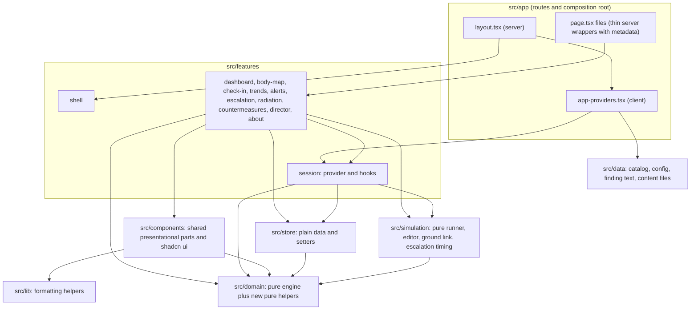
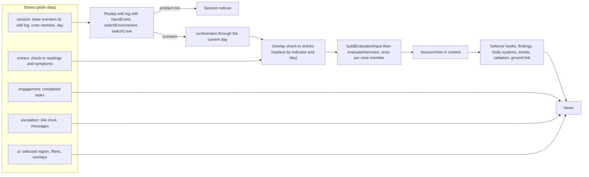
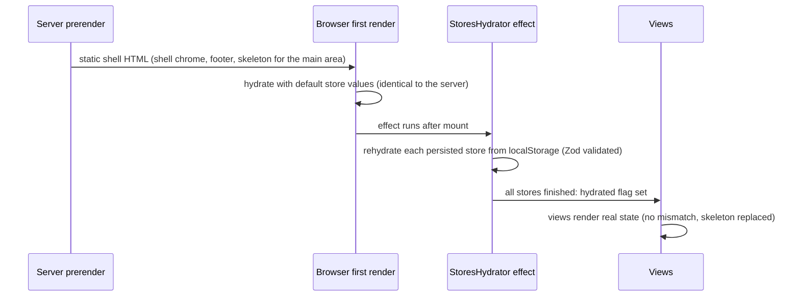
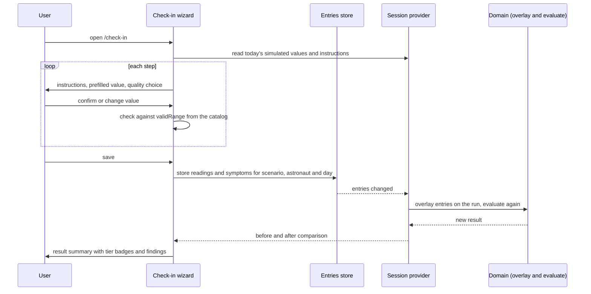
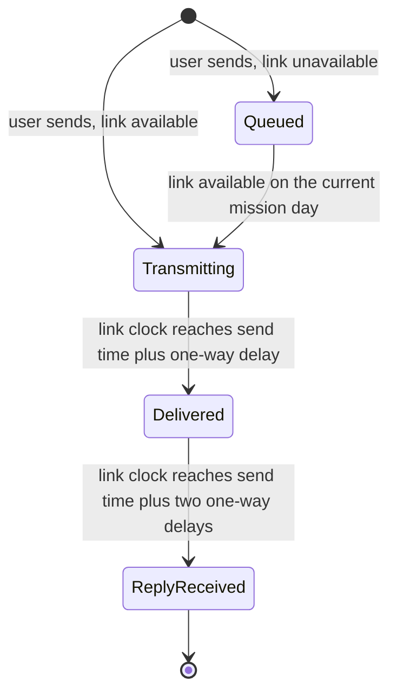

# Design Document: Frontend App

## Overview

The frontend turns the finished engine (`src/domain/`), data (`src/data/`) and simulation (`src/simulation/`) into the app that judges and crew actually use. After this spec the app has an app shell, ten routes, four Zustand stores, a clickable body map, a guided check-in, trend charts with a baseline band, alerts, an escalation flow with a simulated ground delay, a radiation view, countermeasures with light gamification, a hidden director panel and an about page. It adds no health logic, no backend and no new thresholds.

The PROJECT.md section 15.2 split (dashboard-body-map, check-in-trends, alerts-escalation, countermeasures-radiation, demo-director, about) is merged into this one spec on purpose. The design keeps those areas as separate sections ("Feature areas") so the tasks can be sequenced in the same order.

The design follows seven rules:

1. **The engine decides, the UI shows.** Every tier, confidence, finding, body-system rollup, baseline and band edge comes from `src/domain/`. Components format and arrange these values. They never classify.
2. **Content is data.** Instructions, countermeasures, region descriptions, hazard descriptions, shelter steps, scripted ground replies and demo routing live in `src/data/`. The decision-support notice stays in the one constant in `src/data/disclaimer.ts`. Where a citation is missing the `sources` array is empty.
3. **Never colour alone.** One shared presentation map gives every tier a colour token, an icon and a text label. The body map, the charts and the history strips all use it.
4. **Honest about drafts.** A value with verification flag C is never stated as fact. It always carries a visible "draft" marker.
5. **Deterministic and hydration-safe.** No `Math.random`, no clock reads while rendering. Stores start with the same defaults on the server and the client. Persisted state loads after mount.
6. **Failures are visible values.** Simulation problems, engine errors and unreadable stored state show a message and a way to recover. They do not crash a page.
7. **The compiler, schemas, lint and build do the checking.** There is no test runner. "Verification strategy (no test runner)" says exactly what each mechanism covers.

### Scope

In scope: everything the PROJECT.md MVP needs on the UI side (section 4, requirements R8 to R20 and the screens table in section 12):

- App shell, navigation, mission-day, environment and ground-link indicators, footer on every page.
- Stores, derived-data hooks and the content injection boundary.
- Dashboard, body map, region panel, daily summary, crew status.
- Guided check-in, trends, alerts, escalation, radiation, countermeasures.
- Environment (mission) switcher, crew selector.
- Director panel, demo pack playback, about page.
- Two small additive domain exports needed by the chart band (decision FD-4).

Out of scope: any change to engine behaviour, new thresholds or sources, a backend, API routes, server actions, PWA or offline tooling, ML, camera or voice input, PDF export, self-harm screening, a dark-mode toggle, a test runner or test files. `package.json` gains no dependency. The shadcn CLI adds component files only.

### Audit: what exists and what is missing

| Area | State today | This spec |
| ---- | ----------- | --------- |
| `src/app` | `layout.tsx`, a placeholder `page.tsx`, `globals.css`, dev-only `dev/chart-check` | Shell, routes, providers, error pages |
| `src/components` | `disclaimer-footer`, `tier-badge`, shadcn `badge`, `button`, `card`, `tooltip` | Shared presentational parts, more shadcn components |
| `src/features/*` | Seven folders with only `.gitkeep` | All feature views and hooks |
| `src/store` | `counter-store.ts` (placeholder used by the dev chart page) | Four real stores. The counter store stays for the dev route |
| `src/domain`, `src/data`, `src/simulation` | Done and reused | Reused. Only FD-4 touches `src/domain` |

### Research summary

Findings from `node_modules/next/dist/docs/` (this Next.js version differs from older ones) and from the installed packages:

| Finding | Effect on the design |
| ------- | -------------------- |
| `next.config.ts` sets `cacheComponents: true` and `partialPrefetching: true`. Pages are prerendered as a static shell. Next.js keeps up to 3 previously visited routes mounted but hidden with React `Activity`, runs effect clean-ups when a route is hidden and re-runs effects when it shows again (`preserving-ui-state.md`, `cacheComponents.md`). | Routes keep their client state when the user navigates away. Transient state (open check-in step, director overlay, shelter checklist) is reset in a layout-effect clean-up. The ground-clock timer lives in the shell, which is never hidden. |
| `useSearchParams` in a prerendered route forces client rendering up to the nearest `Suspense` boundary (`use-search-params.md`). | The design uses no URL search params. Selections live in the UI store. No `Suspense` workaround is needed. |
| `usePathname` needs no `Suspense` boundary on routes that are fully known at build time (`use-pathname.md`). All routes here are static. | The nav can mark the active link with `usePathname` without extra boundaries. |
| `error.tsx` receives `error` and `retry` (not the older `reset`), and must be a Client Component (`error.md`). | Error pages use `retry`. |
| `metadata` exports work only in Server Components (`metadata-and-og-images.md`). Layout and page props use the global `LayoutProps` and `PageProps` helpers. | Pages stay thin server files that export `metadata` and render one client view. The root layout keeps `LayoutProps<'/'>`. |
| Reading browser-only values (storage, locale) during render causes hydration errors. The documented fixes are a lazy initialiser that matches the server value or an inline script (`preventing-flash-before-hydration.md`). | Stores start with fixed defaults. Persisted stores use `skipHydration: true` and are rehydrated in an effect after mount. Views that depend on stored state show a skeleton until hydration finishes. No inline script is needed. |
| Zustand 5.1.0 `persist` supports `skipHydration`, `rehydrate()`, `hasHydrated()`, `onFinishHydration()`, `partialize`, `version`, `migrate` and `merge`. `createJSONStorage` can return `undefined` when storage is unavailable (`persist.d.mts`). | The persisted stores use these options, with Zod validation in `merge`. |
| Recharts 3.10.1 exports `ResponsiveContainer`, `ComposedChart`, `Area`, `Line`, `ReferenceLine`, `Tooltip`, `XAxis`, `YAxis` and `CartesianGrid` (`recharts/types/index.d.ts`). The dev chart page already renders a `LineChart` with `var(--status-green)` as a stroke and `isAnimationActive={false}`. | Charts use `var(--token)` strings (allowed by `no-literal-colors`). The band is a range `Area`. Animation is off. |
| `eslint.rules.mjs` restricts imports only inside `src/domain` and `src/simulation` (no React, Next or UI layers). Nothing restricts `src/store`, `src/features`, `src/components` or `src/app`. `structure.md` is the only source of the "may use" rules, and nothing enforces it. | See FD-1 and FD-2. The design obeys `structure.md` by construction and checks it with a documented import search. |
| `src/components/disclaimer-footer.tsx` already imports `@/data/disclaimer` although `structure.md` does not list `src/data` for components. | Treated as a known exception. New shared components receive text through props. |
| `evaluateAstronaut` returns `classifications` ordered by indicator id and a `no-data` entry carries no id, so its position identifies the indicator (`evaluate.ts`). `DayState.baselines` holds the baseline in force for each day. | The alerts tier history and the trend band index classifications by position over the id-sorted catalog. This is a named risk. |
| `runScenario` for an earlier day is a prefix of the run for a later day. `buildEvaluationInput` rejects an `asOfDay` after the run's last day. | The app runs the scenario through the current day only, so no future reading is ever in memory for the views. |

Not confirmed: the runtime cost of re-evaluating four astronauts on every day change. The data is small (at most 30 days, 16 indicators, 4 astronauts), and results are memoised per scenario, day and astronaut. Measure during implementation.

Content was rephrased for compliance with licensing restrictions.

## Assumptions and decisions to review

PROJECT.md is silent on these points. Each has a conservative default, so work is not blocked. Values that PROJECT.md does not give are stored as data marked `proposed-default`, as in the domain and simulation specs. Nothing here changes a lint rule.

### Layer rules (needs your decision if you disagree with the default)

| ID | Finding | Default in this design | Alternative |
| -- | ------- | ---------------------- | ----------- |
| FD-1 | `structure.md` says `src/store` may use only `src/domain`. The stores need to hold a scenario and injected events, and the simulation library is needed to build and run them. ESLint does not enforce this rule for `src/store`; it only polices `src/domain` and `src/simulation`. | Obey the rule. Stores hold plain data only: a base scenario id, an ordered **edit log** (inject event, switch environment, switch crew), the current day and user entries. Event payloads in the log are stored as unvalidated plain objects. Hooks in `src/features/session/` replay the log over the base scenario with `injectEvent`, `switchEnvironment` and `switchCrew`. Those functions validate each edit and a Zod parse checks event payloads, so stored data is checked at the boundary. | Allow type-only imports from `src/simulation` in stores for a fully typed log. This needs `structure.md` to change. |
| FD-2 | `structure.md` lets `src/app` use `src/data`, but not `src/features`. Features still need the catalog, cluster definitions, engine config, finding text and all content. `components/disclaimer-footer.tsx` already imports `src/data` (a known exception). | One composition root, `src/app/app-providers.tsx` (client component), imports the data and passes it as props to a provider in `src/features/session/`. Features read engine data and content through context hooks. Shared components receive text through props. Content types and Zod schemas live in `src/domain/content/` (types and schemas only, no logic), following the precedent of `FindingText` (type in the domain, values in `src/data/`). | Let features import `src/data` directly. Simpler, but needs `structure.md` to change. |
| FD-3 | `structure.md` lists seven feature folders. The shell, session providers, dashboard, director panel and about page have no folder. | Add `src/features/session`, `shell`, `dashboard`, `director` and `about`. Feature folders own components, hooks and types (PROJECT.md 13.2 rule 6). | Place them in `src/components`. Not possible, because those parts use stores and `components` may not. |
| FD-4 | The chart band, radiation figures, escalation summary, check-in overlay, streak maths and the ground-link message timing are health, engagement or simulation logic that components must not contain. No finished layer provides them. | Add small **additive, pure** modules to the layer that owns the concept, and edit no existing engine file. In `src/domain/`: `trends/` (trend series with baseline band, classification-by-indicator lookup), `radiation/` (dose figures, shelter flag), `escalation/` (summary builder and its schema), `check-in/` (overlay of saved entries on readings), `engagement/` (streak and crew goal), `content/` (content schemas and types only). In `src/simulation/`: `escalation/` (one-way delay choice, message stage, scripted reply choice) and `teammates/` (seeded teammate completions for the demo). | Put them in feature folders as plain modules. Faster, but it breaks the "no health logic in components" rule. |

### Product behaviour

| ID | Decision | Configurable at |
| -- | -------- | --------------- |
| FD-5 | **Time moves by user action.** A visible "Next day" control in the shell advances one mission day. The director slider scrubs to any day. Mission days are shown as the engine numbers them (0 to duration − 1), so "day 21" in a caption, a finding and the shell all agree. | `src/data/app-defaults.ts` |
| FD-6 | **Check-in.** Three measurement steps (resting heart rate, blood pressure with two fields, mood 1 to 5) and one optional symptom step (the engine's symptom list). Each field is prefilled with the simulated sensor value for the day. The user may change it and mark the measurement good or poor. Saved entries replace that day's simulated reading for that astronaut and indicator, and symptom entries are added to the day's reports. Entries are keyed by base scenario, astronaut, day and indicator, so they apply only while that scenario is loaded and stay stored (dormant) when the user switches away. "Reset session" clears them. There is **no safety-flag input**: PROJECT.md says self-harm screening needs a team ethics discussion first. Instruction wording is drafted without clinical numbers and with empty `sources`, for the team to review. | `src/data/check-in.ts` |
| FD-7 | **Persistence.** The session, entries, engagement and escalation stores persist to `localStorage` under versioned keys, validated with Zod when read. The UI store does not persist. Stored data that fails validation is discarded and a notice says so. A "Reset session" action clears everything. | `src/store/persist-config.ts`, key names in the stores |
| FD-8 | **Environment switcher.** The shell switcher loads the library scenario of the chosen environment (one per environment) and clears the edit log. The day is clamped to the new duration (lunar has 14 days). The director panel can additionally apply `switchEnvironment` to the current scenario, which keeps its events. These are different tools. | `src/data/app-defaults.ts` |
| FD-9 | **Verification markers.** R14 says the "unverified" badge shows in development builds. The badge shows when `NODE_ENV` is not `production`. In production, anything that rests on a flag C value shows a "Draft value" marker, and the About page states that no thresholds have sources yet. Flag C numbers never appear as plain facts. | `VerificationMarker` in `src/components/` |
| FD-10 | **Director panel** is an overlay opened with `Alt+Shift+D` on any page, plus the same panel at the unlinked route `/director` as a fallback. "Hidden" means not shown in navigation. It is not a security feature. | `src/features/director` |
| FD-11 | **Ground link time.** Delay is shown on a compressed "link clock" that a shell timer advances once per real second by a time-scale from data (proposed default 120 link-seconds per real second, so the longest Mars round trip of 44 minutes takes about 22 seconds). A "Skip to next stage" button jumps the clock for the live demo. The one-way delay of each message is picked deterministically from the environment's range with the seeded random source, keyed by the scenario seed and the message id. Where the environment has no delay figure (ISS), a short fixed demo delay from data applies. The reply is due two one-way delays after transmission starts, with no ground processing time. A message created while the link is unavailable (a blackout day) stays queued and starts transmitting when the link is available on the current mission day. A blackout that begins after transmission started does not interrupt it. The reply is a scripted acknowledgement chosen by the highest tier in the summary. Reply text gives no medical advice and no instruction beyond "continue the steps shown and report changes". | `src/data/escalation.ts` |
| FD-12 | **Gamification.** A day counts for the streak when all tasks marked daily in the data are done. The streak is the run of such days ending today (or yesterday if today is not finished). The crew goal is the share of crew members who met today's daily goal, against a target from data (proposed default). Past days are read-only. Teammates' completions are entered by selecting them in the crew selector, or filled with a seeded "simulate teammates" action in the director panel. | `src/data/countermeasures.ts` |
| FD-13 | **Start state** is Mars transit, crew member `aria`, day 9, so charts have history and the first demo segment starts calm. | `src/data/app-defaults.ts` |
| FD-14 | **Director presets** copy event values from the shipped scenarios (sleep drift, mood dip, solar particle event, EVA, treadmill outage, headache). `co2Spike` and `commsBlackout` appear in no scenario, so their parameters are proposed defaults. | `src/data/director-presets.ts` |
| FD-15 | **Body map.** A stylised silhouette with six regions, one per body system. Immune, mental and sleep have no precise anatomical place, so their positions are conventional. An equivalent keyboard-friendly list sits beside the figure. `vision` has no indicator, so it shows "No data yet" until a vision symptom is reported (a cluster can then raise it). | `body-map-geometry.ts` |
| FD-16 | **Out of scope by default:** dark-mode toggle (tokens exist), translations, autoplay of the demo, PDF export, camera input, PWA, and per-environment countermeasure availability (simulation decision MR-5 left it unmodelled; the content schema has an optional `environments` field so it can be added without a schema change). | n/a |

### Housekeeping

| ID | Note |
| -- | ---- |
| FD-17 | The `.config.kiro` of this spec uses the supplied `specId`, which the other specs also use (simulation MR-21). The team may want a unique id. |
| FD-18 | PROJECT.md section 4 lists unit tests in scope. By user decision (`tech.md`) there is no test runner, so this spec relies on the checks in "Verification strategy". |
| FD-19 | The shadcn CLI adds component files only. They must compile against the installed `@base-ui/react` 1.9.0. If one needs another package, stop and ask before adding it. |

## Architecture

### Layers and dependency direction

The arrows follow the "may use" rules of `structure.md`. The one composition root is `src/app/app-providers.tsx`. It is the only place that imports engine data from `src/data/` and hands it to the features (FD-2). Stores hold plain data only (FD-1).



Rules that go beyond `structure.md` (to review in FD-3):

- A feature may import another feature only through that feature's `index.ts`, never its internals, and never in a cycle. Dashboard imports body-map and trends. Radiation imports trends. The shell imports director and escalation.
- `src/domain` and `src/simulation` stay free of React, Next and UI layers (unchanged lint rules). New modules in them are pure, take every input as an argument, read no clock and never throw on user data.
- `src/components` receives all text through props. The one exception is the existing `disclaimer-footer.tsx`.

### Data flow: from stores to screens

One provider, `SessionProvider`, computes everything the views need and exposes it through context. Views never call the engine or the simulation themselves, except for user-triggered actions (inject event, run checks). One computation per state change means four crew evaluations happen once, not once per component.



`SessionView` holds: the resolved scenario and environment, the run, the selected astronaut's `EvaluationResult`, a lightweight status for every crew member (overall tier and worst finding), the ground-link status for the day, and the list of notices. It is recomputed only when the base scenario, the edit log, the day or the entries change. The `day` is passed through `useDeferredValue`, so dragging the director slider stays responsive.

### Route map

All routes are static. Every page file is a server component that exports `metadata` and renders one client view. All pages sit inside the root layout, so each has the shell and the footer.

| Route | Page | Feature | Source in PROJECT.md |
| ----- | ---- | ------- | -------------------- |
| `/` | Dashboard | dashboard, body-map | section 12, R8 to R10 |
| `/check-in` | Guided daily check-in | check-in | R11 |
| `/trends` | Trend charts | trends | R12 |
| `/alerts` | Alerts and findings | alerts | R6, R14 |
| `/escalation` | Escalation summary and ground link | escalation | R15, R16 |
| `/radiation` | Radiation | radiation | section 6.6, 12 |
| `/countermeasures` | Countermeasures and streaks | countermeasures | R20 |
| `/director` | Director panel (not in navigation) | director | R19 |
| `/about` | About | about | R13, section 2.3 |
| `/dev/chart-check` | Existing dev-only route (unchanged, absent from production builds) | none | foundation |

`error.tsx` and `not-found.tsx` at the app root catch route errors and unknown URLs. Both render inside the root layout and so keep the footer.

### Rendering model and hydration safety



- Persisted stores use `skipHydration: true`. Nothing reads `localStorage` while rendering.
- Chrome that does not depend on stored state (title, nav, footer) renders on the server. The main area shows a skeleton until the hydrated flag is set. The context bar (day, environment, link status) is part of the gated area and shows placeholders of fixed size, so the layout does not jump.
- No component calls `Math.random`, `Date.now` or `new Date()` during render. Dates are never shown. Ground-link timing uses the link clock in the escalation store, advanced by a timer inside an effect.
- `process.env.NODE_ENV` is inlined at build time, so the dev-only "Unverified" badge is identical on server and client.
- With Cache Components, a visited route stays mounted but hidden. Effects clean up when it is hidden and run again when it shows. The design therefore keeps timers and global listeners in the shell (never hidden), and resets transient view state (open check-in step, shelter checklist ticks) in layout-effect clean-ups.

### Folder layout

```
src/
├── app/
│   ├── layout.tsx                 # root layout (server): AppProviders, AppShell, footer
│   ├── app-providers.tsx          # client composition root: data injection, hydration gate
│   ├── error.tsx  not-found.tsx
│   ├── page.tsx                   # dashboard (replaces the foundation placeholder)
│   ├── check-in/page.tsx  trends/page.tsx  alerts/page.tsx  escalation/page.tsx
│   ├── radiation/page.tsx  countermeasures/page.tsx  director/page.tsx  about/page.tsx
│   └── dev/chart-check/           # unchanged
├── components/
│   ├── tier-presentation.ts       # tier and "no data" to token classes, icon, label (shared map)
│   ├── tier-badge.tsx             # existing, now reads the shared map
│   ├── confidence-badge.tsx  verification-marker.tsx  page-header.tsx
│   ├── notice-banner.tsx  empty-state.tsx  skeletons.tsx  chart-error-boundary.tsx
│   └── ui/                        # shadcn (existing plus the additions listed under Dependencies)
├── features/
│   ├── session/                   # SessionProvider, hooks, edit replay, hydration gate, notices
│   ├── shell/                     # header, nav, context bar, link clock and sync, hotkey, demo banner
│   ├── dashboard/  body-map/  check-in/  trends/  alerts/
│   ├── escalation/  radiation/  countermeasures/  director/  about/
├── store/
│   ├── session-store.ts  entries-store.ts  engagement-store.ts  escalation-store.ts  ui-store.ts
│   ├── persist-config.ts          # shared persist options and storage guard
│   └── counter-store.ts           # existing, used only by the dev route
├── domain/                        # existing, plus new pure modules (FD-4)
│   ├── content/  trends/  radiation/  escalation/  check-in/  engagement/
├── simulation/                    # existing, plus
│   ├── escalation/                # delay choice, stage of a message, scripted reply choice
│   └── teammates/                 # seeded teammate completions for the demo
├── data/                          # existing, plus content files (see Data models)
└── lib/                           # format-duration.ts and similar display helpers
```

The `.gitkeep` files in the seven existing feature folders are deleted when real files are added.

## Components and Interfaces

Described by purpose, inputs and responsibilities. Exact prop and function shapes are fixed in the requirements and tasks phases. "Pure helper" means a function with no React, no clock and no throw on user data.

### Shared components (`src/components/`)

| Component | Purpose | Inputs | Notes |
| --------- | ------- | ------ | ----- |
| Tier presentation map | One source of truth that maps each tier, and "no data", to a `status-*` token class, an icon and a plain label | none (constants) | Extends the existing `TierBadge` map. `TierBadge`, body map, chart legend and history strips all read it, so colour never stands alone. "No data" uses neutral tokens, a dashed-circle icon and the label "No data yet". |
| `TierBadge` | Existing badge, now reading the shared map | tier or "no data" | Keeps its current look. |
| `ConfidenceBadge` | Shows high, medium or low confidence with an icon and text | confidence | Text such as "Confidence: medium". |
| `VerificationMarker` | "Unverified" badge in non-production builds, "Draft value" marker everywhere for flag C | list of flags, count of sources | Tooltip explains that no source has been supplied. Satisfies R14 and FD-9. |
| `PageHeader` | Title, one-line purpose, optional actions | text, children | Every page uses it, for one heading level per page. |
| `NoticeBanner` | Inline message with an icon, in neutral, warning and error styles | message, action | Used for session notices, empty states and errors. |
| `EmptyState`, skeleton parts | Placeholders of fixed size | text | Prevent layout jumps while stores hydrate. |
| `ChartErrorBoundary` | Catches a chart render error and shows a notice | children | Promoted from the dev chart page. |

### Session feature (`src/features/session/`)

| Part | Purpose | Responsibilities |
| ---- | ------- | ---------------- |
| `SessionProvider` | Computes and shares `SessionView` | Receives engine data and content from `AppProviders`. Replays the edit log, runs the scenario through the current day, overlays check-in entries, evaluates every crew member, builds the ground-link status. Memoised by base scenario, edit log, day and entries. |
| Replay | Turns the base scenario id and the edit log into a scenario | Applies each edit through the simulation editor in order. Any failed edit leaves the log entry out of effect and adds a notice with the simulation problem text. The log itself is never rewritten silently. |
| Selector hooks | Give views narrow slices | Current astronaut result, findings for a region, trend series, radiation figures, ground-link status, crew status list, notices. Each hook returns `loading` until hydration finishes. |
| `StoresHydrator` | Rehydrates persisted stores after mount | Rehydrates in an effect, sets one `hydrated` flag when all stores finish. Discards invalid stored data and raises a notice. |
| Notices | Collect problems from the simulation, the engine's `errors` list and storage | Deduplicated by message. Shown as a dismissible list in the shell. |

### App shell (`src/features/shell/`)

| Part | Purpose | Responsibilities |
| ---- | ------- | ---------------- |
| Header and navigation | App title, links to the seven main pages, the About link, skip link | Marks the active page. Keyboard reachable. Collapses to a menu on narrow screens. The Director page is not linked. |
| Context bar | Shows what the user is looking at on every page | Environment name, mission day "Day N of M", selected astronaut, ground link status badge. |
| Environment switcher | Choose ISS, lunar surface or Mars transit (FD-8) | Loads the library scenario for that environment, clears the edit log, clamps the day. |
| Crew selector | Choose which of the scenario's crew members is shown | Shows each member's overall tier next to the name. |
| Day control | "Next day" and "Previous day" | Moves the day within `0..duration − 1`. Disabled at the ends. |
| Link clock driver | Advances the ground-link clock once per real second | Lives in the shell so it keeps running while a page is hidden. Pauses when the browser tab is hidden. |
| Director hotkey | Opens the director overlay with `Alt+Shift+D` | Ignored while typing in a field. |
| Demo caption bar | Shows the current demo segment caption when a demo is active | Lets the presenter step, leave or restart the pack. |
| Footer | Existing `DisclaimerFooter` | Already on every page through the root layout. |

### Dashboard (`src/features/dashboard/`, `src/features/body-map/`)

| Part | Purpose | Responsibilities |
| ---- | ------- | ---------------- |
| Dashboard page view | The home screen | Arranges body map, daily summary, active findings, next tasks, crew strip and context. |
| Body map | Clickable SVG figure | One region per body system, filled with the tier token and always paired with a tier icon and a text label (a legend and the list beside the figure carry the same text). Each region is a keyboard-focusable button with an accessible name such as "Sleep, concerning. Open details". Selecting a region updates the UI store and opens the panel. |
| Region list | Same six regions as a list of buttons | The accessible and small-screen alternative to the figure. |
| Region panel | Function, status, hazards, trend, actions (R10) | Side sheet on wide screens, stacked below on narrow ones. See "Body region panel" below. |
| Daily summary | Overall tier for the selected astronaut, count of findings by tier, one sentence about the strongest finding | Overall tier comes from the worst body-system tier, using the domain tier order. |
| Active findings | The top findings with reason, confidence and link to the alerts page | Sorted by tier then confidence using domain order helpers. |
| Next tasks | Today's check-in and daily countermeasures not yet done | Reads the engagement store and content. |
| Crew strip | One chip per crew member with overall tier | Clicking a chip selects that astronaut. |

The six regions are the six body systems of the domain: cardiovascular, musculoskeletal, vision, immune, mental, sleep. Region colour comes only from `SystemStatus` as produced by `src/domain/rules/body-systems.ts`. A region with status `no-data` uses the "no data" presentation.

### Body region panel

Content per region, in order:

1. **Name and function.** Plain-language description of what the system does, from `src/data/body-regions.ts`.
2. **Status.** `TierBadge`, and a sentence that tells whether a cluster finding raised the tier.
3. **Threatening hazards.** The hazards of the region's indicators, as listed in the catalog (`indicatorsForSystem`), each with a short hazard description from data. The current environment's hazard weight shows as "emphasised here" or "less emphasised here". Because the catalog mapping is flag C, the section carries a `VerificationMarker`.
4. **Trend.** A compact chart of the region's lead indicator (first indicator of the system in the content file), with a link to the full trends page for the others.
5. **Findings.** The findings for this system with reason, confidence and action, using the same finding card as the alerts page.
6. **Recommended actions.** Countermeasures from data tagged for this system, with a "Mark done" action that writes to the engagement store.

### Check-in (`src/features/check-in/`)

| Part | Purpose | Responsibilities |
| ---- | ------- | ---------------- |
| Check-in wizard | Guided steps for 2 to 3 measurements (FD-6) | Shows step number and progress, instruction list with plain wording, a prefilled value field with the unit, and a quality choice (good or poor). Back and next are always available. Instruction text, valid input ranges for fields and step order come from `src/data/check-in.ts`. |
| Symptom step | Optional report of symptoms for the day | A checklist of the engine's symptom kinds with plain labels. Chest pain and fainting show a fixed note, from data, to follow emergency procedures and tell the crew now. |
| Result summary | After saving, shows what changed | Compares tier and findings before and after saving, using two evaluations of the same day. Shows each saved reading with its tier badge, any new findings with reason, confidence and action, and links to the alerts and trends pages. |

Before saving, the wizard checks every value against the indicator's `validRange` from the catalog. Out-of-range input shows an inline message, and saving is blocked. After saving, the engine's own range check is still the final guard, and any engine error shows as a notice.

### Trends (`src/features/trends/`)

| Part | Purpose | Responsibilities |
| ---- | ------- | ---------------- |
| Indicator picker | Choose one indicator, grouped by body system | Lists catalog indicators that have data. Shows the unit and the verification marker. |
| Range filter | Last 7 days, last 14 days or whole mission so far | Local to the page, kept in the UI store. |
| Trend chart | Reading history with the personal baseline band | Line for readings. Shaded band for baseline mean ± yellow SD, and a dashed line for the mean. Hard limits drawn as labelled reference lines where the indicator has them. Point markers use shape and tier colour, and the legend uses the shared tier map. Poor-quality readings use a hollow marker. Days without data show as gaps. A visually hidden data table gives the same values to screen readers. |
| Baseline note | One sentence under the chart | Says whether the baseline is from pre-flight data or the 14-day window, and when a freeze is in force. For indicators with a floor still pending (TD-11), says "Minimum change not yet set". |

The band edges and points are produced by a pure helper in `src/domain/trends/` from `EvaluationResult.history` (baseline in force each day, and the readings with their tiers). The chart only draws them.

### Alerts (`src/features/alerts/`)

| Part | Purpose | Responsibilities |
| ---- | ------- | ---------------- |
| Findings list | All findings for the selected astronaut on the current day | Sorted by tier, then confidence. Filter by tier and by body system. Empty state says "Nothing needs attention today" in a green, labelled style. |
| Finding card | One finding in full (R6) | Tier badge, kind (single indicator or pattern from several signals), reason, confidence badge, numbered actions, sources, and a verification marker. Sources show "No source supplied yet" when `sourceIds` is empty. A "Show details" area lists the contributing indicators, links to their trends and shows the numbers behind a deviation (mean, spread, distance) when present. |
| Tier history | Per-indicator strip of daily tiers over the mission so far | Uses `EvaluationResult.history`. Each day cell carries the tier icon and a text alternative. A frozen-baseline day is marked. |
| Escalate action | "Prepare message for ground" | Visible on orange and red findings. Opens the escalation page with the finding preselected. |
| Engine problems | Shows `EvaluationResult.errors` | Collapsed list under "Data problems", so a bad reading is visible instead of silent. |

### Escalation (`src/features/escalation/`)

| Part | Purpose | Responsibilities |
| ---- | ------- | ---------------- |
| Summary builder view | Shows the generated summary (R15) | Sections: who and when, environment and mission day, findings with tier and confidence, trends for the contributing indicators (baseline and latest reading), context (symptoms reported, recent events, ground link state) and actions already taken (completed countermeasures and check-ins). The builder is a pure helper in `src/domain/escalation/`. The user can pick which findings to include. |
| Send control | Queues the summary (store and forward) | Creates a message with the summary snapshot, the day it was created and a delay chosen from the environment. Cannot be sent twice for the same snapshot. |
| Link status panel | Shows the environment's delay range, whether the link is available today and a countdown | Blackout days show "Link unavailable. Messages wait in the queue." with the rule that applies (conjunction or signal gaps). |
| Message timeline | Queue, transmitting, delivered, reply received | Each stage has an icon and text. The scripted reply appears after two one-way delays (FD-11). A "Skip to next stage" button advances the link clock for the demo. |
| Reply card | Shows the scripted ground reply | Labelled "Scripted demo reply". Text comes from `src/data/escalation.ts` and gives no medical advice. |
| Message history | Previous messages | Read-only list from the escalation store. |

The one-way delay choice, the stage of a message at a given link time and the reply choice are pure helpers in `src/simulation/escalation/`. The ground-link status for a day comes from the existing `groundLinkStatus` function.

### Radiation (`src/features/radiation/`)

| Part | Purpose | Responsibilities |
| ---- | ------- | ---------------- |
| Dose rate card | Current dose rate against the environment background, as a multiple | Tier badge from the engine's `dose-rate` classification. Marked "Draft value". |
| Career dose card | Projected mission dose and the share of the remaining allowance | Tier badge from the engine's `career-effective-dose` classification. Allowance comes from the catalog's `careerLimitMsv` and the astronaut's prior dose. Marked "Draft value". The text never states the limit as a fact. |
| Dose chart | Dose rate over the mission so far with the background line | Reuses the trend chart parts. |
| SPE alert and shelter flow | Banner while a solar particle event covers the day, with a checklist | Shown from the run's alert list for the current day. The checklist steps come from `src/data/radiation.ts` and carry no numbers. It points to escalation. Ticks reset when the route is hidden. |

Radiation figures (multiple of background, share of allowance, SPE active) come from a pure helper in `src/domain/radiation/` that reuses the engine's inputs. It never re-derives a tier.

### Countermeasures (`src/features/countermeasures/`)

| Part | Purpose | Responsibilities |
| ---- | ------- | ---------------- |
| Task list | Today's countermeasures with how and why | Content from `src/data/countermeasures.ts`. Each task has a title, a plain "why it matters", a short how-to, a body system, a daily flag and a `sources` array. Marking done writes to the engagement store for the selected astronaut and day. |
| Streak card | Current streak and best streak | Pure helper in `src/domain/engagement/` (FD-12). |
| Crew goal | Progress bar of crew members who met today's goal, and a target | Progress bar has a text value, not colour alone. |
| Weekly strip | Last 7 days of completion for the selected astronaut | Icons plus text labels. |
| Suggested for you | Tasks tagged for body systems that are yellow or worse | Uses finding systems. Never gives medication or dosing advice (content rule). |

### Director panel (`src/features/director/`)

Opened by `Alt+Shift+D` as an overlay on any page, or at `/director` (FD-10). It uses the simulation functions through the session hooks. It never writes health logic.

| Section | Purpose | Responsibilities |
| ------- | ------- | ---------------- |
| Time | Scrub the mission day | Slider with the day number, previous and next, jump to a preset day. Uses the deferred day, so dragging stays smooth. |
| Scenario | Switch environment and crew | Environment choice applies `switchEnvironment` to the current scenario, keeping its events (FD-8). Crew choice applies `switchCrew`. Failures show the simulation problem text. |
| Events | Inject an event live | Presets from `src/data/director-presets.ts` (FD-14) with a day field defaulting to the current day. Applies `injectEvent`. A list of active injected events with "Remove" (drops the log entry and replays). |
| Demo pack | Play the judges' demo | Lists the pack's segments with step, caption and target time. "Go to segment" loads the segment's scenario, selects the focus astronaut and sets the first day, and shows the caption in the shell. Next and previous move between segments. A total-time note shows the sum of target seconds. |
| Session | Reset and diagnostics | "Reset session", and "Run simulation checks", which runs `verifySimulation` and lists any problems (a development aid, not shown in navigation). |

### About (`src/features/about/`)

| Part | Purpose | Responsibilities |
| ---- | ------- | ---------------- |
| Notice section | Decision-support positioning | Renders the single notice constant, plus the plain statements from `src/data/about.ts`. `src/app/about/page.tsx` (which may use `src/data`) imports the constant and passes it down as a prop, so the text is referenced and never copied. |
| Draft data section | Explains the verification flags A, B and C and that all values are drafts | Counts of indicators and clusters with no source, computed with the existing verification helpers. |
| Sources section | Lists known sources | Shows "No sources have been supplied yet" while the lists are empty, and the NASA pages named in PROJECT.md section 1 as background reading, flagged as "reading list, not citations". |
| How it works | Short explanation of the core loop and of personal baselines | From `src/data/about.ts`. |

## Data Models

Shapes are described as tables. Every content type has a Zod schema in `src/domain/content/` (types and schemas only, FD-4) and every data file is checked against its schema at module load, in the same way as `src/data/indicators/index.ts`. A bad content file stops the dev server and the build with a message that names the file and field.

### Content files (`src/data/`)

All text is plain language for non-experts. None contains a clinical number, a dose, a drug or a threshold. Every item that gives health guidance has a `sources` array that stays empty until the team supplies citations, and a `verification` flag (default `B` for team-written guidance, `C` where it touches space-specific claims).

| File | Content | Key fields |
| ---- | ------- | ---------- |
| `app-defaults.ts` | Start state and timing | start scenario id, start astronaut id, start day (FD-13), link time-scale (FD-11) |
| `navigation.ts` | Page list for the shell | route, label, short description, icon name, `inNav` flag |
| `body-regions.ts` | One entry per body system | system id, display label, function text, lead indicator id, map region id, `verification`, `sources` |
| `hazards.ts` | One entry per hazard | hazard id, label, short plain description, `verification`, `sources` |
| `check-in.ts` | Steps and instructions | step id, indicator id(s), title, numbered instructions, field labels, unit, safety note text, symptom labels and the emergency note |
| `countermeasures.ts` | Daily and situational tasks | id, title, why, how steps, body system, `daily` flag, `suggestedWhen` (systems), optional `environments`, `verification`, `sources` |
| `engagement.ts` | Gamification settings | crew-goal target share, streak rule text, weekly strip length (FD-12) |
| `escalation.ts` | Ground link wording and demo behaviour | ISS demo delay, scripted replies by highest tier, stage labels, blackout wording by rule, summary section titles |
| `radiation.ts` | Shelter flow and radiation wording | shelter steps (no numbers), explanatory text for dose rate and career dose, draft markers |
| `director-presets.ts` | Event presets for the director panel | label, event payload with a day placeholder, origin (`from-scenario` or `proposed-default`) (FD-14) |
| `about.ts` | About page text | sections, flag explanations, reading list entries |
| `disclaimer.ts` | Existing | the single decision-support constant. It is never copied |

The engine data files (`indicators/`, `clusters.ts`, `engine-config.ts`, `finding-text.ts`) are unchanged. Tier labels and the tier steps stay where they are (`tier-badge.tsx` and `finding-text.ts`).

### Store state (`src/store/`)

All stores hold plain, serialisable data and setter functions. They import nothing from `src/simulation` (FD-1). Persisted stores carry a `version` and a Zod-validated `merge` (FD-7).

| Store | Persisted | State | Notes |
| ----- | --------- | ----- | ----- |
| Session | Yes | base scenario id; ordered edit log; selected astronaut id; current day; `hydrated` flag (not saved) | An edit is one of: inject event (plain payload), switch environment (id), switch crew (ids). Changing the base scenario clears the log. The day is always an integer in `0..duration − 1`, which the session hook enforces when the scenario changes. |
| Entries | Yes | check-in readings keyed by scenario, astronaut, day, indicator (value, quality) and symptom reports keyed by scenario, astronaut, day | Overlaid on the simulated run (FD-6). One entry per key, so a second save replaces the first. |
| Engagement | Yes | completed countermeasure ids keyed by scenario, astronaut and day | Streaks and the crew goal are derived, never stored. |
| Escalation | Yes | link clock (whole link-seconds), list of messages | A message holds an id, a snapshot of the summary, the creation day and link time, the chosen one-way delay and the chosen reply id. Its stage is derived from the link clock, never stored. |
| UI | No | selected region, trend indicator and range, alerts filters, director overlay open flag, demo pack position, dismissed notices | Resets on reload by design. |

### Session view (derived, not stored)

Built by `SessionProvider` (see Data flow). Holds the fields below, so every page reads from one consistent snapshot.

| Field | Meaning |
| ----- | ------- |
| `scenario`, `environment`, `durationDays` | The scenario after the edit log, its environment config, its length |
| `day`, `astronautId` | Current selection, after clamping |
| `run` | The simulation run through the day, with the check-in overlay applied |
| `result` | `EvaluationResult` for the selected astronaut |
| `crewStatus` | For each crew member: overall tier, finding count and the strongest finding id |
| `groundLink` | Result of `groundLinkStatus` for the day, plus the environment's delay range and blackout rules |
| `notices` | Problems from replay, simulation, engine errors and storage |
| `status` | `loading` until every persisted store has finished hydrating, then `ready` or `blocked` (a failed scenario with no fallback) |

### New pure domain and simulation outputs (FD-4)

| Module | Output | Used by |
| ------ | ------ | ------- |
| `domain/trends` | For one astronaut and indicator: per day the reading value, quality, tier, baseline mean and band edges (mean ± yellow SD, using the indicator's own or default SD), whether the baseline was frozen, source of the baseline (seed or window), pending-floor flag, and the indicator's hard-limit reference lines. Also `classificationFor(result, indicatorId)` that resolves the id-ordered classification list to an indicator. | Trend chart, region panel, radiation chart, escalation summary |
| `domain/radiation` | Dose-rate multiple of background, projected dose and share of remaining allowance, SPE active on the day | Radiation page, dashboard |
| `domain/check-in` | The run's readings and symptom reports with the saved entries applied (replace by key), and a before and after comparison of two evaluations | Session hook, check-in result |
| `domain/escalation` | Summary object (sections above) with a Zod schema, built from the evaluation result and chosen findings | Escalation page, message snapshot |
| `domain/engagement` | Streak, best streak, daily completion per astronaut and the crew-goal share | Countermeasures page, dashboard |
| `simulation/escalation` | One-way delay for a message (seeded), stage of a message at a link time, reply choice by highest tier | Escalation page, shell clock |
| `simulation/teammates` | Seeded teammate completions for the demo | Director panel |

None of these re-derives a tier, a baseline or a threshold. They read the engine's results and the catalog.

### Domain types the UI reuses (no changes)

`Tier`, `Finding`, `Confidence`, `BodySystem` and `BODY_SYSTEM_ORDER` and `BODY_SYSTEM_LABELS`, `Hazard`, `SystemStatus`, `Classification`, `DayState`, `EvaluationResult`, `IndicatorDefinition` (units, labels, hard limits, `earthReference`, `validRange`, `sources`, `verification`), `Reading`, `SymptomReport`, `AlertReport`, `EnvironmentProfile`; and from the simulation: `Scenario`, `SimulationRun`, `GroundLinkStatus`, `EnvironmentConfig`, `CrewProfile`, `DemoPack` and `DemoSegment`, `ScenarioEvent`.

## Feature areas and build order

The areas below map to the PROJECT.md suggested specs and to build steps 5 to 10. Each depends only on the areas above it, so tasks can be sequenced and each stage can be checked with `npm run check` and `npm run build`.

| Order | Area | Contents | Requirements covered |
| ----- | ---- | -------- | -------------------- |
| 0 | Foundations for the UI | New pure domain and simulation modules (FD-4), content schemas, content data files, shared components, shadcn additions | R1, R6, R9, R14 (supporting) |
| 1 | App shell and session | Layout, providers, stores, hydration gate, session provider, context bar, environment switcher, crew selector, day control, notices, error and not-found pages | R13, R16 (status), R19 (state) |
| 2 | Dashboard and body map | Body map, region list, region panel, daily summary, active findings, crew strip | R8, R9, R10, R13, R14 |
| 3 | Check-in and trends | Wizard, symptom step, result summary, trend chart with band, baseline notes | R11, R12 |
| 4 | Alerts and escalation | Findings list, finding card, tier history, summary builder, send queue, link clock, scripted reply | R6, R15, R16 |
| 5 | Radiation and countermeasures | Radiation page and shelter flow, countermeasure list, streaks, crew goal | R20, section 6.6 and 12 |
| 6 | Director and demo | Director overlay and route, scrub, injection, switch, demo pack playback and caption bar | R19, section 11.5 and 16 |
| 7 | About, polish and delivery | About page, accessibility pass, empty and error states, responsive pass, README run notes, final checks | R13, section 2.3 |

If time runs short, the PROJECT.md risk note applies: finish the Mars path completely first, then ISS, then lunar. The environment switcher and the data work for all three from stage 1 because the scenarios already exist.

### Check-in flow



### Escalation message life cycle

The stage is derived from the link clock and the stored message. It is never stored, so reloading the page cannot leave a message in an impossible state.



## UI rules compliance

| Rule (tech.md, PROJECT.md 13.3) | How this design meets it |
| ------------------------------- | ------------------------ |
| Tailwind and shadcn only, no custom CSS | No new stylesheet. `globals.css` stays the only one. If a design needs a new token (for example "no data"), it is added to the token blocks there. The design uses the existing neutral tokens for "no data", so no change is expected. |
| Status colours are tokens | Body map regions use Tailwind fill classes from the `status-*` tokens, driven by the tier map. Charts use `var(--status-*)` strings, which `no-literal-colors` allows. |
| Never colour alone (R9) | Every tier display goes through the shared map (colour, icon, label). Map regions add an icon and a text label. Chart points differ in shape and tier text appears in the tooltip and the data table. Progress bars carry a text value. |
| No literal colours | Lint rule `local/no-literal-colors` stays on. No hex, `rgb()`, `hsl()` or `oklch()` appear in any component. |
| No `style={{}}` | Planned uses are none. Chart sizes use `ResponsiveContainer` props. Region geometry uses SVG attributes (`d`, `cx`, `cy`), not styles. If a genuinely dynamic value is unavoidable (for example a progress width), it gets a comment on the line above, as the lint rule requires. |
| Repeated class combinations become shared components | Finding card, tier history strip, link status badge, stat card and page header are components, not copied class strings. |
| Plain-language text | All instructional text is in data files, reviewed for non-expert wording. |
| Thin components | Components read hooks and render. Sorting by tier, deviation maths, band edges, summaries and streaks are domain helpers. |
| Accessibility | One `h1` per page. Skip link. Landmarks (header, nav, main, footer). Focus rings from the shadcn styles. Body map regions and list items are buttons with names. Charts have a text summary and a data table. Status changes announce through a polite live region. Targets are at least 44 px high on touch widths. The design is checked at 320 px width. |
| Responsive | Single column on narrow screens, two or three columns on wide screens. The body map and the region list swap places as needed. |

## Error handling

### Error scenario 1: Stored state is unreadable or from an old version

**Condition**: `localStorage` is missing, blocked, full, or holds data that fails its Zod schema or version check.
**Response**: The store falls back to its defaults. A notice says "Saved data could not be read, starting fresh." No page crashes. Writes that fail show a notice once and the app continues in memory.
**Recovery**: The user can keep working. "Reset session" in the director panel and a link on the notice clear stored keys.

### Error scenario 2: A scenario edit is rejected

**Condition**: `injectEvent`, `switchEnvironment` or `switchCrew` returns problems, for example a day beyond the scenario length.
**Response**: The edit does not take effect. The notice shows the problem text from the simulation, which names the field. The director panel shows the same text next to the control that caused it.
**Recovery**: The user changes the value and tries again. The log is never edited silently.

### Error scenario 3: The run or evaluation fails

**Condition**: `runScenario` returns an error, `buildEvaluationInput` returns an error, or `EvaluationResult.errors` is not empty.
**Response**: A run failure shows a full-width error notice with the problem list, and the shell stays usable so the user can switch scenario. Engine errors show under "Data problems" on the alerts page and a count in the shell notice area. The affected reading or finding is skipped by the engine itself, and the rest of the page renders.
**Recovery**: Switching scenario, crew or day recomputes the view. "Reset session" restores the start state.

### Error scenario 4: A route component throws

**Condition**: An unexpected render error.
**Response**: `error.tsx` at the app root shows a message and a "Try again" button that calls `retry`. The shell and footer stay. A chart error is caught earlier by `ChartErrorBoundary` and shows a notice in place of the chart.
**Recovery**: "Try again", or navigate elsewhere.

### Error scenario 5: Unknown URL

**Condition**: The user opens a route that does not exist.
**Response**: `not-found.tsx` explains and links to the dashboard.
**Recovery**: One click back.

### Error scenario 6: Check-in input is invalid

**Condition**: A value is empty, not a number, or outside the indicator's valid range.
**Response**: An inline message names the field and the allowed range from the catalog. Saving is blocked until it is fixed. The engine's own range check is the second guard, and its errors would show as a notice.
**Recovery**: Correct the value.

### Error scenario 7: Content or data file is invalid

**Condition**: A content file fails its schema at load.
**Response**: The module throws with a message naming the file and field, which stops the dev server and the build (the same behaviour as the shipped catalog). Users never see this in production because the build fails first.
**Recovery**: Fix the data file.

### Error scenario 8: Ground link unavailable

**Condition**: A blackout covers the current mission day.
**Response**: This is an expected state, not an error. The link badge says "Link unavailable". Messages sent now stay queued and the page says so.
**Recovery**: The message starts transmitting when the link is available on the current day.

## Verification strategy (no test runner)

The project has no test runner (`.kiro/steering/tech.md`), and this spec adds none. No test file, test script or test package is created. `package.json` gains no dependency. The table says what each mechanism covers and what it does not.

| Mechanism | What it covers | What it does not cover |
| --------- | -------------- | ---------------------- |
| Strict TypeScript (`npm run typecheck`) | Prop and hook shapes. Exhaustive `switch` on tiers, confidence, hazards, body systems, event kinds and finding kinds, using the `never` pattern the engine already uses. Content files typed with `satisfies` against their schema types. A `Record` keyed by the full `BodySystem` union for map regions, so a missing region fails to compile. | Runtime values. Layout. |
| Zod schemas at boundaries | Content files at module load. Persisted store data when read. Event payloads in the edit log. Summary objects. | The correctness of the values inside valid content. |
| ESLint (`npm run lint`) | No literal colours, no unjustified `style`, no `any`, no `Math.random`, valid Tailwind classes, React hook rules, Next.js rules (including `next/link` use). | Layer imports between `src/store`, `src/features`, `src/components` and `src/app`, which no lint rule enforces today (FD-1, FD-2). Covered by the import search below. |
| Prettier (`npm run format:check`) | Formatting. | Behaviour. |
| `npm run build` | Lint, then type check and production build, which also prerenders every static route. A hydration-unsafe use of a request-bound API, a missing `Suspense` boundary where Cache Components needs one, and a content file that throws at load all fail here. | Client-only hydration differences. Covered by the manual checks. |
| Import search (documented command in the tasks) | No file under `src/store` imports from `src/simulation`, `src/features` or `src/components`. No file under `src/components` imports from `src/store`, `src/features` or `src/data`, except `disclaimer-footer.tsx`. No file under `src/features` imports from `src/data` except through the context hooks. No `src/app` file other than `app-providers.tsx` and page metadata imports from `src/features` internals. | Anything beyond import statements. |
| Search checks (documented commands in the tasks) | No `Math.random`, `Date.now`, `new Date(` or `toLocaleString` in `src/features`, `src/components`, `src/store` or `src/app`. No `style=` without the required comment. No literal tier word used as a colour class outside the tier map (for example `bg-red-`). No `fetch(`, `'use server'`, `route.ts` or `serviceWorker` anywhere. | Intent. |
| Existing `verifySimulation` | Library, scenario, crew and demo-pack consistency, quiet runs and storylines. Exposed in the director panel as "Run simulation checks". | UI behaviour. |
| Manual verification script (a checklist in the tasks) | The items below, performed once per stage in `npm run dev` and once on the final `npm run build` and `npm run start`. | Automation. It is a human check. |

### Manual checks

1. **Start state.** A fresh browser profile opens the dashboard on Mars transit, day 9, crew member Aria. No console error and no hydration warning. The footer notice is visible on every page.
2. **Hydration.** Reload each route with stored data present. The main area shows a skeleton, then state, with no console hydration warning. Corrupt a stored key by hand and reload to confirm the "starting fresh" notice.
3. **Body map.** Every region shows colour, icon and text. Tab and Enter open the region panel. The panel shows function, status, hazards, trend and actions. A cluster finding raises its region.
4. **Check-in.** Complete the three steps, change a value, mark one reading poor, save. The summary shows before and after, and the trend and alerts pages reflect the change. Enter an out-of-range value and see the inline message.
5. **Personal baseline demo.** Select Mei on Mars around days 16 to 21. The resting heart rate chart shows a reading inside the Earth reference range but above her band, and the alert says so with the numbers.
6. **Fatigue cluster.** Scrub Aria on Mars to day 17. A "Fatigue and stress" pattern finding appears with reason, confidence, numbered actions and "No source supplied yet".
7. **Escalation.** Send a summary on Mars. It shows the queue, the transmitting stage and the scripted reply after the compressed delay. "Skip to next stage" works. On ISS the demo delay applies. Inject a blackout in the director panel and confirm the message waits.
8. **Environment switch.** Switch ISS, lunar and Mars. The day clamps on lunar. Hazard emphasis in the region panel changes. The link badge changes.
9. **Radiation.** On Mars at day 21, the SPE banner and shelter checklist show, and the dose-rate tier is red. Draft markers are visible.
10. **Countermeasures.** Mark tasks done, see the streak and crew goal update, reload and confirm they persist.
11. **Director.** `Alt+Shift+D` opens the overlay on every page. Scrub, inject a solar particle event and switch crew. Play the demo pack through all six segments, with captions, and confirm the total target time is 170 seconds.
12. **About.** Notice, draft explanation, source status and reading list are present, and the notice text matches the footer exactly.
13. **Accessibility.** Keyboard-only run through every page. Screen-reader names on map regions and status badges. Zoom to 200 percent and check 320 px width. Check that no status is understood by colour alone (view the app in grayscale).
14. **Production run.** `npm run check`, `npm run build` and `npm run start` all succeed. `/dev/chart-check` is absent from the production build. No network request goes to any domain other than the app's own.

### Properties the design relies on

These hold by construction. The checks above are what would reveal a break.

- Every tier shown on screen comes from `evaluateAstronaut`, the shared tier map or the engine's tier order. No component compares a number with a threshold.
- The same state gives the same screen. Stores start with identical defaults on server and client. Only the hydration step changes them, after mount.
- A change to the edit log, the day, the entries or the crew produces a new `SessionView`, and nothing else does. Views never hold a stale copy of engine output.
- A message's stage is a function of the stored message and the link clock, so reload, hidden routes and repeated renders cannot disagree.
- Running the scenario only through the current day means a view can never show a reading from a later day.

## Correctness Properties

*A property is a characteristic or behavior that should hold true across all valid executions of a system-essentially, a formal statement about what the system should do. Properties serve as the bridge between human-readable specifications and machine-verifiable correctness guarantees.*

This project has no test runner (FD-18), so no property is run by a property-based testing library. Each property below is a precise "for all" statement. It is kept true by construction: strict types, exhaustive `switch` and `Record` types, Zod parsing at boundaries, pure functions, the documented Import_Search and Search_Check commands, and the Manual_Checklist. Where a future team adds a test tool, these statements are the ones to encode.

Criteria that are layout, wording, structure or one-time delivery checks (for example the route list, accessibility and the README) are not properties. The requirements cover them with the Manual_Checklist and the search commands.

### Property 1: Trend series follows the engine

For any Evaluation_Result, indicator id and day range, the Trend_Series has exactly one entry per Mission_Day in the range. For each entry, the Tier equals the engine classification of that indicator on that day, the band edges equal the baseline mean minus and plus the yellow multiple times the baseline standard deviation, and an entry with no reading has no value.

**Validates: Requirements 2.1, 2.2, 2.3, 2.5, 2.6, 2.9**

### Property 2: Classification lookup by indicator id

For any catalog and any indicator id in it, `classificationFor` returns the classification at the position of that id in the id-sorted catalog. For any id not in the catalog, it returns a problem that names the id.

**Validates: Requirements 2.7, 2.8**

### Property 3: Radiation figures follow the readings

For any readings, environment profile, career dose and alert list, the dose-rate multiple equals the latest `dose-rate` reading divided by the background rate, the share of the remaining allowance equals the projected mission dose divided by the remaining allowance, and the solar particle event flag is true exactly when an alert covers the Mission_Day. A zero or negative allowance gives no share and a problem, and an absent reading gives an absent figure.

**Validates: Requirements 3.1, 3.2, 3.3, 3.4, 3.5**

### Property 4: Check-in overlay replaces by key and ignores other scenarios

For any run and any Entries, the overlaid run holds, for each Entry of the given Base_Scenario, the Entry value and quality at its key (added if the run had no reading there), holds each symptom report once, and is unchanged by Entries of other scenarios.

**Validates: Requirements 4.1, 4.2, 4.3, 4.4**

### Property 5: Check-in overlay is idempotent

For any run and any Entries, applying the overlay twice gives the same result as applying it once.

**Validates: Requirements 4.5**

### Property 6: Comparison of evaluations

For any two Evaluation_Results of the same Mission_Day, the findings only after and the findings only before are disjoint, and comparing a result with itself reports no Tier change and no new or removed finding.

**Validates: Requirements 4.6**

### Property 7: Escalation summary content and round trip

For any Evaluation_Result and any chosen finding ids, the summary has the six sections, lists exactly the chosen ids that exist in the result (reporting a problem for each unknown id), and parsing its JSON serialisation with the summary schema gives an equal value.

**Validates: Requirements 5.1, 5.2, 5.5, 5.6, 5.7**

### Property 8: Engagement figures

For any completions, crew and current Mission_Day, the best streak is at least the current streak, the current streak is the run of complete days ending today or, if today is incomplete, yesterday, the crew-goal share equals complete members divided by crew size, the weekly strip has exactly N entries, and the target-met flag is true exactly when the share is at least the target.

**Validates: Requirements 6.1, 6.2, 6.3, 6.4, 6.5, 6.6**

### Property 9: One-way delay stays in range and is repeatable

For any scenario seed, message id and delay range, the chosen delay is at least the range minimum and at most the range maximum, and equal inputs give equal delays.

**Validates: Requirements 7.1, 7.3**

### Property 10: Message stage is derived and never moves back

For any stored message and any two Link_Clock values a at most b, the stage at a is not later than the stage at b. The same message and clock value always give the same stage, so a reload cannot change it. The reply stage starts at the transmission start plus two one-way delays.

**Validates: Requirements 7.4, 7.5, 7.7, 32.5, 32.6, 32.10**

### Property 11: Reply depends only on the highest tier

For any two summaries with the same highest Tier, the chosen Scripted_Reply id is the same.

**Validates: Requirements 7.6**

### Property 12: Teammate completions stay within the inputs

For any inputs, every returned completion names a crew id and a task id that were passed in, none names the selected astronaut, and equal inputs give equal outputs.

**Validates: Requirements 8.1, 8.2, 8.3, 8.4**

### Property 13: Pure helpers are deterministic

For any helper of the Frontend_Domain_Helpers and the Frontend_Simulation_Helpers, calling it twice with equal inputs gives equal outputs.

**Validates: Requirements 1.4, 2.10, 3.7, 5.8, 6.7, 7.3, 8.3

### Property 14: Overall tier is the worst body-system tier

For any set of body-system statuses, the overall Tier of a crew member equals the worst Tier among them under the domain tier order, and is the No_Data_State exactly when every body system has no data.

**Validates: Requirements 13.7, 13.8, 22.3**

### Property 15: Session selection stays valid

For any scenario change, environment switch or day change, the Mission_Day is an integer from 0 to the scenario duration minus 1, and the selected astronaut is in the crew of the scenario. A day control step never leaves that range.

**Validates: Requirements 13.12, 17.1, 17.3, 17.4, 17.7**

### Property 16: Replay ignores a failed edit

For any base scenario and Edit_Log in which one edit fails its Zod parse or returns problems, the replayed scenario equals the replay of the log without that edit, the log itself is unchanged, and a Notice carries the problem text.

**Validates: Requirements 13.3, 13.4, 37.17, 37.18**

### Property 17: The run holds no later day

For any current Mission_Day, every reading, symptom report and alert in the run that the views receive is dated on or before that Mission_Day.

**Validates: Requirements 13.5**

### Property 18: Store keys hold one entry

For any key, saving a value twice leaves exactly one Entry at that key, equal to the second value. Changing the Base_Scenario leaves an empty Edit_Log.

**Validates: Requirements 14.5, 14.6, 23.9**

### Property 19: Notices are unique by message

For any list of Notices, the deduplicated list has no two equal messages and keeps every distinct message.

**Validates: Requirements 19.1**

### Property 20: Findings are ordered by severity

For any list of findings, the sorted list has the same members, and for each adjacent pair the first has a Tier at least as severe as the second, and with equal Tiers a confidence at least as high. The dashboard list is the first N of this order.

**Validates: Requirements 22.4, 22.5, 29.2**

### Property 21: Range validation accepts exactly the valid range

For any input text and any indicator, the check-in validation accepts the value exactly when it is a finite number inside the `validRange` of the indicator in the catalog, and otherwise returns a message that names the field and the allowed range.

**Validates: Requirements 24.1, 24.2, 24.6**

### Property 22: Filters neither hide nor add findings

For any findings and any Tier and Body_System filter, every shown finding matches both filters, and every finding that matches both filters is shown.

**Validates: Requirements 29.3, 29.5**

### Property 23: Escalate action matches severity

For any finding, the "Prepare message for ground" action is shown exactly when the finding Tier is orange or red.

**Validates: Requirements 30.10, 30.11**

### Property 24: A summary snapshot is sent once and waits for the link

For any summary snapshot, sending it twice leaves one Escalation_Message in the store. A message created on a Mission_Day on which the ground link is unavailable stays queued, and starts transmitting on a Mission_Day on which the link is available.

**Validates: Requirements 31.5, 31.6, 31.7, 31.8**

### Property 25: Skipping reaches a later stage

For any unfinished Escalation_Message, setting the Link_Clock to the time of its next stage gives a stage strictly later than before.

**Validates: Requirements 32.8**

### Property 26: Marking a task done and undone restores completions

For any completions and any task, marking the task done and then not done for the same astronaut and Mission_Day gives the original completions.

**Validates: Requirements 34.3, 34.4**

### Property 27: Suggested tasks follow body-system tiers

For any body-system statuses and any task list, a task is in "Suggested for you" exactly when at least one system in its `suggestedWhen` list is yellow or worse.

**Validates: Requirements 34.7, 34.8**

### Property 28: Director shortcut predicate

For any keyboard event, the Director_Overlay toggles exactly when the physical key is `KeyD`, Alt and Shift are held, Ctrl and Meta are not held, and the event target is not an `input`, `textarea`, `select` or content-editable element.

**Validates: Requirements 36.2, 36.3**

### Property 29: An edit enters the log only when the simulation accepts it

For any edit applied by the Director_Panel, the Edit_Log grows by exactly one entry when the simulation returns no problem. Otherwise the Edit_Log and the scenario are unchanged and the problem messages are shown.

**Validates: Requirements 37.9, 37.10**

### Property 30: Demo pack total and segment navigation

For any Demo_Pack, the total target time equals the sum of the target seconds of its segments. For any valid segment, going to it sets the Base_Scenario, the focus astronaut and the first Mission_Day of that segment and leaves an empty Edit_Log. Moving to the next segment and then to the previous one returns to the same segment. For any invalid segment (unknown scenario, focus astronaut not in the crew, first day outside the duration), the session and the segment position stay unchanged and a Notice is shown.

**Validates: Requirements 38.1, 38.2, 38.3, 38.5, 38.6, 38.7, 38.12**

### Property 31: Unverified counts match empty sources

For any catalog and any list of clusters, the number reported as having no source equals the number of entries whose `sources` array is empty, and the listed ids are those entries in their original order.

**Validates: Requirements 39.6, 39.7, 39.8**

### Property 32: Verification markers follow flags and sources

For any list of verification flags, any number of sources and any value of `NODE_ENV`, the "Draft value" marker is shown exactly when the flags include `C`, and the "Unverified" badge is shown exactly when `NODE_ENV` is not `production` and the number of sources is zero.

**Validates: Requirements 43.1, 43.3, 43.5**

### Property 33: Stored state round trip and discard

For any valid store state, parsing its JSON serialisation with the store schema gives an equal state. For any value that is not valid JSON, fails the schema or has another version, the store keeps its defaults and exactly one Notice with the text "Saved data could not be read, starting fresh." is raised. The other persisted stores keep their own valid values.

**Validates: Requirements 45.4, 45.5, 45.6**

### Property 34: Reset returns to the start state

For any session state, entries, completions, messages and link clock, "Reset session" gives the start state of `src/data/app-defaults.ts` with an empty Edit_Log, empty Entries, empty completions, no messages and a Link_Clock of 0.

**Validates: Requirements 45.8**

## Performance considerations

- The engine replays a whole mission for each evaluation, and the app evaluates up to four crew members per state change. With at most 30 days, 16 indicators and 4 astronauts this is small, and the result is memoised per scenario, edit log, day, entries and astronaut. If it proves slow in the manual check, the fallback is to evaluate only the selected astronaut and compute crew chips on demand.
- Charts are the heaviest client parts. Recharts is imported only in the chart components, and the chart pages load them with `next/dynamic` so the dashboard bundle stays small. Animation is off.
- The director slider uses a deferred day value so scrubbing never blocks the main thread.
- Prefetching is the default `Link` behaviour. All routes are static.

## Security considerations

- No network calls, no API routes, no server actions and no secrets. Everything runs in the browser from bundled data.
- Stored data comes from the user's own browser, but it is still parsed with Zod before use, because stale or edited data must not crash the app.
- All rendered text is plain text escaped by React. No `dangerouslySetInnerHTML` is used. No inline script is needed (FD-7 uses effect-based rehydration).
- Entered check-in values are numbers within catalog ranges. Free text is never collected.
- The app collects no personal data. Crew members are synthetic.

## Dependencies

No new npm package. Existing: Next.js 16.4.6, React 19.3.1, Tailwind 4.3.3, shadcn 4.23.0 with `@base-ui/react` 1.9.0, Recharts 3.10.1, Zustand 5.1.0, Zod 4.6.7, `lucide-react` 1.73.0.

shadcn components to add with the CLI (component files only, FD-19): `sheet`, `tabs`, `select`, `checkbox`, `progress`, `slider`, `separator`, `skeleton`, `alert`, `scroll-area`, `dialog` and `toggle-group`. The foundation components `button`, `card`, `badge` and `tooltip` are reused. If one of them needs a package that is not installed, the tasks stop and ask before adding it.
