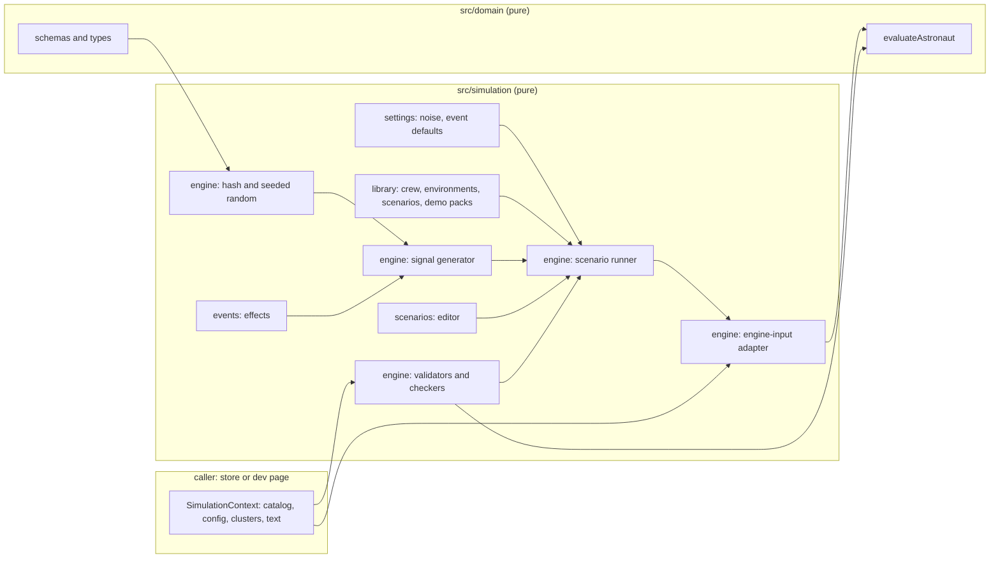
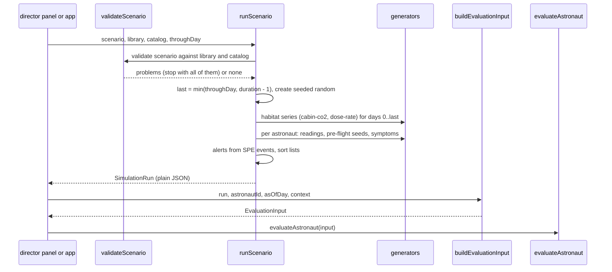

# Design Document: Simulation

## Overview

The simulation layer is the deterministic synthetic-data source of the Astronaut Health Companion. It lives in `src/simulation/`, is pure TypeScript (decision D4), and turns declarative data (scenarios, four crew profiles, three environment configs, an event library, a demo pack) into the exact records that `evaluateAstronaut` consumes: `Reading`, `SymptomReport`, `SafetyFlag`, `AlertReport`, pre-flight seeds, the career dose before the mission, and an `EnvironmentProfile`. It also provides the data the later director panel needs (run to day N, inject an event, switch environment or crew) and the data of the simulated ground link. It contains no UI and no health logic. Every tier, finding and cluster comes from `evaluateAstronaut`.

The design follows six rules:

1. **Everything tunable is data.** Noise levels, noise clip and spread, hazard weights, cabin CO₂ baselines, the solar particle event dose-rate multiple, default event lengths, event parameters (the shape of each effect), pre-flight sample counts, and the demo-pack segment lengths are values in data files, validated by Zod. The functions contain mechanisms only. Changing a number never means editing a function.
2. **Randomness is keyed, not sequential.** A value is a pure function of the Scenario_Seed and a Random_Key such as `[astronautId, indicatorId, 'noise', …]`. No generator state exists, so adding an event, scrubbing time, or switching crew cannot change a value that the change does not touch.
3. **Output is exactly what the engine reads.** The adapter fills `EvaluationInput` from a run and adds nothing. Generated data uses only catalog indicator ids, stays inside each indicator's `validRange`, and has at most one reading per astronaut, indicator and day, so `evaluateAstronaut` reports none of `unknown-indicator`, `duplicate-reading`, `value-out-of-range` or `invalid-input`.
4. **Nothing is invented.** Environment numbers come from `docs/PROJECT.md` sections 10 and 6.6 with flag C and empty `sources`. Values the document does not give (hazard weights, CO₂ baselines, the SPE multiple, noise levels, extra events) are recorded in "Assumptions and decisions to review" and stored as data marked as proposed defaults.
5. **Failures are values.** Bad data returns a `SimulationProblem` list. Nothing in the layer throws on caller data.
6. **The compiler, the schemas and the validators do the checking.** The project has no test runner (`.kiro/steering/tech.md`). "Verification Strategy (no test runner)" states what each mechanism covers and what it does not.

### Scope

In scope: `src/simulation/` (seeded random, signal generation, event library, environment configs, crew profiles, scenarios, scenario editor, runner, ground-link status, engine-input adapter, demo pack, validators, storyline check, quiet-run check, compile-time guards). Out of scope: UI, the director panel UI, the escalation summary and scripted reply, countermeasure content, new health thresholds, and any test runner, test script, test package or test file. `package.json` gains nothing.

### Research summary

- **Why no `Math.log`, `Math.cos` or `**`.** The ECMAScript specification lets engines return implementation-approximated results for the transcendental `Math` functions and for `Math.pow` and `**` ([ECMAScript Math object](https://tc39.es/ecma262/#sec-function-properties-of-the-math-object)). Requirement 2.3 asks for identical numbers on every engine, so Box–Muller (which needs `log` and `cos`) is not used. Only `Math.imul`, `>>>`, `^`, `+ - * /`, `Math.floor`, `Math.round`, `Math.abs`, `Math.min` and `Math.max` appear in generation code. These are exactly specified.
- **Hash.** The key hash folds the key text with a 32-bit FNV-1a step (xor, then multiply by the prime 16777619; [FNV hash](http://www.isthe.com/chongo/tech/comp/fnv/)) and finishes with the MurmurHash3 32-bit finaliser `fmix32` (multipliers `0x85ebca6b` and `0xc2b2ae35`; Austin Appleby, public domain, [smhasher](https://github.com/aappleby/smhasher)). The seed is mixed in with `fmix32` and the 32-bit constant `0x9e3779b9`. This is a statistical hash for demo data, not a cryptographic one.
- **Normal sample.** The sum of 12 independent uniform [0,1) numbers minus 6 has mean 0 and variance 1 and uses only addition ([Irwin–Hall distribution](https://en.wikipedia.org/wiki/Irwin%E2%80%93Hall_distribution)). It is truncated to ±clip by redrawing, with a fixed draw limit.
- **Paired noise.** Pairing each noise sample with an opposite-signed partner is the antithetic-variates idea from Monte Carlo methods ([antithetic variates](https://en.wikipedia.org/wiki/Antithetic_variates)). It keeps the sample mean of a window near the baseline and keeps the sample SD away from zero. This matters because the engine has no deviation floor for most indicators (domain decision TD-11) and uses a sample SD from as few as 2 readings (TD-18).
- **Engine facts the design depends on** (read from `src/domain/`): the replay starts at the earliest reading day; the baseline for day `d` uses only readings up to `d − 1`; seed values are used until the 14-day window holds 2 accepted readings; any orange or red tier freezes baselines and the readings of frozen days are never accepted; a zero difference is never a deviation; `classifications` are ordered by indicator id.
- Content was rephrased for compliance with licensing restrictions.

### Evidence used to choose the values (throwaway run, not part of the deliverable)

To choose noise levels, event sizes and seeds, I ran an uncommitted Node script against the real `evaluateAstronaut`, the shipped catalog and the shipped cluster definitions. It mirrors the formulas in this document. It is not a test, adds no dependency and is deleted. The numbers it produced are quoted below as "observed" and carry no guarantee in the repository. The repository mechanisms that reproduce the same checks are `checkQuietRun` and `checkStorylines` (see "Verification Strategy"). The key layouts, the formulas and the data values in this document are the ones the script used, so the observed results apply to an implementation that follows it exactly.

| Check | Observed result |
| ----- | --------------- |
| Quiet series (no events), 60 seeds × 3 environments × 4 crew = 720 runs, noise spread 0.2 | 0 runs had any non-green tier, 0 engine errors |
| Same sweep with spread 0.4 | 0 of 720 non-green. With the final ISS events, spread 0.4 gave two single-day yellows (`kofi` diastolic, `tomas` systolic) that spread 0.2 did not, so 0.2 is the default |
| Mars, seed 2026, crew `aria`, `kofi`, `mei` | `fatigue-stress` first raised on day 17 (`aria`), 17 (`kofi`), 16 (`mei`); `dose-rate` red on day 21 for all three; `mei` yellow or worse on `resting-hr` from day 16 with readings 60, 58, 63, 63 on days 18 to 21 |
| ISS, seed 7001, all four crew | `possible-co2-exposure` first raised for `aria` on day 25 and for nobody else; `exercise-adherence` orange from day 21 for all four; `cabin-co2` orange from day 23 for all four |
| Lunar, seed 4004, all four crew | `resting-hr` orange on days 3 and 7 for `aria` and `kofi` only; `dose-rate` red on day 9 for all four |
| ISS week 1 with stronger fluid-shift events (HR +1.5 bpm/day, systolic −2 mmHg/day, diastolic −1.5 mmHg/day) | Orange tiers, baseline freezes, and stray yellow and orange tiers on indicators that had no event (see SD-9). The final events are about a third of that size |

## Assumptions and decisions to review

### Minimal readings accepted by the user (carried from the requirements)

Each row is a team decision to review. The last column says where the value lives, so changing it never needs a code change.

| ID    | Reading | Lives in |
| ----- | ------- | -------- |
| MR-1  | ISS one-way delay is `null`. No default blackout window exists. Blackouts come only from `commsBlackout` events. | `environments/*.ts` (`groundLink`), scenario events |
| MR-2  | The profile dose rate is the midpoint of the environment's dose rate range (ISS 0.5, lunar 1.3, Mars 1.8 mSv/day). | `doseRateMsvPerDay` in `environments/*.ts` |
| MR-3  | Hazard weight 2 for each emphasised hazard and 1 for the others. | `hazardWeights` in `environments/*.ts` |
| MR-4  | Emphasised hazards: ISS `gravity-fields`, `hostile-closed-environment`; lunar `hostile-closed-environment`, `radiation`; Mars `isolation-confinement`, `radiation`, `distance-from-earth`. | `emphasisedHazards` |
| MR-5  | Emphasised checks and available countermeasures are not modelled. | Out of scope (later specs) |
| MR-6  | Cabin CO₂ habitat baselines are placeholders below the catalog orange limit of 5 mmHg. Values in SD-3. | `habitat['cabin-co2'].baseline` |
| MR-7  | Events use catalog indicator ids (`sleep-hours`, not `sleep`). | Scenario data |
| MR-8  | `moderate` is the only SPE severity. A missing `lengthDays` means 1 day. The dose-rate multiple is above 20. Value in SD-4. | `settings.events.solarParticleEvent` |
| MR-9  | Drift adds `perDay × (day − start + 1)` inside its window and nothing after it. A mood dip subtracts a constant `depth` inside its window. | Event parameters in scenario data; formulas in `events/effects.ts` |
| MR-10 | The athlete is the profile with `resting-hr` 48. Names are in SD-8. | `crew/*.ts` |
| MR-11 | ISS lasts 30 days. The Mars expectation is "by day 29", not "after day 21". Timing in SD-11. | Scenario data (`durationDays`, `byDay`) |
| MR-12 | Extra events exist only to meet the storyline expectations. They are listed in SD-6. | Scenario data |
| MR-13 | Weekly readings (`who5`, `exercise-adherence`) fall on days that are multiples of 7. No glucose reading is generated. | `periodDays` in crew Signal_Specs |
| MR-14 | The design chooses pre-flight sample count, noise standard deviations and the clip. Values in SD-1, SD-7 and "Crew data". | `settings.noise`, `crew/*.ts` |
| MR-15 | No safety flag, no poor-quality reading, no missing reading. | Fixed by the runner (empty `safetyFlags`, quality `good`) |
| MR-16 | No vision symptom is generated. Lunar dust irritation uses `sore-throat` and `other`. | Scenario data |
| MR-17 | One event kind `equipmentOutage` with `equipment: 'treadmill'`. | Event schema |
| MR-18 | The demo pack holds steps 2 to 7 and its target durations sum to at most 180 seconds. | `demo-packs/judges-demo.ts` |
| MR-19 | The seeded random source lives in `src/simulation/engine/`. | Folder layout |
| MR-20 | The simulation imports `src/domain` only. Catalog, config, clusters and text are parameters. | `SimulationContext` |
| MR-21 | The `.config.kiro` of this spec uses the supplied `specId`, which the domain-engine spec also uses. The team may want a unique id. | `.kiro/specs/simulation/.config.kiro` |

### Decisions added by the design (to review)

Where PROJECT.md and the requirements leave a choice open, the design chooses the conservative option and says so. Values that are not in PROJECT.md carry `valueSource: 'proposed-default'` in the data.

| ID    | Decision | Configurable at |
| ----- | -------- | --------------- |
| SD-1  | **Paired noise.** The noise sample of reading `k` of a series is `sign × (1 + spread × z / clip)`. Here `z` is a truncated normal sample in [−clip, +clip], `sign` is ±1, and samples `2j` and `2j+1` use the same `z` and opposite signs, in an order chosen by a keyed bit. The reading adds `noiseSd × sample`. Defaults: `clip` 1.5, `spread` 0.2 (allowed range up to 0.4). This is a refinement of Requirements 8.2 and 8.3: the noise term is still a standard-normal-derived sample times `noiseSd`, keyed by seed, astronaut, indicator and series position (a pair index instead of a bare day). It replaces a plain normal sample because a plain normal sample gives stray yellow tiers on indicators without a deviation floor (argument in Property 6). | `settings.noise` |
| SD-2  | **Normal sample** is the sum of 12 uniform draws minus 6, truncated by redrawing (at most `maxDraws` 16 attempts, then clamped). No transcendental function is used. | `settings.noise.maxDraws` |
| SD-3  | **Cabin CO₂ baselines** (mmHg, flag C, placeholders): ISS 2.5, lunar surface 1.5, Mars transit 2.0. PROJECT.md gives only "a few mmHg" for ISS. The values differ only so that the baseline is visibly per habitat. All are below the orange limit of 5. Noise `noiseSd` 0.15, 2 decimals. | `habitat['cabin-co2']` in `environments/*.ts` |
| SD-4  | **SPE dose-rate multiple** is 25 (proposed default, flag C). The requirement needs a value above 20 so the reading agrees with the red rule. 25 leaves a 25% margin over 20× after noise and rounding. The number is synthetic and is not a physical claim. Default SPE length: 1 day. | `settings.events.solarParticleEvent` |
| SD-5  | **Event shapes.** `drift` is a ramp that resets: `perDay × (day − start + 1)` inside the window and 0 after it (open-ended when `lengthDays` is absent). A one-day pulse is a `drift` with `lengthDays: 1`. `moodDip`, `co2Spike` and `eva` are constant steps inside their window. `equipmentOutage` and the SPE are multiplicative. All sizes and lengths are event parameters in scenario data. The three forms (ramp, step, factor) are formulas in code because each is one expression of its parameters. | Scenario data; defaults in `settings.events` |
| SD-6  | **Extra events** (Requirements 16.4, 17.2, 17.4, 18.2, 18.3). Mars: one crew-wide `drift` on `resting-hr` from day 14 (+2 bpm/day for 8 days). It is needed for the `resting-hr` member of `fatigue-stress` and for the athlete expectation. ISS: mild week-1 `drift` events on `resting-hr`, `bp-systolic`, `bp-diastolic`; `headache` symptoms on days 1 to 3 for `aria` and `kofi`; later a `headache` for `aria` on days 24 to 26 and a one-day `reaction-time` pulse of +100 ms on day 25 for `aria`. Lunar: two `eva` days, dust symptoms, the SPE. Full lists in "Scenario data". | `scenarios/**` |
| SD-7  | **Pre-flight samples:** 10 per indicator, an even number so that complete pairs give a seed mean equal to the baseline. | `preflightSamples` in `crew/*.ts` |
| SD-8  | **Crew.** `aria`, `kofi`, `mei` (the athlete, resting HR 48) and `tomas`. Names, baselines and career doses before the mission (aria 120, kofi 60, mei 30, tomas 200 mSv) are placeholders. The id `habitat` is reserved. | `crew/*.ts` |
| SD-9  | **Event hygiene.** Any orange or red tier freezes every baseline, and readings of frozen days are never accepted. Later windows can then be small and unbalanced, and noise alone can give a stray yellow or orange on an unrelated indicator. Events that are not the point of a storyline are therefore sized to stay green: the ISS week-1 events are about a third of the size that first gave chain freezes in the throwaway run. Events that are the point of a storyline (Mars sleep, mood and heart rate; the lunar EVA days; the ISS CO₂, reaction-time and treadmill events; the SPE) are meant to reach orange or red. | Scenario data |
| SD-10 | **Noise resolution rules** (validator, not engine): `noiseSd` must be at least 3 rounding steps when the indicator has deviation settings and no floor; for an indicator with a floor `f`, `2 × noiseSd × (1 + spread) + step < f`; `spread` is at most 0.4; the pre-flight sample count is even. | `validateCrewProfile`, `settings` schema |
| SD-11 | **Mars timing.** Expectations say "by day 29" and are checked as "at some evaluation from day 0 to day 29". The design predicts first detection around day 16 to 17, well before day 29 and before the SPE on day 21. PROJECT.md says the cluster comes after the SPE. The three Mars events given in PROJECT.md (sleep from day 6, mood day 14 to 18) cannot produce a cluster after day 22 because the mood member leaves the 5-day window. The design keeps the PROJECT.md events unchanged. The demo pack can show the SPE (day 21) and the cluster (day 17) in either order. | `byDay` in scenario expectations |
| SD-12 | **Expectation scopes.** Requirement 21.1 names one astronaut per expectation, but 16.5, 16.7, 17.5 and 18.5 say "at least one" and "each". The expectation therefore carries a `scope`: one named astronaut, any crew member, or every crew member. | `StorylineExpectation.scope` |
| SD-13 | **Extra problem codes** beyond Requirement 20: `reserved-id`, `noise-resolution`, `preflight-count-odd`, `career-dose-headroom`, `environment-dose-order`, and the run-based `quiet-run-tier` check. All are plain data in the problem list. | `SimulationProblemCodeSchema` |
| SD-14 | **No static rule for the cognitive-dip pulse.** A pulse too weak to reach 125% of the baseline mean is caught by `checkStorylines`, not by a static rule, because the dip depends on the baseline mean in force that day. | `checkStorylines` |
| SD-15 | **Scenario seeds.** Mars 2026 (from PROJECT.md section 11.2). ISS 7001 and lunar 4004 are placeholders chosen because the quiet and storyline runs behaved as expected. Changing a seed means re-running the checks. | `seed` in scenario files |
| SD-16 | **Ids.** ISS scenario `iss-early-adaptation-30d`, lunar scenario `lunar-dust-eva-14d`, demo pack `judges-3min`. | Scenario and pack data |
| SD-17 | **Data placement.** Domain data (catalog, engine config, clusters, finding text) stays in `src/data/` as in the domain-engine design. Simulation data (crew, environments, events, scenarios, demo pack, settings) lives in `src/simulation/` as PROJECT.md section 11.1 and decision D9 say. The domain never imports from `src/data/`, and the simulation does not either. | Folder layout |

## Architecture

### Layers and dependency direction

`src/simulation/` imports only Zod, `@/domain/...` and itself. The caller (a later store or dev page) imports the shipped catalog, config, clusters and text from `src/data/` and passes them in as one `SimulationContext`. This keeps Requirement 1.2 true without relying on lint, because `eslint.rules.mjs` forbids React, Next and the UI layers inside `src/simulation` but does not forbid `src/data`.



### Run flow



### Folder layout

The six groups of PROJECT.md section 11.1 are kept. Shared types and guards sit at the top, as in `src/domain/`.

```
src/simulation/
├── types.ts                    # types inferred from the schemas (re-exports)
├── type-guards.ts              # Equal<> / Expect<> assertions only (types, no runtime code)
├── library.ts                  # defaultLibrary and defaultSettings assembled from the data files
├── engine/
│   ├── problem.ts              # SimulationProblem schema, codes, helper
│   ├── settings-schema.ts      # SimulationSettings schema (noise, event defaults)
│   ├── signal-spec-schema.ts   # SignalSpec schema
│   ├── run-schema.ts           # SimulationRun, AstronautRun, GroundLinkStatus schemas
│   ├── settings.ts             # defaultSettings (data)
│   ├── hash.ts                 # fmix32, FNV fold, keyed hash
│   ├── seeded-random.ts        # createSeededRandom: uniform, truncatedNormal
│   ├── noise.ts                # paired noise sample
│   ├── generate-reading.ts     # baseline + effects + noise, bounds, rounding
│   ├── pre-flight.ts           # seed samples
│   ├── run-scenario.ts         # Scenario_Runner
│   ├── ground-link.ts          # Ground_Link_Status
│   ├── engine-input.ts         # Engine_Input_Adapter
│   ├── validate-scenario.ts
│   ├── validate-crew.ts
│   ├── validate-environment.ts
│   ├── validate-demo-pack.ts
│   ├── validate-library.ts
│   ├── check-storylines.ts     # Storyline_Checker
│   └── check-quiet-run.ts      # noise-only run check (SD-13)
├── crew/                       # crew-schema.ts, signal-shapes.ts, aria.ts, kofi.ts, mei.ts, tomas.ts, index.ts
├── environments/               # environment-schema.ts, iss.ts, lunar-surface.ts, mars-transit.ts, profile.ts, index.ts
├── events/                     # event-schemas.ts, effects.ts, canonical-order.ts
├── scenarios/                  # scenario-schema.ts, editor.ts
│   ├── iss/                    # iss-early-adaptation-30d.ts
│   ├── lunar/                  # lunar-dust-eva-14d.ts
│   └── mars/                   # mars-transit-30d.ts
└── demo-packs/                 # demo-pack-schema.ts, judges-demo.ts
```

The `.gitkeep` of each folder is deleted when its first real file is added. No file under `src/` is a test file.

## Components and Interfaces

All functions are pure. All input and output types use `readonly` fields and arrays. Types come from the schemas in "Data Models". `Result` is the existing type from `@/domain/result`.

### Context and library

```ts
/** What the caller passes in. The fields match EvaluationInput, so the adapter copies them unchanged. */
export type SimulationContext = Pick<
  EvaluationInput,
  'catalog' | 'clusters' | 'config' | 'text'
>;

export interface SimulationLibrary {
  readonly settings: SimulationSettings;
  readonly crew: readonly CrewProfile[];
  readonly environments: readonly EnvironmentConfig[];
  readonly scenarios: readonly Scenario[];
  readonly demoPacks: readonly DemoPack[];
}
```

### Seeded random (`engine/hash.ts`, `engine/seeded-random.ts`)

```ts
export type RandomKey = readonly (string | number)[];

export interface SeededRandom {
  /** [0, 1). `stream` selects one of many independent numbers for the same key. */
  readonly uniform: (key: RandomKey, stream: number) => number;
  /** Standard normal, truncated to [-clip, +clip]. */
  readonly truncatedNormal: (key: RandomKey) => number;
}

export function createSeededRandom(
  seed: number,
  noise: Pick<NoiseSettings, 'clip' | 'maxDraws'>,
): Result<SeededRandom, readonly SimulationProblem[]>;
```

`createSeededRandom` is where Requirements 2.7 and 2.8 are enforced. A seed that is not a safe integer gives a problem with field `seed`. A clip that is not a positive finite number gives a problem with field `noiseClip`. After creation, `uniform` and `truncatedNormal` are total functions. The returned object closes over two immutable numbers and nothing else.

**Algorithm** (all steps use 32-bit integer operations or IEEE 754 `+ - * /` only):

```ts
function fmix32(input: number): number {
  let h = input >>> 0;
  h ^= h >>> 16;
  h = Math.imul(h, 0x85ebca6b);
  h ^= h >>> 13;
  h = Math.imul(h, 0xc2b2ae35);
  h ^= h >>> 16;
  return h >>> 0;
}

// Each part becomes `<len>:<tag><text>`. The length prefix makes the encoding injective (Requirement 2.6):
// ['ab', 'c'] and ['a', 'bc'] give different strings.
function encodeKey(key: RandomKey): string {
  return key
    .map((part) => {
      const tagged = typeof part === 'number' ? `i${part}` : `s${part}`;
      return `${tagged.length}:${tagged}`;
    })
    .join('');
}

function hashKey(seed: number, key: RandomKey): number {
  const low = seed >>> 0;
  const high = Math.floor(seed / 4294967296) >>> 0; // division by 2^32 is exact
  let h = fmix32((low ^ fmix32((high + 0x9e3779b9) >>> 0)) >>> 0);
  const text = encodeKey(key);
  for (let i = 0; i < text.length; i += 1) {
    h = Math.imul((h ^ text.charCodeAt(i)) >>> 0, 16777619) >>> 0; // FNV-1a step over UTF-16 code units
  }
  return fmix32(h);
}

// uniform(key, stream) = hashKey(seed, [...key, 'u', stream]) / 4294967296   -> in [0, 1)
```

`truncatedNormal(key)` makes up to `maxDraws` attempts. Attempt `a` sums the 12 uniforms `uniform(key, 12·a + i)` for `i = 0..11` and subtracts 6. The first sample with absolute value at most `clip` is returned. If every attempt is rejected, the last sample is clamped to ±clip. With `clip` 1.5 the rejection chance per attempt is about 13%, so the clamp path is practically unreachable but is defined. Because every number is derived from the seed and the key alone, no sequence position exists (Requirement 2.5).

Integers in keys (days, pair indexes, stream numbers) are always whole numbers, so `String(n)` is exact on every engine. Key parts are built only from validated ids and integers.

### Noise (`engine/noise.ts`)

```ts
/**
 * Noise sample for position `index` of a series (SD-1). Positions 2j and 2j+1 form a pair: they share
 * one amplitude and have opposite signs. The order inside a pair comes from a keyed bit.
 * The result is in [-(1 + spread), -(1 - spread)] or [(1 - spread), (1 + spread)].
 */
export function pairedNoiseSample(
  random: SeededRandom,
  key: RandomKey,
  index: number,
  noise: Pick<NoiseSettings, 'clip' | 'spread'>,
): number {
  const pair = Math.floor(index / 2);
  const firstSign = random.uniform([...key, 'order', pair], 0) < 0.5 ? 1 : -1;
  const sign = index % 2 === 0 ? firstSign : -firstSign;
  const z = random.truncatedNormal([...key, 'amp', pair]);
  return sign * (1 + (noise.spread * z) / noise.clip);
}
```

**Key layouts** (a fixed part of the design, because the observed results depend on them):

| Series | Key passed to `pairedNoiseSample` | `index` |
| ------ | --------------------------------- | ------- |
| In-flight astronaut reading | `[astronautId, indicatorId, 'noise']` | `day / periodDays` |
| Pre-flight astronaut sample | `[astronautId, indicatorId, 'pre-flight']` | sample number `0..n−1` |
| In-flight habitat reading (`cabin-co2`, `dose-rate`) | `['habitat', indicatorId]` | `day` (period 1) |
| Pre-flight habitat sample | `['habitat', indicatorId, 'pre-flight']` | sample number |

The id `habitat` is reserved so that no astronaut key can equal a habitat key.

### Signal generation (`engine/generate-reading.ts`, `engine/pre-flight.ts`)

```ts
export interface EffectTotals { readonly additive: number; readonly multiplicative: number }

/**
 * value = clamp( (baseline + additive + noiseSd * noiseSample) * multiplicative ), then round to `decimals`.
 * Requirement 8.2 order: baseline, additive effects, noise, multiplicative effects, bounds, rounding.
 */
export function composeReading(
  spec: SignalSpec,
  effects: EffectTotals,
  noiseSample: number,
): number;
```

Rounding is `Math.round(v * f) / f` with `f` read from the constant table `[1, 10, 100, 1000, 10000, 100000, 1000000]` indexed by `decimals`. The table avoids `Math.pow` and `**`. Bounds apply only where a bound is present. A reading is produced for day `d` when `d % periodDays === 0` and `d ≤ last`. Quality is always `good`. `fasting-glucose` has no Signal_Spec and so never produces a reading (Requirements 7.5, 8.10).

Pre-flight samples: sample `i` is `composeReading(spec, { additive: 0, multiplicative: 1 }, pairedNoiseSample(...))` with the pre-flight key. With an even sample count, the sample mean equals the baseline apart from rounding. Habitat seeds come from the environment's habitat Signal_Specs and are the same for every astronaut (Requirement 8.7).

### Event library (`events/`)

```ts
export const EVENT_KINDS = [
  'drift', 'moodDip', 'solarParticleEvent', 'co2Spike',
  'eva', 'equipmentOutage', 'symptom', 'commsBlackout',
] as const satisfies readonly EventKind[];

/** What one event does to one reading target. Neutral values (0 and 1) mean "no effect". */
export interface EffectTarget {
  readonly astronautId: string | null; // null for habitat series
  readonly indicatorId: string;
  readonly day: number;
}

export interface EffectRule<E extends ScenarioEvent> {
  readonly additive: (event: E, target: EffectTarget) => number;
  readonly multiplicative: (event: E, target: EffectTarget, settings: EventSettings) => number;
  readonly symptoms: (event: E, astronautId: string, day: number, settings: EventSettings) => readonly SymptomKind[];
  readonly alerts: (event: E, settings: EventSettings, lastDay: number) => readonly AlertReport[];
  readonly blackoutOn: (event: E, day: number) => boolean;
}

export const EFFECT_RULES = {
  drift: driftRule,
  moodDip: moodDipRule,
  solarParticleEvent: solarParticleEventRule,
  co2Spike: co2SpikeRule,
  eva: evaRule,
  equipmentOutage: equipmentOutageRule,
  symptom: symptomRule,
  commsBlackout: commsBlackoutRule,
} satisfies { readonly [K in EventKind]: EffectRule<Extract<ScenarioEvent, { type: K }>> };
```

Because `EFFECT_RULES` is keyed by the full union, adding an event kind fails `npm run typecheck` until a rule exists (Requirement 9.12). The dispatch function over `event.type` ends with a `never` check.

Effect formulas (day `d`, event day `D`, window `[D, D + L)`; an absent `L` on `drift` is open-ended; `L` defaults come from `settings.events`):

| Kind | Effect on a reading |
| ---- | ------------------- |
| `drift` | additive `perDay × (d − D + 1)` on the named indicator inside the window, for the listed astronauts or the whole crew; for a habitat indicator, on the shared series |
| `moodDip` | additive `−depth` on `mood` inside the window |
| `co2Spike` | additive `+deltaMmHg` on `cabin-co2` inside the window (whole crew, shared series) |
| `eva` | additive `+heartRateDeltaBpm` on `resting-hr` of each listed astronaut inside the window |
| `equipmentOutage` | multiplicative `1 − reductionFraction` on `exercise-adherence` readings inside the window (treadmill) |
| `solarParticleEvent` | multiplicative `settings.events.solarParticleEvent.doseRateMultiple[severity]` on `dose-rate` inside the window (default length from settings); one `AlertReport` |
| `symptom` | one `SymptomReport` per affected astronaut and day inside the window (default length from settings) |
| `commsBlackout` | no reading effect; the ground link is unavailable inside the window |

An effect applies only where the affected astronaut has a Signal_Spec for the indicator, or where the indicator is a habitat indicator (Requirement 10.9).

**Order independence (Requirement 10.7).** `canonical-order.ts` sorts a copy of the event list by day, then type, then a canonical string of the event (JSON with keys in sorted order). Additive effects are summed and multiplicative effects multiplied in that order, so the floating-point result does not depend on the order of the scenario list.

### Environments and ground link

```ts
/** Midpoint of the dose rate range; hazard weights pass through. Result parses with EnvironmentProfileSchema. */
export function toEnvironmentProfile(env: EnvironmentConfig): EnvironmentProfile;

export interface GroundLinkStatus {
  readonly available: boolean;
  /** The environment's one-way delay range in seconds, or null where PROJECT.md gives no figure. */
  readonly oneWayDelaySeconds: { readonly min: number; readonly max: number } | null;
}
export function groundLinkStatus(
  env: EnvironmentConfig,
  events: readonly ScenarioEvent[],
  day: number,
): GroundLinkStatus;
```

`available` is false exactly when some `commsBlackout` event covers `day`. Queuing, the scripted reply and the summary belong to the alerts-escalation spec (Requirement 6.9).

### Scenario runner (`engine/run-scenario.ts`)

```ts
export function runScenario(
  scenario: Scenario,
  library: SimulationLibrary,
  catalog: Catalog,
  throughDay: number,
): Result<SimulationRun, readonly SimulationProblem[]>;
```

Steps: validate the scenario with `validateScenario` and return every problem found (Requirement 13.7); check `throughDay` is a whole number of at least 0 (problem field `throughDay`, Requirement 13.8); set `last = min(throughDay, durationDays − 1)`; create the seeded random; build the shared habitat series for days `0..last`; for each astronaut build readings, symptoms and seeds; build the alerts; sort. The runner keeps no state.

**Radiation outputs** (Requirement 11):

- `dose-rate` reading on day `d` is generated like any habitat reading: `(background + additive + noiseSd × noise) × multiplicative`, where `background` is the Signal_Spec baseline (the midpoint). An SPE multiplies the whole value by the multiple.
- `career-effective-dose` on day `d` is `Σ dose-rate(0..d) + background × (durationDays − 1 − d)`, rounded to 3 decimals. It does not include the career dose before the mission, because the engine subtracts that itself. It depends on days up to `d` only, so an event on a later day does not change an earlier reading.
- Each `solarParticleEvent` with `D ≤ last` adds one `AlertReport { kind: 'solar-particle-event', startDay: D, endDay: min(last, D + L − 1) }`.
- `safetyFlags` is always empty (Requirement 12.3). Symptom reports are de-duplicated per astronaut, kind and day.

**Sorting (Requirement 13.5).** The astronaut list is sorted by id. Each astronaut's readings are sorted by day, then indicator id. Symptom reports are sorted by day, then kind. Alerts by start day, then end day.

**Prefix property (Requirement 13.6).** No value depends on `throughDay`. `throughDay` only chooses how many days are produced, and the only quantity that depends on it, the alert `endDay`, is clamped to `last`. So the run for `N ≤ M` equals the run for `M` cut at `N`.

### Scenario editor (`scenarios/editor.ts`)

```ts
export function injectEvent(scenario: Scenario, event: ScenarioEvent, library: SimulationLibrary, catalog: Catalog): Result<Scenario, readonly SimulationProblem[]>;
export function switchEnvironment(scenario: Scenario, environmentId: string, library: SimulationLibrary, catalog: Catalog): Result<Scenario, readonly SimulationProblem[]>;
export function switchCrew(scenario: Scenario, astronautIds: readonly string[], library: SimulationLibrary, catalog: Catalog): Result<Scenario, readonly SimulationProblem[]>;
```

Each builds a new scenario (spread, never mutation), then returns it only if `validateScenario` finds no problem; otherwise it returns all problems and no scenario (Requirement 14.5). Because the randomness is keyed, the director panel scrubs, injects and switches by calling `runScenario` again.

### Engine-input adapter (`engine/engine-input.ts`)

```ts
export function buildEvaluationInput(
  run: SimulationRun,
  astronautId: string,
  asOfDay: number,
  context: SimulationContext,
): Result<EvaluationInput, SimulationProblem>;
```

The adapter returns `{ astronautId, asOfDay, seeds, readings, symptoms, safetyFlags, alerts, careerDoseBeforeMissionMsv, environment, ...context }` from the named astronaut's record and the run's shared fields. `startDay` is omitted, so the engine starts at the earliest reading day. A missing astronaut gives a problem with field `astronautId`. An `asOfDay` after the run's last day gives a problem with field `asOfDay`. It contains no tier, threshold, cluster or confidence logic.

### Validators (`engine/validate-*.ts`)

Each validator takes the data to check, the library where cross-references are needed, the `Catalog` and the `EngineConfig` (and, for `validateScenario` and `validateLibrary`, the cluster definitions, to check cluster ids in expectations), returns `readonly SimulationProblem[]`, never throws, and returns an empty list when nothing is wrong. Each starts with a Zod `safeParse` and turns every issue into a problem (field = dotted issue path), then runs the consistency checks on entries that parsed. No check reports an empty `sources` array (Requirement 20.8).

| Validator | Problems reported (in addition to schema failures) |
| --------- | ---------------------------------------------------- |
| `validateScenario` | duplicate scenario id; unknown environment id; unknown or duplicate crew id; event dated at or after `durationDays`; unknown indicator id in an event; astronaut id on an event that is not in the crew; astronaut list on an event that targets a habitat indicator; event on an indicator for which an affected astronaut has no Signal_Spec; expectation naming an unknown astronaut, cluster (checked against the cluster ids passed in) or indicator |
| `validateCrewProfile` | indicator id not in the catalog; `periodDays` differs from the catalog `periodDays`; `bounds` differ from the catalog `validRange`; `preflightSamples` below `config.baseline.minSeedReadings`; baseline range (baseline ± `clip × noiseSd`) that satisfies a hard limit of the indicator; `noise-resolution` (SD-10); `preflight-count-odd`; `reserved-id` |
| `validateEnvironmentConfig` | dose rate low above high; delay minimum above maximum; missing hazard weight; emphasised hazard whose weight is not above every other weight; `dose-rate` baseline different from the midpoint; `cabin-co2` baseline that satisfies a hard limit of `cabin-co2` |
| `validateDemoPack` | target durations summing to more than 180 s; unknown scenario id; day outside the scenario duration; first day after last day; focus astronaut not in the scenario crew; plan steps not ascending |
| `validateLibrary` | the above for every entry; crew count other than 4; duplicate crew id; duplicate `resting-hr` baseline; no profile with `resting-hr` 48; `environment-dose-order` (ISS below lunar below Mars, Requirement 5.4); `career-dose-headroom` (for every crew profile and environment, `careerDose + maxProjected` stays below `0.8 × (careerLimit − careerDose)`, where `maxProjected` is the projected dose with the SPE multiple on one day) |

The `noise-resolution` rule (SD-10) reads the catalog `deviation` settings of each indicator: no deviation settings gives no rule; `minAbsoluteChange: null` requires `noiseSd ≥ 3 × 10^−decimals`; a numeric floor `f` requires `2 × noiseSd × (1 + spread) + 10^−decimals < f`. The `baseline range` check keeps the requirement's `clip × noiseSd` wording. That is wider than the real maximum noise of `(1 + spread) × noiseSd`, so it is the conservative choice.

### Storyline check and quiet-run check

```ts
export function checkStorylines(
  scenario: Scenario,
  library: SimulationLibrary,
  context: SimulationContext,
): readonly SimulationProblem[];

export function checkQuietRun(
  scenario: Scenario,
  library: SimulationLibrary,
  context: SimulationContext,
): readonly SimulationProblem[];
```

`checkStorylines` runs the scenario once through its largest expectation day, then for each expectation and each astronaut in its scope evaluates with `evaluateAstronaut` as of each day `0..byDay`. A cluster expectation holds when some evaluation has a finding of kind `cluster` with the stated id. An indicator expectation holds when some evaluation classifies the indicator at the minimum tier or worse. With `withinEarthReference`, only evaluations whose reading is on that day and inside the catalog `earthReference` range (inclusive, a missing bound is unbounded) count. The indicator is found by position, because `classifications` are ordered by indicator id and a `no-data` entry carries no id. Scope `any-crew-member` needs one astronaut to hold; `every-crew-member` needs all. An unmet expectation gives `expectation-unmet` naming the scenario, the astronaut scope and the expectation. Any engine `errors` entry gives `engine-error` quoting it. The checker holds no tier, threshold or cluster logic.

`checkQuietRun` copies the scenario with no events and no expectations, runs it through its last day, evaluates every astronaut as of the last day, and reports `quiet-run-tier` for any indicator that is not green on any replayed day (indicator, astronaut, day in the message) and `engine-error` for any engine error. It proves that noise alone, with this seed, crew and environment, produces no tier. It is the repository's check for SD-1.

Both functions are plain and are meant to be called from a dev page or a load-time check. They are not part of `npm run check`.

## Data Models

Each type is `z.infer` of its schema (Requirement 3.1). Objects use `z.strictObject`. No schema uses `transform`, `preprocess` or `catch`, so a parsed value equals its input. The existing domain schemas (`ReadingSchema`, `SymptomReportSchema`, `SafetyFlagSchema`, `AlertReportSchema`, `EnvironmentProfileSchema`, `HazardSchema`, `SymptomKindSchema`, `MissionDaySchema`, `SourceReferenceSchema`) are reused, not copied.

### Settings, signal spec, problem

```ts
export const NoiseSettingsSchema = z.strictObject({
  clip: z.number().positive(),
  spread: z.number().gt(0).max(0.4),               // SD-10: (1 + spread) / (1 - spread) must stay below 2.83
  maxDraws: z.int().min(1),
});

export const EventSettingsSchema = z.strictObject({
  solarParticleEvent: z.strictObject({
    defaultLengthDays: z.int().min(1),
    doseRateMultiple: z.strictObject({ moderate: z.number().gt(20) }),   // Requirement 11.2
    valueSource: z.literal('proposed-default'),
    verification: z.literal('C'),
  }),
  symptom: z.strictObject({ defaultLengthDays: z.int().min(1) }),
});
export const SimulationSettingsSchema = z.strictObject({ noise: NoiseSettingsSchema, events: EventSettingsSchema });

export const SignalSpecSchema = z.strictObject({
  baseline: z.number(),
  noiseSd: z.number().min(0),
  decimals: z.int().min(0).max(6),
  periodDays: z.int().min(1),
  bounds: z.strictObject({ min: z.number().optional(), max: z.number().optional() }).optional(),
});

export const SimulationProblemCodeSchema = z.enum([
  'schema', 'invalid-argument', 'engine-error', 'expectation-unmet', 'quiet-run-tier',
  'duplicate-id', 'reserved-id', 'unknown-environment', 'unknown-crew', 'duplicate-crew',
  'event-out-of-range', 'unknown-indicator', 'astronaut-not-in-crew', 'astronaut-list-on-habitat-event',
  'event-without-signal-spec', 'unknown-expectation-target',
  'period-mismatch', 'bounds-mismatch', 'too-few-preflight-samples', 'preflight-count-odd',
  'baseline-range-hits-limit', 'noise-resolution', 'career-dose-headroom',
  'dose-range-order', 'delay-range-order', 'missing-hazard-weight', 'emphasis-weight',
  'dose-baseline-midpoint', 'co2-baseline-hits-limit', 'environment-dose-order',
  'crew-count', 'duplicate-baseline', 'athlete-missing',
  'demo-duration', 'demo-unknown-scenario', 'demo-day-range', 'demo-day-order',
  'demo-focus-not-in-crew', 'demo-step-order',
]);

export const SimulationProblemSchema = z.strictObject({
  code: SimulationProblemCodeSchema,
  entryKind: z.enum(['scenario', 'crew', 'environment', 'demo-pack', 'library', 'settings', 'run']),
  entryId: z.string().min(1),
  field: z.string(),
  message: z.string().min(1),
});
```

Every field of a problem is a string, so a problem list round-trips through JSON unchanged (Requirement 20.2). A display function over `code` ends with a `never` check, so a new code forces every consumer to handle it.

Shipped settings (`engine/settings.ts`): `noise { clip: 1.5, spread: 0.2, maxDraws: 16 }`; `events.solarParticleEvent { defaultLengthDays: 1, doseRateMultiple { moderate: 25 }, valueSource 'proposed-default', verification 'C' }`; `events.symptom { defaultLengthDays: 1 }`.

### Crew profile

```ts
export const AstronautIndicatorIdSchema = z.enum([
  'resting-hr', 'bp-systolic', 'bp-diastolic', 'body-temperature', 'spo2', 'sleep-hours',
  'mood', 'who5', 'reaction-time', 'body-mass-change-30d', 'energy-intake', 'exercise-adherence',
]);                                                                   // no 'fasting-glucose' (Requirement 7.5)

export const CrewProfileSchema = z.strictObject({
  id: z.string().min(1),
  label: z.string().min(1),
  synthetic: z.literal(true),
  baselineStatus: z.literal('placeholder'),                           // Requirement 7.9
  careerDoseBeforeMissionMsv: z.number().min(0),
  preflightSamples: z.int().min(2),
  signals: z.record(AstronautIndicatorIdSchema, SignalSpecSchema),    // Zod 4: all 12 keys required
});
```

**Signal shapes shared by all crew** (`crew/signal-shapes.ts`). Each crew file supplies only baselines and calls `withShapes(baselines)`. `bounds` equal the catalog `validRange` where one exists (`mood`, `who5`). SpO₂ has a scale cap of 100 that is a unit limit, not a threshold.

| Indicator | `noiseSd` | `decimals` | `periodDays` | `bounds` | Why this noise (SD-10) |
| --------- | --------- | ---------- | ------------ | -------- | ----------------------- |
| `resting-hr` | 1.5 | 0 | 1 | none | has a floor of 5 bpm: `2 × 1.5 × 1.2 + 1 = 4.6 < 5` |
| `bp-systolic` | 3 | 0 | 1 | none | no floor: `3 ≥ 3 × 1` |
| `bp-diastolic` | 3 | 0 | 1 | none | no floor: `3 ≥ 3 × 1` |
| `body-temperature` | 0.3 | 1 | 1 | none | no floor: `0.3 ≥ 3 × 0.1` |
| `spo2` | 1 | 0 | 1 | max 100 | no deviation settings |
| `sleep-hours` | 0.3 | 1 | 1 | none | no floor: `0.3 ≥ 3 × 0.1` |
| `mood` | 0.4 | 1 | 1 | 1 to 5 | no floor: `0.4 ≥ 0.3` |
| `who5` | 6 | 0 | 7 | 0 to 100 | no deviation settings |
| `reaction-time` | 15 | 0 | 1 | none | no floor: `15 ≥ 3` |
| `body-mass-change-30d` | 0.3 | 1 | 1 | none | no floor: `0.3 ≥ 0.3` |
| `energy-intake` | 3 | 0 | 1 | none | no floor: `3 ≥ 3` |
| `exercise-adherence` | 5 | 0 | 7 | none | no deviation settings |

**Crew data** (all placeholders, `synthetic: true`; `preflightSamples` 10 for all):

| Indicator | `aria` | `kofi` | `mei` (athlete) | `tomas` |
| --------- | ------ | ------ | --------------- | ------- |
| `resting-hr` (bpm) | 68 | 74 | **48** | 62 |
| `bp-systolic` (mmHg) | 112 | 118 | 108 | 116 |
| `bp-diastolic` (mmHg) | 72 | 76 | 68 | 74 |
| `body-temperature` (°C) | 36.6 | 36.7 | 36.4 | 36.6 |
| `spo2` (%) | 98 | 97 | 99 | 98 |
| `sleep-hours` (h) | 7.4 | 7.6 | 7.8 | 7.2 |
| `mood` (1 to 5) | 3.8 | 4.0 | 4.2 | 3.6 |
| `who5` | 72 | 76 | 80 | 70 |
| `reaction-time` (ms) | 300 | 290 | 280 | 310 |
| `body-mass-change-30d` (% loss) | 0.5 | 0.5 | 0.5 | 0.5 |
| `energy-intake` (% of plan) | 95 | 96 | 97 | 94 |
| `exercise-adherence` (% of target) | 90 | 92 | 95 | 88 |
| `careerDoseBeforeMissionMsv` | 120 | 60 | 30 | 200 |

The athlete's `resting-hr` of 48 with noise of at most ±1.8 stays above the catalog orange limit of 45. A reading of 62 is inside the Earth reference of 60 to 100 but is 14 bpm above the athlete's baseline, which is what the demo shows.

### Environment config

```ts
export const EnvironmentConfigSchema = z.strictObject({
  id: z.string().min(1),
  label: z.string().min(1),
  gravityG: z.number().min(0),
  doseRateMsvPerDay: z.strictObject({ low: z.number().min(0), high: z.number().min(0) }),
  evacuation: z.enum(['hours-to-days', 'days', 'not-possible']),
  groundLink: z.strictObject({
    oneWayDelaySeconds: z.strictObject({ min: z.number().min(0), max: z.number().min(0) }).nullable(),
    blackoutRules: z.array(z.enum(['signal-gaps', 'conjunction'])),
  }),
  emphasisedHazards: z.array(HazardSchema),
  hazardWeights: z.record(HazardSchema, z.number().min(0)),            // all five required
  hazardWeightSource: z.literal('proposed-default'),                    // Requirement 4.4
  habitat: z.strictObject({ 'cabin-co2': SignalSpecSchema, 'dose-rate': SignalSpecSchema }),
  verification: z.literal('C'),                                          // Requirement 4.3
  status: z.literal('unverified-draft'),
  sources: z.array(SourceReferenceSchema).length(0),                     // empty, Requirement 4.3
});
```

Order checks that a schema cannot express (low above high, minimum above maximum) are in `validateEnvironmentConfig`.

| Field | `iss` | `lunar-surface` | `mars-transit` |
| ----- | ----- | --------------- | -------------- |
| `gravityG` | 0 | 0.16 | 0 |
| `doseRateMsvPerDay` | 0.3 to 0.7 | 1.3 to 1.3 | 1.8 to 1.8 |
| `evacuation` | `hours-to-days` | `days` | `not-possible` |
| `oneWayDelaySeconds` | `null` | 1.3 to 1.3 | 180 to 1320 |
| `blackoutRules` | `signal-gaps` | none | `conjunction` |
| `emphasisedHazards` | `gravity-fields`, `hostile-closed-environment` | `hostile-closed-environment`, `radiation` | `isolation-confinement`, `radiation`, `distance-from-earth` |
| `hazardWeights` | gravity 2, hostile 2, others 1 | hostile 2, radiation 2, others 1 | isolation 2, radiation 2, distance 2, others 1 |
| habitat `dose-rate` baseline (midpoint), `noiseSd`, `decimals` | 0.5, 0.015, 3 | 1.3, 0.04, 3 | 1.8, 0.05, 3 |
| habitat `cabin-co2` baseline, `noiseSd`, `decimals` | 2.5, 0.15, 2 (SD-3) | 1.5, 0.15, 2 | 2.0, 0.15, 2 |

Every numeric value carries a comment citing PROJECT.md section 10 or 6.6 (Requirement 5.7), or "proposed default". Habitat Signal_Specs use `periodDays` 1 and `bounds.min` 0 for `cabin-co2`. Each file ends `satisfies EnvironmentConfig` (Requirement 4.8).

### Events and scenarios

```ts
const AstronautListSchema = z.array(z.string().min(1)).min(1);
const base = { day: MissionDaySchema };

export const ScenarioEventSchema = z.discriminatedUnion('type', [
  z.strictObject({ type: z.literal('drift'), ...base, indicator: z.string().min(1), perDay: z.number(),
    lengthDays: z.int().min(1).optional(), astronauts: AstronautListSchema.optional() }),
  z.strictObject({ type: z.literal('moodDip'), ...base, depth: z.number().gt(0), lengthDays: z.int().min(1),
    astronauts: AstronautListSchema.optional() }),
  z.strictObject({ type: z.literal('solarParticleEvent'), ...base, severity: z.enum(['moderate']),
    lengthDays: z.int().min(1).optional() }),
  z.strictObject({ type: z.literal('co2Spike'), ...base, deltaMmHg: z.number().gt(0), lengthDays: z.int().min(1) }),
  z.strictObject({ type: z.literal('eva'), ...base, heartRateDeltaBpm: z.number().gt(0), lengthDays: z.int().min(1),
    astronauts: AstronautListSchema }),
  z.strictObject({ type: z.literal('equipmentOutage'), ...base, equipment: z.enum(['treadmill']),
    reductionFraction: z.number().gt(0).max(1), lengthDays: z.int().min(1), astronauts: AstronautListSchema.optional() }),
  z.strictObject({ type: z.literal('symptom'), ...base, kind: SymptomKindSchema,
    lengthDays: z.int().min(1).optional(), astronauts: AstronautListSchema.optional() }),
  z.strictObject({ type: z.literal('commsBlackout'), ...base, lengthDays: z.int().min(1) }),
]);

export const ExpectationScopeSchema = z.discriminatedUnion('who', [
  z.strictObject({ who: z.literal('astronaut'), astronautId: z.string().min(1) }),
  z.strictObject({ who: z.literal('any-crew-member') }),
  z.strictObject({ who: z.literal('every-crew-member') }),
]);

export const StorylineExpectationSchema = z.discriminatedUnion('form', [
  z.strictObject({ form: z.literal('cluster'), scope: ExpectationScopeSchema, clusterId: z.string().min(1), byDay: MissionDaySchema }),
  z.strictObject({ form: z.literal('indicator'), scope: ExpectationScopeSchema, indicatorId: z.string().min(1),
    minTier: FindingTierSchema, withinEarthReference: z.boolean().optional(), byDay: MissionDaySchema }),
]);

export const ScenarioSchema = z.strictObject({
  id: z.string().min(1), label: z.string().min(1), environmentId: z.string().min(1),
  seed: z.int(),                                                      // Zod 4 z.int() accepts safe integers only
  crew: z.array(z.string().min(1)).min(1),
  durationDays: z.int().min(1),
  events: z.array(ScenarioEventSchema),
  expectations: z.array(StorylineExpectationSchema),
});
```

Unique crew ids and the `crew` order are checked by `validateScenario`. `ScenarioEvent['type']` is the `EventKind` union.

**Scenario data** (each file ends `satisfies Scenario`):

*Mars: `mars-transit-30d`* — environment `mars-transit`, seed 2026, 30 days, crew `aria`, `kofi`, `mei`.

| # | Event | Source |
| - | ----- | ------ |
| 1 | `drift` `sleep-hours` day 6, `perDay` −0.12, open-ended | PROJECT.md 11.2 |
| 2 | `moodDip` day 14, `depth` 1.5, `lengthDays` 5 | PROJECT.md 11.2 |
| 3 | `solarParticleEvent` day 21, `moderate` | PROJECT.md 11.2 |
| 4 | `drift` `resting-hr` day 14, `perDay` 2, `lengthDays` 8, whole crew (SD-6) | design |

Expectations: `fatigue-stress` cluster, scope any crew member, by day 29; `resting-hr` at yellow or worse within the Earth reference, scope astronaut `mei`, by day 29; `dose-rate` at red, scope every crew member, by day 21.

*ISS: `iss-early-adaptation-30d`* — environment `iss`, seed 7001, 30 days, crew `aria`, `kofi`, `mei`, `tomas`.

| # | Event |
| - | ----- |
| 1 | `drift` `resting-hr` day 0, `perDay` 0.6, `lengthDays` 5 |
| 2 | `drift` `bp-systolic` day 0, `perDay` −0.8, `lengthDays` 5 |
| 3 | `drift` `bp-diastolic` day 0, `perDay` −0.6, `lengthDays` 5 |
| 4 | `symptom` `headache` day 1, `lengthDays` 3, `aria` and `kofi` |
| 5 | `equipmentOutage` `treadmill` day 12, `reductionFraction` 0.6, `lengthDays` 12 (weekly readings on days 14 and 21 fall inside it) |
| 6 | `drift` `cabin-co2` day 20, `perDay` 0.15, open-ended (peaks at about 4.0 mmHg, below the orange limit of 5) |
| 7 | `symptom` `headache` day 24, `lengthDays` 3, `aria` |
| 8 | `drift` `reaction-time` day 25, `perDay` 100, `lengthDays` 1, `aria` (one-day pulse, 133% of the baseline mean, above the 125% the cluster member needs, with margin for noise) |

Expectations: `possible-co2-exposure` cluster, any crew member, by day 29; `exercise-adherence` at orange, any crew member, by day 29.

*Lunar: `lunar-dust-eva-14d`* — environment `lunar-surface`, seed 4004, 14 days, crew all four.

| # | Event |
| - | ----- |
| 1 | `eva` day 3, `heartRateDeltaBpm` 20, `lengthDays` 1, `aria` and `kofi` |
| 2 | `eva` day 7, `heartRateDeltaBpm` 20, `lengthDays` 1, `aria` and `kofi` |
| 3 | `symptom` `sore-throat` day 5, `lengthDays` 4, `aria` and `kofi` |
| 4 | `symptom` `other` day 5, `lengthDays` 4, `aria` and `kofi` |
| 5 | `solarParticleEvent` day 9, `moderate` |

Expectation: `dose-rate` at red, every crew member, by day 9. The dust symptoms do not form the infection cluster, because temperature stays green.

### Demo pack

```ts
export const DemoSegmentSchema = z.strictObject({
  id: z.string().min(1), planStep: z.int().min(2).max(7), scenarioId: z.string().min(1),
  firstDay: MissionDaySchema, lastDay: MissionDaySchema, focusAstronautId: z.string().min(1),
  targetSeconds: z.int().min(1), caption: z.string().min(1),
});
export const DemoPackSchema = z.strictObject({
  id: z.string().min(1), label: z.string().min(1), segments: z.array(DemoSegmentSchema).min(1),
});
```

`judges-3min` holds steps 2 to 7 in order (steps 1 and 8 are not in-app). The lengths are data; they sum to 170 s, below the 180 s cap.

| Step | Segment id | Scenario | Days | Focus | Seconds | What it shows |
| ---- | ---------- | -------- | ---- | ----- | ------- | ------------- |
| 2 | `dashboard-body-map` | `mars-transit-30d` | 0 to 9 | `aria` | 30 | Calm baseline, body map, sleep starting to drift |
| 3 | `guided-check-in` | `mars-transit-30d` | 10 to 11 | `aria` | 30 | Check-in for a non-expert |
| 4 | `fatigue-cluster` | `mars-transit-30d` | 12 to 17 | `aria` | 40 | Sleep, mood and heart rate decline; cluster raised (observed day 17) |
| 5 | `personal-baseline` | `mars-transit-30d` | 16 to 21 | `mei` | 20 | Reading in the Earth range, deviation for the athlete |
| 6 | `escalation` | `mars-transit-30d` | 17 to 22 | `aria` | 30 | Escalation with the Mars delay; SPE on day 21 |
| 7 | `environment-switch` | `iss-early-adaptation-30d` | 20 to 25 | `aria` | 20 | Different hazard emphasis; CO₂ cluster (observed day 25) |

Captions are plain-language text in the data file.

### Run

```ts
export const AstronautRunSchema = z.strictObject({
  astronautId: z.string().min(1),
  preFlightSeeds: z.record(z.string(), z.array(z.number())),
  careerDoseBeforeMissionMsv: z.number().min(0),
  readings: z.array(ReadingSchema),
  symptoms: z.array(SymptomReportSchema),
  safetyFlags: z.array(SafetyFlagSchema),
});
export const GroundLinkConfigSchema = EnvironmentConfigSchema.shape.groundLink;
export const SimulationRunSchema = z.strictObject({
  scenarioId: z.string().min(1),
  throughDay: MissionDaySchema,           // the last day actually produced
  durationDays: z.int().min(1),
  astronauts: z.array(AstronautRunSchema),
  alerts: z.array(AlertReportSchema),
  environment: EnvironmentProfileSchema,
  groundLink: GroundLinkConfigSchema,
});
```

A run is plain objects and arrays, so it serialises to JSON and parses back to an equal value (Requirement 13.4).

## Correctness Properties

*A property is a characteristic or behavior that should hold true across all valid executions of a system-essentially, a formal statement about what the system should do. Properties serve as the bridge between human-readable specifications and machine-verifiable correctness guarantees.*

The project has no test runner, so **none of the statements below is checked by an automated test.** They are documented invariants: behaviour the implementation must preserve and that a reviewer can check against the code. Each names the requirements it comes from and the mechanism that supports it:

- **Type (T):** the compiler enforces it through strict types, `readonly`, exhaustive `switch`, `Record` keyed by a full union, `satisfies` or `Equal<>`. `npm run typecheck` fails when it drifts.
- **Validation (V):** a Zod schema, a validator function or a check function reports a violation at run time, when data is loaded or when a developer calls the check. `npm run check` does not run it.
- **Construction (C):** it holds because of how the code is structured (one code path, keyed inputs, a canonical sort, no module state). Only code review can confirm it.

### Property 1: Determinism

*For any* valid scenario, library, catalog and last day, calling `runScenario` twice returns deeply equal results, and no argument is modified. The same holds for the editor, the adapter, the validators and the checkers.

**Validates: Requirements 1.5, 1.6, 1.7, 13.9, 14.4**

**Supported by:** T (`readonly` types make a write a compile error), C (no module-level mutable state; no clock; `Math.random` and `Date.now` are banned in `src/simulation` by `eslint.rules.mjs`; the `Date` constructor is not lint-checked, so review confirms it).

### Property 2: Keyed independence

*For any* two runs with the same seed, a reading or pre-flight sample is equal in both if its astronaut id, indicator id, day (or sample index), Signal_Spec and the set of events that affect it are equal. It does not depend on other events, other astronauts, the environment (except habitat series), the scenario duration (except `career-effective-dose`), or `throughDay`.

**Validates: Requirements 2.2, 2.5, 8.3, 8.4, 14.6, 14.7, 14.8**

**Supported by:** C (every sample is `hashKey(seed, key)` with a key built from those fields only; the generator has no running position and no shared stream).

### Property 3: Key encoding is injective

*For any* two Random_Keys that differ in any part, including a different split of the same characters, the encoded key strings differ.

**Validates: Requirements 2.6**

**Supported by:** C (each part is written as `<length>:<tag><text>`, so the part boundaries are recoverable from the string).

### Property 4: Random numbers are in range and engine-independent

*For any* seed that is a safe integer and any key, `uniform` returns a number in [0, 1), and `truncatedNormal` returns a finite number with absolute value at most `clip`. Generation code uses only 32-bit integer operations, `+ - * /`, `Math.floor`, `Math.round`, `Math.abs`, `Math.min` and `Math.max`.

**Validates: Requirements 2.1, 2.3, 2.4**

**Supported by:** C (`fmix32` returns an unsigned 32-bit value and the divisor is 2³²; the truncation loop redraws and then clamps; no `Math.log`, `Math.cos`, `Math.pow` or `**`; the power-of-ten table replaces `10 ** decimals`). T for the clip and seed checks through `Result`. The absence of approximate `Math` functions is a review item, because no lint rule bans them.

### Property 5: Paired noise bounds and balance

*For any* seed, key, index and settings with `spread` in (0, 0.4], the paired noise sample has absolute value between `1 − spread` and `1 + spread`. For any pair index `j`, the samples at indexes `2j` and `2j + 1` have opposite signs and equal absolute value.

**Validates: Requirements 8.2, 8.3**

**Supported by:** C (one formula; the partner reuses the same keyed amplitude and the negated sign) and V (`SimulationSettingsSchema` limits `spread`).

### Property 6: A quiet series stays green

*For any* scenario with no events whose crew, environment and seed pass `validateLibrary`, every astronaut has no non-green tier on any day and the engine reports no errors.

**Validates: Requirements 8.8, 15.5**

**Supported by:** V (`validateCrewProfile` noise rules, `SimulationSettingsSchema`, `checkQuietRun`), and C (the argument below). This is the **weakest-supported** invariant. It is an argument about the engine's behaviour, not a theorem. The repository mechanism is `checkQuietRun`, which must be run for each shipped scenario after any change to noise settings, crew, environment or seed.

*Why paired noise keeps a quiet series green.* The engine marks a deviation when `|value − mean| ≥ 2 × sd`, with the mean and sample SD of the baseline in force (seed values on days 0 and 1, then a trailing window that starts at day 0 and gains one reading a day). With plain random noise a window of 2 to 5 readings often has a small SD, and the next reading then lands outside 2 SD (for a window of 2 normal samples roughly 3 times in 10), so strays appear on indicators with no floor. With paired noise every window is a set of complete pairs plus at most one half pair. For a window `(a, −a)` the SD is `√2 × a ≥ √2 × (1 − h) × σ`, so the 2-SD limit is at least `2.83 × (1 − h) × σ`, while the next reading is at most `(1 + h) × σ` away. That holds whenever `(1 + h) / (1 − h) < 2.83`, which is `h < 0.47`. The design caps `h` at 0.4 and uses 0.2. Larger windows keep the mean within `(1 + h) × σ / n` of the baseline and the SD above about `(1 − h) × σ`. Rounding adds at most half a step per value, which is why `noiseSd` must be at least 3 steps. Resting heart rate has a 5 bpm floor, so its noise only has to stay under that. The argument holds while no day is frozen. After a freeze, readings of frozen days leave the window and balance is lost, which is why SD-9 keeps unrelated events below orange.

### Property 7: Generated readings are valid engine input

*For any* run produced by `runScenario`, every reading parses with `ReadingSchema`, has quality `good`, names an indicator in the catalog, lies inside that indicator's `validRange` where one exists, and is the only reading for its astronaut, indicator and day. No reading exists for `fasting-glucose`. Readings exist exactly for the days `d ≤ last` with `d % periodDays === 0` (and for every day for the habitat indicators and `career-effective-dose`).

**Validates: Requirements 8.1, 8.5, 8.9, 8.10, 15.5**

**Supported by:** V (`SimulationRunSchema`, `validateCrewProfile` bounds check against the catalog), T (`AstronautIndicatorIdSchema` has no glucose key), C (one nested loop over days and indicators emits at most one reading per pair).

### Property 8: Event order independence

*For any* scenario and any permutation of its `events` list, `runScenario` returns an equal run.

**Validates: Requirements 10.7**

**Supported by:** C (events are copied and sorted by day, type and canonical string before effects are summed in that order; floating-point addition order is therefore fixed).

### Property 9: Event effects are local and follow the formulas

*For any* scenario and any event, adding the event leaves every reading unchanged except those whose astronaut, indicator and day it affects (and `career-effective-dose` readings on or after the event day when it changes the shared dose series). On affected readings the pre-rounding value changes by the formula in the effect table: `perDay × (d − D + 1)` inside a drift window and 0 after it; `−depth` for a mood dip; `+deltaMmHg`; `+heartRateDeltaBpm` for listed astronauts; `× (1 − reductionFraction)` on treadmill-affected weekly readings; and the SPE multiple on `dose-rate`.

**Validates: Requirements 9.10, 10.1, 10.2, 10.3, 10.4, 10.5, 10.6, 10.8, 10.9, 11.2, 14.6**

**Supported by:** C (each rule returns the neutral value 0 or 1 outside its window and target; `EFFECT_RULES` is the single place a formula exists) and T (`EFFECT_RULES` is keyed by `EventKind` with `satisfies`, so a missing rule fails typecheck).

### Property 10: Scrub prefix

*For any* scenario and last days `N ≤ M`, the run for `N` equals the run for `M` restricted to days `≤ N`, with alert end days limited to `N`.

**Validates: Requirements 13.2, 13.5, 13.6, 13.9**

**Supported by:** C (no generated value reads `throughDay`; only the produced day range and the alert end clamp use it).

### Property 11: Run is plain JSON

*For any* run, serialising it to JSON and parsing it with `SimulationRunSchema` gives a value equal to the original, up to the sign of zero. The same holds for scenarios, crew profiles, environment configs, demo packs and problem lists.

**Validates: Requirements 3.6, 13.4, 20.2**

**Supported by:** C (no schema contains `transform`, `preprocess` or `catch`; every run field is a string, number or boolean in plain objects and arrays) and T (`Equal<>` guards tie each exported type to its schema).

### Property 12: Schemas reject bad data

*For any* input with an unknown field, a non-finite number, an unknown enum value or a missing required field, the schema returns a failure whose path names that field, and no function throws.

**Validates: Requirements 1.8, 3.2, 3.4, 3.5**

**Supported by:** V (`z.strictObject`, Zod 4 `z.number()` rejects `NaN` and infinities, `z.int()` accepts safe integers only) and C (library code calls `safeParse` only).

### Property 13: Validator contract

*For any* input, each validator returns every problem it finds in one list, returns an empty list when there is none, never throws, returns plain string data, and reports no problem for an empty `sources` array. Each check named in the validator table is performed.

**Validates: Requirements 3.5, 5.4, 19.7, 20.1, 20.2, 20.3, 20.4, 20.5, 20.6, 20.7, 20.8, 20.9**

**Supported by:** T (return type `readonly SimulationProblem[]`; the code enum is closed and consumed with a `never` check) and C (each step appends to one list and calls only `safeParse`). That every listed condition is covered is a review item.

### Property 14: Editor results are valid scenarios

*For any* scenario, library and edit, the editor returns either a new scenario that `validateScenario` accepts, or every problem found and no scenario. The input scenario is unchanged.

**Validates: Requirements 14.1, 14.2, 14.3, 14.4, 14.5**

**Supported by:** C (each function builds a copy and passes it through the same `validateScenario` the runner uses) and T (`Result` return type).

### Property 15: Adapter output is what the engine reads

*For any* run, astronaut id and as-of day within the run, `buildEvaluationInput` returns an `EvaluationInput` whose records belong to that astronaut only, and `evaluateAstronaut` reports none of the errors `unknown-indicator`, `duplicate-reading`, `value-out-of-range` or `invalid-input`. An unknown astronaut or a day beyond the run returns a problem naming `astronautId` or `asOfDay`.

**Validates: Requirements 15.1, 15.2, 15.3, 15.4, 15.5, 15.6**

**Supported by:** T (the result type is the domain's `EvaluationInput`, so a field that drifts fails typecheck; `SimulationContext` is a `Pick` of it) and C (the adapter only copies fields). The no-engine-errors half is exercised by `checkStorylines`, which reports every engine error it sees.

### Property 16: Radiation outputs agree with the engine's rules

*For any* run and any `solarParticleEvent` with severity `moderate`, the `dose-rate` reading on each event day is above 20 times the environment background (the multiple is above 20 and noise is at most `(1 + spread) × noiseSd`), an alert covers exactly the event days up to `last`, and `career-effective-dose` on day `d` equals the sum of the `dose-rate` readings of days `0..d` plus `background × (durationDays − 1 − d)` and excludes the career dose before the mission.

**Validates: Requirements 11.1, 11.2, 11.3, 11.4, 11.5, 11.6, 11.7, 11.8**

**Supported by:** V (`EventSettingsSchema` requires `doseRateMultiple.moderate > 20`; `validateLibrary` checks `career-dose-headroom` and the habitat baseline) and C (the career series is computed from the same habitat series the readings use).

### Property 17: Symptoms and safety flags

*For any* run, each symptom event produces exactly one `SymptomReport` per affected astronaut and day inside its window (default length 1), no duplicates exist for an astronaut, kind and day, and `safetyFlags` is empty for every astronaut.

**Validates: Requirements 12.1, 12.2, 12.3, 12.4**

**Supported by:** C (symptom reports are collected into a set keyed by astronaut, kind and day; the runner has no code path that creates a safety flag).

### Property 18: Ground link status

*For any* environment config, event list and day, `available` is false if and only if some `commsBlackout` event covers the day, and otherwise the status carries the environment's one-way delay range (or `null`).

**Validates: Requirements 6.6, 6.7, 6.8**

**Supported by:** T (`blackoutRules` is a closed union) and C (one `some` over the events).

### Property 19: Environment profile conversion

*For any* valid environment config, `toEnvironmentProfile` returns a value that parses with `EnvironmentProfileSchema`, whose `backgroundDoseRateMsvPerDay` is the midpoint of the dose rate range and whose `hazardWeights` has all five hazards. The shipped configs have dose rates ordered ISS < lunar < Mars and the habitat `dose-rate` baseline equals the midpoint.

**Validates: Requirements 4.6, 5.4, 5.5**

**Supported by:** V (`EnvironmentProfileSchema`; `validateEnvironmentConfig`; `validateLibrary` `environment-dose-order`) and T (`z.record(HazardSchema, …)` needs every key).

### Property 20: Storyline check contract

*For any* scenario, `checkStorylines` returns `expectation-unmet` for an expectation exactly when no evaluation as of days `0..byDay` meets it in the stated scope, returns `engine-error` for any engine error, and contains no tier, threshold or cluster logic.

**Validates: Requirements 16.5, 16.6, 16.7, 17.5, 17.6, 18.5, 21.1, 21.2, 21.3, 21.4, 21.5, 21.6, 21.7, 21.8, 21.9**

**Supported by:** C (it calls only `runScenario`, `buildEvaluationInput` and `evaluateAstronaut`) and V (the problem list). Whether a shipped storyline holds is not a type-level fact. It is known only when `checkStorylines` is run on the shipped scenarios.

### Property 21: Layering and purity

*For any* file under `src/simulation/`, its imports are limited to TypeScript, Zod, `@/domain/...` and other simulation files, it holds no `any`, and it holds no module-level mutable state.

**Validates: Requirements 1.1, 1.2, 1.4, 1.9, 22.2, 22.3, 22.4, 22.5, 22.6, 22.7**

**Supported by:** `eslint.rules.mjs` (no React, no Next, no UI layers, no `Math.random`, no `Date.now`, no explicit `any`) and T (exhaustive `switch`, `satisfies`, `Equal<>`). The ban on importing `src/data/` and on the `Date` constructor is not enforced by lint and is a review item.

## Error Handling

The layer never throws on caller data. Functions that can fail return `Result` or a problem list. Programmer errors that the compiler cannot see (a missing event rule) are prevented by exhaustive types.

| Condition | Where detected | Behaviour |
| --------- | -------------- | --------- |
| Seed not a safe integer | `createSeededRandom` | `invalid-argument` problem, field `seed` |
| Clip not a positive finite number | `createSeededRandom` | `invalid-argument` problem, field `noiseClip` |
| Schema failure in any data | Validators, `runScenario` | `schema` problem per Zod issue, field = dotted path |
| Scenario fails validation | `runScenario`, editor | Every problem returned, no run, no scenario |
| `throughDay` not a whole number of 0 or more | `runScenario` | `invalid-argument` problem, field `throughDay` |
| `throughDay` beyond the duration | `runScenario` | Clamped to `durationDays − 1`; not an error |
| Unknown astronaut or `asOfDay` beyond the run | `buildEvaluationInput` | `invalid-argument` problem, field `astronautId` or `asOfDay` |
| Event on an indicator an astronaut has no spec for | `validateScenario` | `event-without-signal-spec` problem |
| Noise too small for the rounding step, or too large for a floor | `validateCrewProfile` | `noise-resolution` problem |
| Noise alone gives a tier | `checkQuietRun` | `quiet-run-tier` problem naming indicator, astronaut and day |
| Storyline expectation not met | `checkStorylines` | `expectation-unmet` problem |
| Engine reports an error for a generated run | `checkStorylines`, `checkQuietRun` | `engine-error` problem quoting it |
| Empty `sources` or an unverified draft status | Validators | Never a problem (Requirement 20.8) |
| Shipped data invalid | The caller that runs `validateLibrary` | The problem list; the layer itself has no load-time throw because validation needs the catalog, which is a parameter |

## Verification Strategy (no test runner)

The project has no Vitest, Vite, fast-check or other test runner, and this spec adds none, no test script, no test package and no test file (Requirement 22.6). The only command is `npm run check` (`lint`, then `format:check`, then `typecheck`). The strategy moves checking into the type system, boundary validation and plain functions that return problems, and says which guarantees remain a matter of review.

### What each mechanism covers

| Mechanism | What it enforces | Requirements | Run by |
| --------- | ---------------- | ------------ | ------ |
| Strict TypeScript, no `any`, `readonly` types | Typed inputs and outputs; no argument is written to | 1.6, 1.9 | `typecheck`, `lint` |
| Exhaustive `switch` with a `never` default | Every branch over event kind, event type, blackout rule, evacuation class, expectation form, expectation scope and problem code handles all members | 22.2 | `typecheck` |
| `Record` or mapped type keyed by the full union, with `satisfies` | `EFFECT_RULES`, the SPE multiple table (`Record<Severity, number>`) and any per-kind table have exactly the keys of the union | 9.12, 22.3 | `typecheck` |
| `satisfies` on data files | Crew profiles, environment configs, scenarios, the demo pack and settings match their inferred schema types, without `as` | 4.8, 22.4 | `typecheck` |
| `Equal<>` assertions in `type-guards.ts` (using `Equal` and `Expect` from `@/domain/type-guards`) | Each exported simulation type equals the output of its schema; `EVENT_KINDS` lists every `EventKind` once | 3.1, 22.5 | `typecheck` |
| ESLint rules (existing) | No React, Next or UI-layer imports; no `Math.random`; no `Date.now`; no explicit `any` in `src/simulation` | 1.1, 1.4, 1.9 | `lint` |
| Zod boundary validation | Strict objects, finite numbers, safe-integer seeds, known enums on scenarios, crew, environments, settings, demo packs and runs | 3.2 to 3.5 | Run time |
| Validators (`validateScenario`, `validateCrewProfile`, `validateEnvironmentConfig`, `validateDemoPack`, `validateLibrary`) | Cross-references, ranges, noise rules, headroom, ordering, demo-pack limits | 19.7, 20.1 to 20.9 | Run time, when a developer calls them |
| `checkQuietRun` | Noise alone gives no tier and no engine error for each shipped scenario | 8.8, 15.5 | Run time |
| `checkStorylines` | Each storyline expectation is met by the real engine | 16 to 18, 21 | Run time |
| Design by construction | Determinism, keyed independence, order independence, prefix, locality (see the invariants) | 1.5, 2, 10.7, 13.6, 14.6 to 14.8 | Code review |

### What `npm run check` does not cover

`npm run check` does not run any simulation code. It does not confirm that the shipped library passes `validateLibrary`, that a quiet run is green, or that a storyline produces its findings. Those checks run only when someone calls `validateLibrary`, `checkQuietRun` and `checkStorylines` with the shipped library and the shipped catalog, config, clusters and text from `src/data/`. A dev page can show the combined problem list, the way `src/app/dev/chart-check` exists for charts. Building that page is outside this spec. The per-scenario recipe is: `validateLibrary`, then for each scenario `checkQuietRun` and `checkStorylines`. All three must return an empty list. They must be run again after any change to a seed, a crew baseline, a noise value, an event or the engine's catalog.

Invariants marked Construction are not machine-checked. The ones that deserve the most review attention are Property 2 (keyed independence, because one stray shared value breaks it silently), Property 6 (quiet series, because it depends on engine behaviour the simulation does not control), and Property 8 (event order, because it depends on the canonical sort).

### Review checklist for implementers

1. Every new union member is handled in each `switch`, with a `never` check and no `default` that returns another value.
2. Every data file ends with `satisfies <Type>`, and none uses `as` to silence a type error.
3. Every new exported type has an `Equal<>` line in `type-guards.ts`.
4. No file reads a clock, calls `Math.random`, `Math.log`, `Math.cos`, `Math.pow` or `**`, uses the `Date` constructor, imports `src/data/`, mutates an argument or sorts in place.
5. Every random sample is `hashKey(seed, key)` with a key from the key-layout table in "Noise". No shared stream, counter or closure state.
6. Every tunable value is in a data file with a source marker. No value is added without a PROJECT.md source or a `proposed-default` marker. Every `sources` array is empty.
7. `npm run check` passes.
8. For each shipped scenario, `checkQuietRun` and `checkStorylines` return an empty list.

### Worked examples for review

Hand-checkable cases that document intended behaviour. They are not executable tests.

- **Drift window (Requirement 10.1).** Mars `sleep-hours` drift from day 6 at −0.12 per day: the additive effect is −0.12 on day 6, −0.24 on day 7 and −0.12 × (d − 5) on day d. A drift with `lengthDays: 8` from day 14 adds `2 × (d − 13)` bpm on days 14 to 21 and nothing on day 22.
- **Pulse (SD-5).** A `drift` of `perDay` 100 with `lengthDays: 1` on day 25 adds +100 ms on day 25 only.
- **Pair order (Property 5).** Samples at indexes 4 and 5 share one amplitude and have opposite signs, in either order.
- **Rounding (Requirement 8.2).** `resting-hr` baseline 48, noise sample +1.1, `noiseSd` 1.5, no effects: `48 + 1.5 × 1.1 = 49.65`, rounded to 0 decimals gives 50.
- **SPE (Requirement 11.2).** Mars background 1.8 mSv/day, multiple 25, noise 3.6% at most: the day-21 reading is at least `1.8 × 0.964 × 25 ≈ 43.4`, far above `20 × 1.8 = 36`.
- **Career dose (Requirement 11.6).** Mars, 30 days, no events, readings near 1.8 per day: on day 9 the value is the sum of ten daily readings (about 18) plus `1.8 × 20 = 36`, about 54 mSv. For `tomas` (prior dose 200, limit 600, remaining 400) the 0.8 fraction is 320 mSv, so it stays green. With the SPE the value rises by about 43 mSv on and after day 21, still far below 320.
- **Prefix (Requirement 13.6).** The run through day 10 equals the run through day 29 cut at day 10, including the alert for an SPE on day 21 being absent from the shorter run.

### Requirements coverage

- Requirement 1 by Properties 1 and 21. Requirement 2 by Properties 2 to 4. Requirement 3 by Properties 11 and 12.
- Requirements 4 and 5 by Property 19 and the environment table. Requirement 6 by Property 18 and the ground-link component.
- Requirement 7 by the crew tables, `validateCrewProfile` and `validateLibrary`. Requirement 8 by Properties 5 to 7. Requirement 9 and 10 by Properties 8 and 9.
- Requirement 11 by Property 16. Requirement 12 by Property 17. Requirement 13 by Properties 1, 10 and 11. Requirement 14 by Properties 2, 9 and 14. Requirement 15 by Property 15.
- Requirements 16 to 18 by the scenario data, Property 20 and `checkStorylines`. Requirement 19 by the demo-pack table and `validateDemoPack`.
- Requirement 20 by Property 13. Requirement 21 by Property 20. Requirement 22 by this strategy and Property 21.
